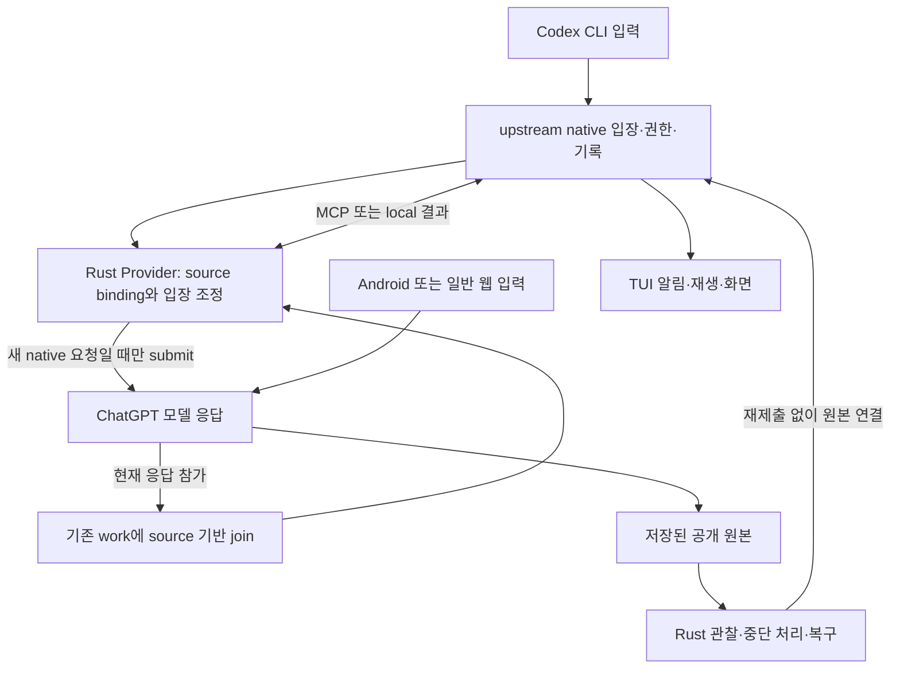

# ChatGPT–Codex 통합 독립 기술 감사 및 구현 결정

현재 구현 방향에 대한 정정: 이 문서의 원본 감사는 2026-10-26 기준이다.
후속 실제 시험에서 항시 원본 조회의 요청 증폭이 확인됐고, 사용자는
Bridge가 받은 요청을 기존 Native 작업에 등록하는 경로를 우선하도록 지시했다.
지속 조회/알림 관찰을 기본 입장 절차로 삼는 권고는 이 부분에서 대체한다.
최신 계약과 잔여 검증 경계는 SPEC.md와 CURRENT.md를 따른다. 원본 감사의 증거와
당시 판정은 보존하며, 사후 관찰을 실제 Native 실행으로 승격하지 않는다.

**2026-10-27 문서 정리 시점의 적용 범위.** 아래 본문은 원본 감사 시점의 판정과
제안을 보존한다. 현재 구현 명세로 그대로 사용하지 않는다. Full119·Provider15의
서명 배포와 기기 적용은 완료됐으며, 실제 시험 범위와 다음 작업은
[CURRENT의 수용 시험표](CURRENT.md#implemented-but-incompletely-qualified)와
[작업 순서](CURRENT.md#product-completion-scope-and-work-order)가 소유한다.

| 원본 감사의 표현·제안 | 현재 채택한 계약과 상태 |
| --- | --- |
| 원본 관찰을 지속 개발 입장의 기본 경로로 사용 | 일반 `join`은 Bridge 입력을 먼저 Native에 입장시킨다. 정기 saved-Chat 조회는 제거됐고, 원본 검증은 명시적 `source_sync`/`source_join`이다. |
| 아래 미구현 `join`은 conversation/message를 읽고 task를 받지 않음 | 이 원본 기반 제안은 현재 `source_join`에 해당한다. 배포된 일반 `join`은 기존 work_id·task·고정 call_id를 받아 Direct 문맥 수락을 요구한다. 실제 필수 인수는 SPEC과 현행 schema를 따른다. |
| bind/unbind/join을 앞으로 추가 | 소유 원본 binding과 세 API는 Provider15에 배포됐다. 임의 기존 Chat 입양과 모든 외부 원본 식별은 완료되지 않았다. |
| Current/Managed, 또는 관찰과 실행의 혼용 | 현행 reasoning은 direct/provider만 허용한다. MCP/local_function은 반환 방식이고 독립 위임은 별도 추론 문맥의 속성이다. 과거 라벨은 역사적 기록에만 남는다. |
| 참가 생략을 항상 감지·복구 | 수신한 요청·명시적으로 관찰한 원본에서만 판정 가능하다. Bridge에 도달하지 않은 앱 입력을 보이지 않는 상태에서 감지한다고 보장하지 않는다. |
| 기존2초 원본 관찰 주기 | 일반 경로의 원격 원본 polling 근거가 아니다. Native 이벤트·로컬 회복 관찰과 명시적 원본 조회를 구분한다. |
| A1 뒤 공통화·독립 작업자 확장 | A1의 실제 Android/Web/CLI 미검증 경계를 먼저 판정하고, A2는 이미 공유된 AppHost 위의 실제 중복만 정리한다. A3는 그 기반 위에서 별도 추론·계보·결과 반환을 실증한다. |


## 2026-10-28 추가 감사: 전송 경로와 모델·노력도 유지

이 절은 원본 감사를 보존하면서 후속 전송 조사를 기록한다. 조사 기준 소스는
`b4567f9`, 실제 운영은 Full121/Provider21이다. 제품 코드·설치·운영 설정을
변경하지 않고, 공식 앱 26.1007.21434의 소스와 격리된 시험 호스트에서 확인했다.

**판정: 기존 대화의 모델·노력도를 유지하는 전송은 가능하다. 단순 생략으로는
유지되지 않는다.** 대화의 준비된 선택 상태를 읽어 보내는 앱 보조 함수에서는
Thinking/Standard와 Extended 유지가 실제 요청·응답으로 통과했다. 반면 같은
Thinking/Extended 대화에서 공통 전송 함수에 설정을 생략하면 `auto` 요청과
노력도 없는 `gpt-6` 응답으로 바뀌었다. 현재 우리 `chat_input`도 앱 선택 대신
Provider 설정을 명시하므로 사용자 설정 유지 기능으로 사용할 수 없다.

### 이름과 실제 호출 관계

`chat_input`은 우리 Rust/MCP/CLI의 기능 이름이다. 앱 공개 SDK의 함수 이름이
아니다. `qNt`와 `pNi`는 서로 다른 계층이 아니라 **같은 함수**의 export 이름과
번들 내부 지역 이름이다. 확인한 번들의 `export { pNi as qNt }`에 해당한다.
마찬가지로 `yRt`는 `Mwi`, `bRt`는 `Nwi`를 가리킨다. 축약된 빌드 산출물 이름이라
각 글자에 제품상 의미를 부여하거나 다음 앱 버전에서도 같다고 가정하면 안 된다.

```text
실제 입력창: LNt → j0 → yRt/Mwi → Fwi → prepare/startCompletionStream → /f/conversation
보조 입력: qNt/pNi ─────────→ yRt/Mwi → Fwi → 같은 전송 계층
우리 chat_input: Inputs::submit → app_bridge.js → yRt/Mwi → Fwi → 같은 전송 계층
도구 반환: bRt/Nwi ──────────────────────────→ Fwi → 같은 전송 계층
일부 재생성·재시도·steering: 별도 함수 ───────→ Fwi → 같은 전송 계층
```

따라서 일반 입력과 우리 입력은 공통 전송부로 합류하지만 **모두 yRt를 거친다는
설명은 틀리다.** `bRt/Nwi`, `SRt/Pwi`, `xRt/Iwi`, `_Rt/Lwi`, `hRt/Rwi`는
확인한 앱에서 Fwi를 직접 사용한다. 음성·별도 패널까지 이 일반 텍스트 경로와
완전히 같다고 보장하지 않는다. 현재 우리 local_function 결과 경로는 결과를
구조화해 `yRt`로 전달하고, MCP는 원래 호스트 도구 반환을 사용한다. 호출 후
결과 반환은 새로운 사용자 입력으로 치환하면 안 된다.

`qNt/pNi`는 입력창 전체 로직이 아니다. 대화 busy/활성 조건을 확인하고, 대화별
선택 `Vwn/Hk`를 읽고, 기본 또는 전달된 system hints와 프롬프트를 준비해 Mwi를
호출한다. 소스와 실제 stack 모두 입력창은 `j0 → Mwi → Fwi`, 보조 함수는
`pNi → Mwi → Fwi`임을 확인했다. qNt 호출자는 본문 follow-up 링크, 소스 패널,
제안·위젯 등이다. 이를 그냥 '입력창 Enter 함수'라고 부르면 부정확하다.

### 설정의 출처와 복원 조건

앱의 `Vwn/Hk` 선택은 현재 대화의 유효한 선택과 조정 상태를 우선하고, 그 상태가
없으면 대화 메타데이터의 모델, 해당 branch 이력의 노력도, 모델 카탈로그와
정책상 기본값을 조합한다. `Bfn`은 공개 assistant의 `thinking_effort` 및 특정
도구 제어 메타데이터를 따라 역순으로 노력도를 찾는다. 마지막 모델 이름 하나로
노력도나 현재 선택을 추정하는 구조가 아니다.

일반 선택 함수 `lTn/SSn`, 노력도 함수 `dTn/CSn`은 대화의 선택 상태를 바꾸며,
일반 Chat에서는 로컬 last-selected 저장소도 갱신한다. Work/tpp의 선택 저장은
별도 분기다. 따라서 선택 함수를 호출하는 것과 한 요청에 override를 주는 것은
다르다. 시험 때문에 사용자의 공용 picker/default를 바꾸는 방식은 기본 전송
설계로 채택하지 않는다. 이번 선택 실험은 별도 시험 프로필에서만 수행했다.

재시작 후 검증은 다음과 같다. 마지막 완료 응답이 Thinking/Extended인 대화와
일반 기본값 Instant를 의도적으로 함께 두고 시험했다.

| 관찰 단계 | 유효 선택 | 판정 |
| --- | --- | --- |
| 재시작 직후, 대화 미로드 | gpt-6 / 노력도 없음 | 대화 선택 유지로 사용할 수 없음 |
| raw mapping을 uCn으로 hydrate | gpt-6 / extended | 메시지만으로 모델 메타데이터 query가 준비되지 않음 |
| 정상 nSn/mA 대화 query와 모델 카탈로그 로드 | gpt-6-thinking / extended | 저장된 모델·노력도 복원 확인 |

같은 대화에 raw hydrate만 하고 즉시 qNt를 부르면 잘못 계산된 기본 모델을 쓸 수
있다. 모델 카탈로그·대화 query·identity·branch가 준비됐는지 확인한 뒤 선택을
읽어야 한다. 이번에는 메타데이터를 준비한 뒤의 선택 복원을 확인했으며,
재시작 후 qNt 추가 추론까지 반복하지는 않았다.

입력창 `j0`에는 더 많은 의미가 있다. 첨부·draft·project·system hints·선택 문맥을
준비하고, quota-aware 경로에서는 현재 가용 모델과 한도를 보고 선택을 다시
계산할 수 있다. 그러므로 '선택을 보존'에는 현재 화면의 선택을 읽는 것과
앱의 quota 조정까지 모사하는 것이 다르다. 사용자가 고정한 모델/노력도를 우리
워크플로우가 임의 하향하면 안 된다. 적용 불가 시 이유를 반환해야 한다.

`yRt/Mwi` 자체는 모델을 생략해도 picker를 찾아주지 않는다. `Fwi`가 모델을
전달값 → 적용 가능한 custom GPT override → `auto` 순으로 결정하고, 노력도는
전달값 또는 null로 처리한다. SDK 호출의 생략과 wire의 필드 생략은 다르다.
일반 Chat/Work 선택도 모델의 Thinking 여부와 별개다. 이번4회는 모두 일반
Chat, origin/mode 없음, system hints 없음, 사용자 메시지 한 건이었다.

### 실제 시험 결과

새 시험 대화 `6ae19363-ac64-83e8-91ca-f0bb6621a5b2`의 같은 branch에4회만
전송했다. 각 요청은 도구를 사용하지 않는 고유 문장 반환이며 Pro는0회다.

| 시험 | 호출 전 선택 / 호출 방식 | 실제 요청 | 실제 원본 최종 응답 |
| --- | --- | --- | --- |
| A 입력창 | UI에서 Thinking/Standard 선택 후 실제 Send 버튼 | gpt-6-thinking / standard | 같은 모델·노력도, UI_THINKING_STANDARD_A |
| B 설정 없는 보조 입력 | A의 기존 대화에 qNt, 모델·노력도 인수 없음 | gpt-6-thinking / standard | 같은 모델·노력도, HELPER_KEEP_STANDARD_B |
| C 기존 노력도 변경 후 보조 입력 | 시험 프로필의 앱 effort setter로 Extended 선택, qNt에 설정 인수 없음 | gpt-6-thinking / extended | 같은 모델·노력도, HELPER_KEEP_EXTENDED_C |
| D 낮은 수준 생략 | 재시작·메타데이터 로드로 Thinking/Extended 복원 후 yRt에 설정 인수 없음 | auto / thinking_effort 필드 없음 | gpt-6 / 노력도 없음, LOWLEVEL_OMISSION_D |

각각 dispatch1회이며 사용자 원문 한 건과 정확한 공개 최종 답변을 확인했다.
4회 모두 같은 Chat에서 직전 최종 답변을 다음 입력의 parent로 이어간다.
독립 saved-source read의11개 노드 중8개 공개 사용자/최종 메시지를 정확히
대조했으며 숨겨진3개 내용은 읽거나 검증했다고 주장하지 않는다. 실제 모델·노력도는
모델의 자기소개가 아니라 wire와 공개 응답 메타데이터로 판정했다.

기존 Android 시험 대화의 알려진 최종 메시지 메타데이터도 별도1회 조회했다.
PUBLIC_PROGRESS의 `289b6871…`와 ROUNDTRIP의 `43edad73…`는 모두
`gpt-6-thinking / max`, 자동 PLAIN_AUTO의 `91048d2d…`는 `gpt-6 / effort 없음`이다.
조회 당시 대화 default_model_slug도 gpt-6이었다. 따라서 이전 자동 시험은
입력·Native 결과 연결을 입증했지만 **사용자 추론 설정을 유지한 입력 모사라는
합격 근거로 재사용할 수 없다.** 당시 Android의 미전송 UI 상태나 default 변경의
원인까지 이 조회만으로 사용자에게 귀속하지 않는다. 원본 대화 설정을 소급
변경하거나 '복구'한다는 명목으로 덮어쓰지 않았다.

### 원문·제어·호환성 및 권장 구현

`qNt → Mwi`의 일반 prompt 생성은 `trim()`과 기본 system hints를 사용할 수 있다.
우리 현행 경로는 `userCompletionMessages`로 완성된 사용자 메시지를 제공하므로
공백·CRLF를 포함한 원문 보존과 안정된 메시지 ID를 직접 통제할 수 있다.
qNt가 모델·노력도를 유지한다는 이유만으로 현행 전송 함수를 qNt로 교체하면
원문·고정 ID·callback·취소·명시 branch·project·승인 흐름을 잃을 수 있다.
qNt는 onCompletion/startupSignal 등을 전부 그대로 받는 일반 전송 함수도 아니다.
원문 trim과 hint 주입은 소스 판정이며, 공백을 달리한 추가 추론 시험은 하지 않았다.

권장안은 **입력 의미와 설정의 출처를 구분하되 전송·중복 방지 구현은 공유**하는 것이다.

1. 사용자 모사: 소유된 앱 대화의 준비된 선택 상태를 읽어 유지한다. 이 특수
   경로를 일반 개발 작업의 기본으로 삼지 않는다. 필요하면 실제 입력창 모사를
   별도 qualification에서 수행한다.
2. 개발 워크플로우: 사용자 명시 선택 → 구성 기본값. 허용된 시험에서 모델이
   인수를 선택할 수 있지만 공용 환경변수나 설정 파일을 요청마다 고치지 않는다.
3. 호스트 기본 선택: 설정을 생략해 auto로 맡기는 동작은 명시적으로 구별한다.
   이를 현재 모델·노력도 유지라고 표시하지 않는다.
4. 문맥/지침/도구 결과 입력: 현재 model adapter와 원래 도구 결과 경로를 쓴다.
   모든 의미를 chat_input 하나에 섞거나 새 모드를 위한 별도 전송부를 복제하지 않는다.

현재 exact-message 생성과 durable intent를 유지하고, 설정 선택 책임을 Rust admission과
앱 상태 읽기 사이에서 명확히 정한다. 앱의 선택 상태 해석은 앱 내부 selector를
재사용하되 Rust가 identity·branch·요청 소유권·사용자 제약을 검증한다. 실제 적용
설정은 기존 intent/result에 기록하고 재시도는 같은 intent를 관찰한다. 비동기 query
동안 account/branch/selection이 바뀌면 재검증하며, active MCP round 중에는 현재
`mcp_active_route_change` 제한을 유지한다. 승인/결과 반환의 effort 전파도 회귀
범위에 포함해야 한다. 현재 앱 승인 경로는 offered.model을 넘기지만 effort 인수는
명시하지 않으므로, 그 복구 의미는 별도 실제 승인 시험이 필요하다.

Android/일반 웹의 선택은 Provider 소유 Electron의 로컬 선택 상태와 동일한 메모리가
아니다. 저장된 대화 모델과 응답 노력도는 복원 가능하지만, 다른 클라이언트에서
선택만 하고 아직 보내지 않은 값까지 안다고 보장할 수 없다. 해당 동기화와
계정·동시 선택·분기·압축·Stop·승인·project 첨부는 아직 실제 합격 범위 밖이다.
Pro·동일 Chat 독립 자식 모델 능력도 이번 조사의 대상 결과로 승격하지 않는다.

### 조사 범위·원본·운영 경계

현재 app.asar의 webview/.vite JavaScript14,804개(약392MB)를 entry import와
전송 sink 기준으로 목록화·검색해 관련42모듈을 추출했다. 축약 export의 직접
호출34곳(qNt8/yRt26), core 내부 함수, 실제 입력창과 반환·재생성·전송 sink를
추적했다. 이는 전체14,804파일을 줄별 의미 감사했다는 뜻도, 별도 Android 앱의
비공개 코드를 분석했다는 뜻도 아니다. 기존 추출 core asset은 실제 archive와
바이트가 일치함을 확인했다. 이 결론은 조사한 앱 버전의 내부 인터페이스에 한한다.

비공개 증거는 `$TMPDIR/chat-transmission-audit-pyxdbg1v`에 보존한다.
`inventory.json`, `call-sites.json`, `source-locations.json`은 범위와 위치를,
`phase1-complete-private.json`, `status-omitted-1.json`,
`saved-final-original-private.json`, `query-load.json`, `verification.json`은 실제
실행과 독립 대조를 담는다. minified 함수의 위치는 `source-locations.json`의
문자 offset과 실제 stack의 줄·열로 식별하며 가짜 줄 번호를 붙이지 않는다.
요약은 기존 maintenance root의 `chat-transmission-audit.json`이다.

초기 시험 호스트의 PTY 실행은 PRoot tracer의 stopped 상태와 CDP timeout을
보였다. 독립 session의 pipe로 실행한 시험 호스트는 준비됐다. 이를 운영
Provider 장애의 원인으로 일반화하지 않는다. 선택 UI는 비동기 commit이므로
표시가 움직였다는 사실만으로 적용됐다고 보지 않고 실제 selector를 재확인했다.
실패한 사전 조건 검사에서는 요청이0건임을 관찰한 후에만 계속했다.
phase1은 observer 복원·원래 Instant 기본값/Codex 화면 복원 후 exit0이다.
phase2는 응답 완료 후 대화 중단으로 종료 기록을 받지 못했다. 재개 시 inspector
PID31409의 부재와 profile lease 가용성을 별도 확인했으며 정상 종료로 꾸미지 않는다.
운영 Provider PID19747은 보존됐고 Native 작업·제품 설치·공용 config는 바꾸지 않았다.

이번 산출물은 전송 감사·계약 정리이며 제품 구현/배포가 아니다. 문서·diff 검사와
보존된 원본의 실행 검증을 수행한다. 후속 구현은 준비된 선택 읽기, durable intent와
원문 보존, 명시 설정/default 구분, 동시성/실패·실제 Native/TUI 수용 시험 순이다.

---

## 전송 설계 작성안과 기존 구현·업스트림 비교

작성 기준은 `fd04849`이며 아래는 구현 전 작성안이다. 규범 원칙과 요청 작성안은
[SPEC의 input preparation 절](SPEC.md#input-preparation-and-execution-settings-implementation-draft)에
반영했다. 별도 입력 엔진·설정 관리자·전송 계층을 추가하는 안은 채택하지 않는다.

### 책임과 변경 범위

앱이 자기 대화 설정의 의미를 해석하고 Native가 자기 thread 설정을 소유한다.
Rust는 원문·대상·권한·예산·명시 설정을 입장시키고 기존 intent와 반환 경로를
유지한다. 앱 상태를 읽는 최소 JS 기능은 기존 app_bridge에 둔다. Rust에 앱의
picker/default/복원 알고리즘을 복제하거나 native 설정을 JS에서 결정하지 않는다.

| 현재 로직 | 작성안에서 바뀌는 부분 | 그대로 사용하는 부분 |
| --- | --- | --- |
| chat_input.rs:65–79의 config.model 무조건 선택 | 선택된 Chat의 준비된 설정을 기본 출처로 사용. 명시 선택과 host default는 별도 의미로 입장 | 정확한 task, source cursor, stable call_id/message ID, 예산, 단일 submit |
| app_bridge.js chat_adopt의 raw conversation hydrate | 대화 query·카탈로그 준비와 selector 조회를 기존 준비 경계에서 수행. 비동기 뒤 identity/branch/설정 재검증 | 기존 lane 소유권·project·active/busy 거부와 account 검사 |
| app_bridge.js submit의 yRt 호출 | 준비·입장된 실제 모델/노력도를 전달 | userCompletionMessages, 원문/ID, callback·취소·원래 도구 반환 |
| protocol.rs::Request::parse_with_issuer | Native가 확정한 요청 설정을 계속 권위로 사용. 외부 기본값으로 덮지 않음 | Responses model 필수·catalog 검증, instruction/tool/input 분리 |
| Operator session_action create/resume/fork 공통 기본값 | 새 작업 초기화와 기존 thread 복원을 구분. 명시 전환만 Native override로 전달 | native_admission, controller/generation fencing, 기존 Native 실행·기록 |
| resume_unloaded_native·mode-only start | 현재의 저장 설정 보존을 유지하고 회귀 검증 | thread/read→thread/resume, 기존 history/context 일치 확인 |
| chat_result·public receipt | 기존 intent/result에 유효 설정과 출처를 추가해 호출자와 retry가 사용 | UUID/parent/원본 final 대조, unknown delivery의 재전송 금지 |
| MCP/local_function·TUI | 새로운 입력 의미와 설정을 기존 실행/표시 계약에 반영 | 전송별 결과 경로·승인·Stop·완전한 공개 기록 |

특히 operator.rs:3250 부근은 현재 create뿐 아니라 resume/fork에도 Provider의
model/effort 기본값을 인수로 만든다. 반면 `resume_unloaded_native`(:2761)는
같은 기본값을 넣지 않는 경로다. 이것은 코드에서 확인한 차이다. 모든 명시 resume가
같은 잘못을 일으킨다고 실증한 것은 아니며, 각 호출의 명시 provider 전환 의도까지
구분해 시험해야 한다. 작성안은 초기화/복원/명시 전환의 구분을 이 owner에서
수정하도록 한다. 이미 올바른 복원 함수 위에 별도 '복구' 경로를 더하지 않는다.

protocol.rs:142 부근의 effort 누락 시 config fallback도 별도 의미 검증 대상이다.
Native에서 nullable effort가 실제 wire에 어떻게 표현되는지 확인해야 하며,
'입력 인수 생략', 명시 none, 기존 thread의 null을 같은 값으로 취급하면 안 된다.
이 fallback을 근거 없이 지우는 대신 config와 저장 설정이 충돌하는 실제 요청으로
현재 의미를 확정하고, 책임 owner에서 보존하도록 구현한다.

요청 작성안은 기존 관련 action에 optional `model_settings` 객체 하나다.
source는 chat/native/config/host_default 중 실제 설정 소유자를 뜻하며,
model/effort는 선택적인 명시 override다. API별 기본 출처는 chat_input→Chat,
기존 Native 실행→thread, 새 작업→config다. 의미 없는 source/대상 조합은 거부한다.
모델만 바꿨을 때 기존 effort가 맞지 않으면 조용히 none으로 낮추지 않는다.
필드 이름은 구현 시 기존 schema/caller 전체와 함께 확정하되 이 의미는 유지한다.

이것은 모든 입력을 같은 action에 넣는 안이 아니다. 사용자 모사 chat_input,
개발 작업 start/Responses, Native queue, 원래 tool return은 기존 소비자별 의미를
유지한다. 새 base_input 서비스가 필요한 실제 소비자는 아직 확인되지 않았으므로
그 구현은 추가하지 않는다. 향후 실제 요구가 있으면 같은 admission/send를
재사용하는 작성안을 검토하며, chat_input에 숨은 문맥을 섞어 해결하지 않는다.

### 업스트림과 얼마나 일관되는가

| 비교 경계 | 확인한 근거 | 일관성 및 한계 |
| --- | --- | --- |
| Codex Native 저장·복원 | 운영 baseline source6aaac694의 ThreadResumeParams와 thread_resume_preserves_acknowledged_model_effort_and_approvals_reviewer_update 시험 소스 | 기존 선택을 유지하는 owner/API를 사용. 이 조사에서 upstream 시험을 새로 실행한 것은 아님 |
| Codex model/effort 변경 |0.164 및 release pin0.165 source360319d8의 TurnStartParams | model/effort override가 현재 및 후속 turn에 적용된다는 upstream 의미 유지. '이번 한 번만'이라고 임의 변경하지 않음 |
| ChatGPT 앱 설정 | 고정 공식 앱의 Vwn/Hk·nSn/mA·catalog, 실제4회 요청 | selector/query/공통 전송을 재사용. picker 해석을 독자 재현하지 않음 |
| ChatGPT 입력창 | 실제 j0→Mwi→Fwi stack, source의 attachment/draft/quota 처리 | 동일 공통 전송을 쓰지만 입력창 전체 부수 동작을 복제하지 않음. 이를 완전한 UI 모사라고 부르지 않음 |
| 연결·원문·중복 방지 | 우리 Inputs::submit·MCP lease·Native controller | 우리 환경에 필요한 책임. upstream에 있는 것처럼 주장하지 않음 |
| 내부 앱 API의 안정성 | qNt/yRt는 번들 export, Mwi/pNi는 minified 지역 이름 | 현재 버전과는 일치하지만 공개 지원 API는 아님. 버전 변경 시 기능 확인·실제 합격 시험 필요 |

0.164 자료는 기존 checkout의 변경되지 않은 protocol/test 원본과 git object를
대조했다(TUI에는 별도 작업이 있으므로 그 수정본을 순수 upstream으로 취급하지 않음).
0.165는 공식 openai/codex의 exact commit에서 두 protocol 파일을 직접 읽었다.
현재 GitHub 최신 전체 버전을 전수 검증했다는 주장이나 새로운 Core 승인 주장이 아니다.
이 작성안에 필요한 **Codex upstream API 변경은0건**이며 Core/TUI 신규 기능도
우선 요구하지 않는다. 앱 쪽은 현재도 내부 인터페이스를 사용하므로 유지보수 위험이
사라지는 것은 아니다. 다만 우리가 재구현하는 설정 규칙을 줄이는 방향이다.

참조: [공식0.165 turn/start 계약](https://github.com/openai/codex/blob/360319d8dee62d87e2d59fc0c21805d79519cfed/codex-rs/app-server-protocol/schema/typescript/v2/TurnStartParams.ts),
[공식0.165 resume 계약](https://github.com/openai/codex/blob/360319d8dee62d87e2d59fc0c21805d79519cfed/codex-rs/app-server-protocol/schema/typescript/v2/ThreadResumeParams.ts).

### 개선 효과와 구현 순서

확인된 문제는 과거 자동 입력의 max→노력도 없음, metadata 미준비 시 잘못된
모델/effort 조합, create와 resume의 기본값 취급 차이다. 작성안은 각 원인 owner를
바꾸고, 소유자·원문·예산·전송 구현을 유지한다. qNt 단순 교체, config 임시 수정,
새 입력 전송 엔진보다 기존 기능 훼손과 동시성 오류를 줄이는 안이다.

성능 향상·코드 감소율은 아직 측정하지 않았다. 새 상시 polling·추가 모델 호출은
설계상 필요 없지만, cold Chat 메타데이터 준비에 명시적인 원격 조회가 필요할 수
있다. 현재 source 검증/입양과 같은 검증된 snapshot을 실제로 공유할 수 있을 때만
중복 조회를 제거한다. 준비 실패/429를 retry loop나 기본값으로 숨기지 않는다.

1. 기존 chat_input의 설정 선택을 준비된 Chat selector로 교체하고 실제 선택과
   출처를 기존 intent/result에 보존한다. 기존 config fallback은 같이 제거한다.
   과거 admitted intent는 그대로 관찰하며 설정을 소급 채우거나 재전송하지 않는다.
2. 기존 Native 초기화/복원/명시 override를 분리하고 새 model_settings schema와
   CLI JSON parsing·tool declaration·consumer를 함께 수정한다. protocol.rs의
   model 필수 검증은 유지한다. 양 전송은 admission과 결과 반환 책임을 그대로 쓴다.
3. 독립된 회귀/변이 시험 뒤 실제 앱 source→Native→TUI 및 역방향을 검증한다.
   ordinary/max 유지, config와 저장값 충돌, fork/resume/mode-only, metadata 준비
   중 branch/account/selection 변경, 같은 call ID의 restart/unknown delivery,
   model 변경의 후속 지속, Stop·승인·결과 반환을 포함한다. 시험 수와 모델 요청은
   구분하며 남은 Pro discovery를 routine qualification에 쓰지 않는다.
4. applicable Provider gate·서명/공개 readback·disposable update·기기 전환까지
   완료한 뒤에만 설치 기능으로 보고한다. 그 후 남은 A1과 A2 공통화 순서를 잇는다.

예상 변경의 중심은 `chat_input.rs`, `app_bridge.js`, `operator.rs`,
`main.rs`, 기존 schema/tests와 qualification caller다. `app.rs`/`mcp_bridge.rs`는
기존 immutable request 설정과 continuation 전달의 실제 변경 필요가 있을 때만
수정한다. 새로운 forwarding module·설정 저장소·상시 controller는 계획하지 않는다.

## 독자 구현 재점검: miuuyy 의존과 현재 제품의 범위

사용자가 지적한 저장소의 실제 이름은 역사적 NOTICE 기준
[miuuyy/codex-chatgpt-web](https://github.com/miuuyy/codex-chatgpt-web/tree/92a356fac2292e3af5a97ab7ba634edd8d38621e)이다.
이번에는 그 exact source의 전체312개 tree 항목과82개 source/license/package 파일
(TypeScript80개)을 원본으로 확보했다. 소스는 TMPDIR의 비교 자료로만 두었고
제품 코드에 옮기지 않았다.

**기술 판정은 '현재 활성 Provider의 실행·빌드·신규 패키지는 그 저장소에
의존하지 않는다'이다. '저장소 전체와 모든 알고리즘이100% 우리 창작'이라는
절대 판정은 아니다.** 확인 내용과 범위는 다음과 같다.

| 확인 대상 | 현재 결과 |
| --- | --- |
| 퇴역 JS adapter/parser/transport | e0f0927에서 제거. 현재 Rust/앱 JS 실행 경로와 Cargo 의존성에 해당 저장소 로딩 없음 |
| 복사 summary preamble와 bridge-LICENSE |4aad4e9에서 실제 파일 삭제. native-summary-prefix.txt·bridge-LICENSE·별도 copied upstream-codex-LICENSE는 현재 소스/신규 Provider 패키지에 없음 |
| 원래 ocx1 checkpoint codec | 현재 일반 경로가 디코딩하지 않음. ocx1 문자열은 거부 시험에 남고, 현재 codec은 public continuation JSON과 소유 journal의 acknowledgment |
| 현재 실행 이미지 | 설치 Provider21의 manifest source=e78d83a69d3e, file_count6. 해당 저장소 license/template가 inventory에 없음 |
| 과거 license 이름의 잔존 | release-builder와 publication의 LEGACY_FILES 및 실제8-file rollback 시험 소비자. 새 빌드 의존성이나 새 payload 주입이 아님 |
| 원본 장문 상수 대조 | 외부 TypeScript의120자·15단어 이상 리터럴268개를 현재 Provider source55개와 공백 정규화 비교. 완전 일치0개. 의미·알고리즘 전체 독립성의 증명으로 과장하지 않음 |

외부 구현은 ocx1/base64·복사 preamble와 browser adapter 중심이며, 현재 Provider는
Native thread/turn·Rust 제어·issued public checkpoint·앱 내부 capability 경계를
사용한다. 공통 Responses 필드, summary 요청, 도구 호출/결과 등의 요구는 같은
upstream 프로토콜을 만족하기 위한 것이며, 그것만으로 코드를 가져왔다고 판정하지
않는다. 반대로 파일명/언어/상수를 바꿨다는 사실만으로 독립성을 입증하지도 않는다.
이번 점검은 알려진 복사 대상 제거, 실제 의존 경로, 변경 이력과 현행 패키지를
대조한 기술 감사이며 모든 가능한 파생 관계에 대한 법적 판정이 아니다.

원래 ChatGPT 수정본의16파일 변경 작업 트리132fc00 기반은 그대로 남아 있고,
현재에 반영된 후속 Codex 보완과 구분해 보존된다. 옛 서명 자산·Git 이력을
새로운 독자 구현처럼 고치거나 삭제하지 않는다. 사용자는 소급 수정을 요구하지 않았다.
Core의 upstream Codex, 실제 Rust 라이브러리, PRoot/noVNC 등은 여전히 외부 구성요소다.
따라서 '제품 전체가 타 라이선스 불필요'라고 말하면 틀리고, 이들의 정당한 NOTICE를
없애서 독자 구현처럼 보이게 하지 않는다. 본문에 필요한 특정 저장소의 코드 차용을
다시 도입하지 않는 것은 이번 입력 설계의 유지 조건이다.

추가 증거: `$TMPDIR/input-design-audit-ot9uwhn6`의 exact external tree/source,
`originality-comparison.json`, `upstream-protocol-comparison.json`. 이 작성안은
문서만 변경한다. 제품 재빌드·모델 호출·기기 설치·기존 사용자 설정 변경은 없다.

---

감사 기준: 2026-10-26 UTC. 저장소 humtr/codex, rewrite/rust-core,
기준 HEAD e4d5400754e86f0ca68f9e3ac02ff6621df5234c.
이 보고서는 원본·코드를 다시 대조한 기술 판정이다. 별도 감사 모델이나
GPT Pro 검토를 수행한 것으로 주장하지 않는다. 제품 코드 변경·새 모델 시험·
빌드·배포·서비스 재시작은 이번 문서 감사에서 수행하지 않았다.
규범 계약은 [SPEC](SPEC.md#entrance-equivalence-and-continuous-development-binding),
실제 상태는 [CURRENT](CURRENT.md)가 소유한다. 아래 API와 단계는 명시적으로
현재 구현과 구분한다.

## 1. 최종 판정

기존 설명의 기반인 두 추론 경로, MCP/앱 내부 함수의 구분, 원본 관찰을 통한
재추론 없는 복구, Rust 중심의 제어는 대체로 타당하다. 그러나 **배포된 기능은
모든 진입점에서 같은 실행과 화면을 보장하는 완성품이 아니다.**

이번 지정 대화에서 원본 사용자 입력은 15개다. 연결된 native history의
사용자 항목 6개 중 원문과 완전히 일치하는 항목은 2개이고, 나머지 4개는
모델이 새로 만든 인계 문맥 및 진단 작업 지시다. 이는 저장 동기화, 수동 참가,
새 native turn 시작이 섞였음을 보여 준다. 15개 전부가 실행 지시였다고 단정하거나
모두 도구를 실행했어야 한다고 계산한 것은 아니다. 다만 전체 대화를 동일 원본
단위로 지속 연결했다는 증거는 아니다.

권장안은 **기존 Provider의 지속 개발 연결 + 현재 Chat 응답 참가 + 독립적인
원본 관찰/복구**다. 공통 원본 식별과 native 입장 제어를 먼저 완성한다.
관찰만 된 응답을 native 도구 실행으로 위장하지 않으며, 동기화를 위해 이미
시작된 ChatGPT 질문을 다시 제출하지 않는다. 별도 작업자는 명시적 위임일 때만
추가한다. 큰 오케스트레이터나 모든 Chat의 일괄 native thread 생성은 채택하지 않는다.

한계도 확정한다. 일반 Android 앱/다른 브라우저의 요청 시작은 Provider 소유
Electron 렌더러 밖에서 일어난다. 현재 확보한 인터페이스만으로 그 요청에
개발자 지침·도구 선언을 선행 주입한다고 보장할 수 없다. 모델 참가 생략 시
시스템이 보장할 것은 감지, 원본 보존, 정확한 상태와 안전한 복구이며,
실제로 발생하지 않은 native 실행이 아니다. 무조건적인 실행 전 연결이 필요하면
해당 ChatGPT 호스트의 지원 인터페이스가 별도로 입증돼야 한다.

## 2. 원본 확보와 감사 완전성

### 식별과 원본 범위

비공개 원본/분석 자료의 위치는
~/.cache/codex/acceptance/independent-architecture-audit-20261026/ 이다.
이 저장소에는 대화 본문, 인증 값, controller/turn token을 복사하지 않는다.

| 원본 | 실제 확인 범위 |
| --- | --- |
| 지정 Chat 6adf2ada-6184-83ee-9d78-e6b3f8d6a79a | branch 2b6d7105-cf0f-4e26-a37f-6cb146c41eba; 410개, 100개씩 5회 공개 도구 읽기; 마지막 cursor.count=410, complete=true |
| 지정 work b23e0aa8441c1b03c19d6869edfa456c456bf94817ff545d | thread 01a177ab-ad95-77c3-8f3f-5b9d083162f6, szob execution home; native 공개 항목 111개, 추가 after 읽기 0개 |
| 지정 native 항목 | userMessage 6, agentMessage 60, commandExecution 45; 상태 completed, driver transfer_prepared, pending_calls 없음 |
| 현재 Codex 대화 | 환경의 실제 thread 01a16d35-ed95-78a0-b268-344263df33e5; 공유 sessions 원본 약 77MB 순차 조사, 최초 채취 공개 user/assistant 항목 450개 |
| 원본 도구/진행 기록 | 지정 work와 독자 구현·예산 소진·장애 work의 native history 총 597개 확보; 각 history/context cursor 보존 |
| 관련 native 저장 파일 | 관련 작업 9개와 현재 작업의 rollout 10개, 별도 시점 순차 조사 24,298개 레코드; 기록 종류·turn·출처 색인 |
| 전체 작업 목록 | 운영 서비스 28개 work; 저장소·원본 source·명시된 과거 work를 기준으로 관련성 구분, 다른 termux 작업을 같은 대화로 합치지 않음 |

지정 Chat의 처음 메시지 ID는 927fc7fa-d35c-4896-b0ef-ec93192a0bd5,
마지막은 2b6d7105-cf0f-4e26-a37f-6cb146c41eba다. 원본 그래프가 반환한
leaf 목록은 각 확보 대화에서 1개다. 이를 원격 삭제 분기까지 존재하지 않는다는
증거로 해석하지 않는다. 이 요청은 그 웹 대화에서 작성한 프롬프트를 기존 Codex
대화에 전달한 것이므로, 두 대화 자체가 동일한 conversation이라고 혼동하지 않는다.

**complete와 content_complete는 다르다.** 지정 Chat의 숨김 placeholder는
78개이며 content_complete=false다. 비공개 추론을 복원하지 않았다. 원본 도구는
자격 증명/비공개 capability를 가리고, 일부 이전 대화의 unsupported content는
본문을 제공하지 않는다. native 원본이 제공하는 도구 실행·결과는 별도로 대조했으나
가려진 모든 호스트 내부 정보를 확보했다고 주장하지 않는다.

| 관련 Chat 원본 ID | branch | 공개 도구 메시지 수 | 의미/제한 |
| --- | --- | ---: | --- |
| 6add69ea-9b3c-83ee-9843-cd98d2647c64 | 3b71f5cb-c9ea-4c7c-b280-7515583ba973 | 834 | 독자 구현 지시·수정·완료; hidden 78, unsupported 36 |
| 6add5bed-5598-83e8-8e39-a6dd4123e9a1 | 4bfdfdf6-9e7a-47a8-8ce1-68fc286ffa3d | 294 | 프로젝트/TZ/역방향 장애; hidden 46 |
| 6ade1ab8-2110-83ee-b46d-112e9ca1df56 | d169f41c-de9f-46f8-97d0-adab4af1bd63 | 8 | 실제 앱 입력 시험 대화; content_complete=true |
| 6adeed2d-164c-83e8-99a9-8380ea566d5c | ca323ca0-7209-458f-a541-ea83ce8fd857 | 10 | 실제 Android 입력과 native 후속 5개 turn; content_complete=true |
| 6add1a09-b21c-83ec-9c38-ed5ae0cad0ff | 0b1a6e7b-c07a-4120-9490-ccfc9c28a186 | 7 | 원래 Session terminated 보고 |
| 6add28c3-651c-83ee-9741-e310278d9dd2 | 2738c1ed-8898-456c-92ea-1f0847de3309 | 101 | 실제 프로젝트 생성 보고 |
| 6add2dba-0610-83ee-9262-493449ce6558 | e889d819-ef3a-4845-ba4e-fd7675e1d338 | 62 | 이전 저장소 조사 |
| 6add4bce-4d3c-83ec-8210-bf025a9fa769 | 3f70e8d0-ada7-407a-b81f-53ab7e3da0e8 | 237 | 실제 work 목록에서 재확인한 이전 조사 |
| 6adf112c-ebe8-83ee-9309-fb96bb0252b9 | 60fe62ca-3e22-4c44-a605-79d252ee9f87 | 74 | 배포 후보의 실제 MCP 두 작업 시험; 현재 원본 74개, 과거 readback 시점 68개 |

관련 9개 대화 합계 1,627개와 지정 대화 410개, 총 2,037개를 각 마지막 커서까지
중복 ID 없이 확보했다. 원본 실행 기록에 잘못 참조된
6add4bce-4d3c-83ec-9754-f1422be47144는 app_chat_not_found였다.
제목으로 바꿔 끼우지 않고, work 목록에 실제 연결된 위의 다른 ID를 별도로 조사했다.

주요 native 원본: 독자 수정 work 9c0c3147f9d38168b72dfc19b2418f03c563f3882a95c591는
184항목(실행 91개), 소진 work 431ed8daca18eed9d52ee241a758f1e217172b53af2afdca는
151항목(실행 75개), 과거 장애 work df83c57dfc1b61e4dbf97cc26ef10e5b4d27b9c850c3393e는
151항목이다. 원본은 별도 work로 유지한다. 같은 제목/경로를 동일 작업의 증거로 쓰지 않았다.

### 저장소 전수 범위와 깊이

시작 시 추적 파일 271개, 134,245줄. 전체 내용을 파일·심볼·참조·테스트 경계로
색인했고 Python 100개 파일은 AST 구문을 확인했다. 부록에 모든 파일을 열거한다.
핵심 실행 경로는 실제 호출자와 수신자, 저장 기록까지 대조했다. Core/Manager/배포
주변부는 소유권·계약·호출 경계 및 기존 시험 입력 중심으로 검토했다.
이 전수 범위가 134,245줄 모두에 대한 동등한 깊이의 수작업 검증이나 무결함 증명은 아니다.
미추적 providers/chatgpt/target/은 생성물로 별도 식별하고 소스/사용자 파일을 삭제하지 않았다.

| 하위 시스템 | 검토/재사용 판정 |
| --- | --- |
| Provider protocol/responses/server | Responses parser, SSE, native call/result ID 유지; 같은 모델 이름만으로 동일 요청/설정을 단정하지 않음 |
| AppHost/McpBridge/bound_chat | native 요청/저장 원본 연결 재사용, 관찰 수명·중단·도구 출처 분리 보완 필요 |
| Operator/operation/journal | controller 세대, admission, durable intent/result, Stop, queue 재사용; 참가·원본 연결을 하나의 책임으로 정리 |
| chats/chat_input/project/control | 모델 없는 조회와 새 입력 구분 유지; 프로젝트 기본 선택은 기존 Chat 이동과 다름 |
| CDP/host/viewer | private pipe/소유 프로세스/인증된 앱 경계 유지; 외부 Android 렌더러 통제와 혼동 금지 |
| Core/runtime-binding | 실제 native server·공유 저장·서명·업데이트 소유권 유지; Provider 전용 실행 엔진을 추가하지 않음 |
| Manager | 프로필/쿼터/창/복구 보조, 현재 원본 thread와 다른 execution home의 writer를 임의 정리하지 않음 |
| TUI patch 및 src | native 알림·기록 로딩·모델 재진입·진행 접기 재사용; commit과 실제 화면/재접속 표시 별도 검증 |
| release-builder/installer/CI | exact source, 6/8-file verifier, 불변 공개물, CAS promotion 유지; 새 기능은 별도 합격 전 배포 금지 |
| qualification/tests/scripts | 단위/대역/실기기/클라우드/물리 UI 구분; 기존 helper 성공을 새 완전성 시험으로 승격하지 않음 |

## 3. 기존 주장별 독립 판정

| 주장 | 판정 | 근거 및 정정 |
| --- | --- | --- |
| Full117/Provider14가 설치·서비스에 반영됨 | 사실 | 설치 선택 readback Provider14, runit 세 서비스 실행 중; 기존 deployment 원본도 존재. 새 감사 설계가 설치됐다는 뜻은 아님 |
| 재시작하면 모든 문제가 해결된 최신 상태 | 오류(일반화) | 설치된 버전을 쓰게 될 뿐, 아래 확인된 관찰 결함·지속 참가 미구현은 남음 |
| 주요 Android→native→후속 경로 통과 | 사실, 한정 | resumed-actual-android-continuity 원본 및 실제 source 10메시지. 동시에 입력하거나 중단된 응답은 그 시험 범위 아님 |
| 모든 후속 입력이 자동으로 같은 실행에 참여 | 오류 | 지정 Chat 15입력 대 native 6항목, current 전환 후 managed-only 관찰 조건 |
| 기본 프로젝트 선택 변경이 기존 Chat을 옮김 | 오류 | project::control과 앱 open/adopt의 membership 경계; 새 대화 기본값만 변경 |
| 현재 후속 누락 원인은 단순 네트워크 문제 | 오류 | 관찰 종료, 미완료 turn 처리, 실행 경로/소유권 차이가 각각 존재 |
| CDP timeout과 interrupted 때문에 관찰이 종료됨 | 사실 | watch_completion의 return 및 실제 10:37:56/10:49:43 UTC 운영 로그 |
| queue는 항상 새 모델 또는 항상 모델 없는 미러 | 둘 다 오류 | 일반 native 입력 큐. 사전 source admission이 있을 때만 follow로 기존 응답 관찰 |
| 이번 current 수동 start가 독립 모델을 호출 | 오류 | exchange_inner가 Current일 때 start_driver 생략. native turn은 추가됐지만 별도 app submit은 아님 |
| managed는 항상 별도 Chat/독립 자식 모델 | 부분 사실 | Provider가 모델 요청을 시작하나 같은 Chat의 순차 후속/도구 계속 실행도 포함; 독립 자식은 별도 문맥·위임 필요 |
| MCP/local_function은 서로 다른 모델 종류 | 오류 | 도구 전달 방식이며 current는 현 구현상 MCP만 허용 |
| local_function도 항상 클라우드 터널 필요 | 오류 | 앱 내부 함수로 native 결과를 반환할 수 있음. 외부 ChatGPT→MCP에는 터널 필요 |
| 원본 관찰이면 모든 ChatGPT 도구도 native 실행 기록 | 오류 | bound_chat::select는 공개 assistant text만 선택, native 도구를 실행하지 않음 |
| Android/웹 후속 요청을 app_bridge.js hook으로 선행 통제 | 미입증/해당 일반 경로에는 적용 불가 | hook은 해당 소유 렌더러 객체만 감싼다. 다른 기기의 요청 시작은 이 JS를 거치지 않음 |
| 모델 자율 참가가 실행 경로를 맞출 수 있음 | 사실(호출 성공 시) | 기존 current controls와 saved-source native_catalog/source_discovery 재사용 가능. 생략 여부는 결정적으로 보장되지 않음 |
| 같은 Chat의 여러 요청은 여러 독립 에이전트 | 오류 | 순차 model request와 별도 추론 문맥/자식 식별자는 다름 |
| ChatGPT 내부 다중 모델을 같은 Chat 안에서 독립 자식으로 실행 가능 | 미검증 | 출처별 run/parent/event/result API의 실제 호스트 증거 없음; 다른 API 제품의 기능을 이 호스트로 추론 금지 |
| parent_work_id가 native parent_thread_id와 동일 | 오류 | Operator는 assignment.parent 저장. thread/start/fork 요청에 native parent 인수 없음 |
| 외부 모델을 기존 /subagents에 ID만 지정하면 연결 가능 | 미지원으로 판정(검토 API 범위) | pinned 및 현재 공식 ThreadStart/Fork params에 외부 자식 등록/parent 쓰기 필드 없음 |
| JS는 Core가 JS이기 때문에 필요 | 오류 | 앱 렌더러의 React/모듈/콜백 접근 때문에 필요; native 실행·Provider는 Rust 중심 |
| JS를 없애면 같은 기능의 Rust 전환이 간단 | 오류 | 인증 앱 내부 함수/상태 접근 경계를 대체할 인터페이스가 먼저 필요 |
| 새 Provider는 퇴역 어댑터/ocx1/복사 summary preamble에 의존 | 현재 소스에서는 반증 | 실행 경로에서 사용 안 함; ocx1은 거부 시험, 과거 라이선스명은 불변 8-file 검증/롤백 소비자 |
| 그러므로 제품 전체가 타 라이선스 불필요 | 오류 | upstream Codex·라이브러리·PRoot/noVNC의 실제 권리는 별개. 법적 무관계 전체 증명을 수행한 것은 아님 |
| 75/1000은 전역 하드코딩 예산 | 오류 | work assignment 인수. 실제 75/91 calls 별도 native 기록으로 확인 |
| 모델의 예산 자동 재평가가 이미 구현됨 | 오류 | 명시적인 settled claim cap 확장만 구현/배포. 자동 재평가는 후속 설계 |
| 중복 표시가 추가 추론의 증거 | 오류 | 물리 메시지/phase별 projection으로 설명 가능한 사례, 독립 요청 수 계측 필요 |
| 모든 과거 프로세스 종료는 TUI 누수/3GB 상한 | 미검증 | 한 ADB LOW_MEMORY 기록은 특정 Termux 종료만 설명. compiler와 제품 메모리 구분 |

판정의 직접 원본 메시지: 0240acc4…(관찰 결함), e4f261e5…(queue/current/managed),
1334bc6e…(부모·자식), 3be11a69…(자율 참가·JS), 3e461df2…(최종 제언).
전체 UUID/본문은 private answer-* 및 chat-complete-public.json에 보존했다.

## 4. 원인과 실제 실행 경로

### CLI 입력

Core의 native app-server → Provider server의 Responses parser →
Operator::exchange → native home/workspace 발견 → managed AppHost 또는 기존
operator driver → app_bridge submit → ChatGPT 호스트 모델 실행 → MCP 또는
local_function 결과 반환 → Responses native tool dispatch → upstream 실행/승인/기록 → TUI.

[operator.rs:4462](providers/chatgpt/src/operator.rs#L4462)의 routing은
execution.mode 하나만으로 설명되지 않는다. native binding 설정 유무, 기존 work의
selection과 legacy operator fallback이 함께 결정한다.
Model-adapter MCP는 native_catalog/native_tool을 제공하고,
operator-driven Chat은 codex_attach/execute/report/finish를 사용한다.
새 설계는 중복 구현을 늘리지 않고 이 기존 소비자들을 공동 입장 책임에 연결한다.

### 외부 ChatGPT 입력

Android/웹 호스트가 먼저 모델 요청을 시작한다. 해당 모델이 Bridge를 부르면
현재 응답이 기존 native 도구를 사용할 수 있다. Bridge를 부르지 않으면 Provider는
자신이 소유한 저장 Chat을 관찰할 수 있을 뿐이다. 현재 자동 경로는
AppHost::external_input → bound_chat::read/select → Operator::observe_external →
thread/queue/add → 소비 확인 → source_input을 가진 McpBridge → JS follow다.
follow는 yRt/startCompletionStream을 호출하지 않는다.

확인된 원인:

1. **연결 수명과 reasoning selection 결합.** restore_source_observers와 synchronize는
   Managed/MCP를 필터링한다. 동일 Chat을 Current로 인계하면 지속 관찰의 계약이 없다.
   [operator.rs:2709](providers/chatgpt/src/operator.rs#L2709),
   [operator.rs:2892](providers/chatgpt/src/operator.rs#L2892).
2. **일시 관찰 오류의 영구 종료.** source_observation_pending에는 cdp_operation_timeout이
   없고 watch_completion은 나머지 오류에 return한다. startup restore는 재시작 때만
   실행되고 완료 work의 도중 실패를 감독하는 독립 복구가 없다.
   [operator.rs:31](providers/chatgpt/src/operator.rs#L31),
   [operator.rs:2855](providers/chatgpt/src/operator.rs#L2855).
3. **중단과 다음 입력 처리 부재.** 최종이 없는 앞 입력 뒤에 다음 user가 오면
   bound_chat_turn_interrupted. native 취소/중단 상태로 한 원본을 정리하고 다음으로
   진행하는 경로가 없다. [bound_chat.rs:143](providers/chatgpt/src/bound_chat.rs#L143).
4. **사후 관찰은 실행 문맥 연결이 아님.** selector는 assistant/public/text만 가져온다.
   별도 host tool은 native commandExecution이 되지 않는다. 이미지/첨부 입력은
   bound_chat_text_input_required로 거부된다.
5. **수동 start가 원본 대체 작업을 만듦.** 기존 결과 요약을 task로 보내면 새 userMessage가
   생성된다. Current라 추가 app inference가 없더라도 원본 입력과 다른 native turn이다.
6. **기록·표시·활성 서버는 별도 경계.** native 기록 존재는 현재 터미널이 같은
   execution home/backend/thread를 구독한다는 증거가 아니다. source UUID, native owner,
   live notification, TUI 소비/재생을 각각 확인해야 한다.

현재 운영 로그에 두 관찰 실패를 직접 다시 확인했다. 과거 HTTP/2 복구 교정이
이 두 코드를 해결했다고 볼 수 없다. 과거 native_context_prefix_changed도 별도
문맥 입장 실패이며, 해당 당시 전체 송신 input이 없어 첫 변경 항목의 원인은 미확정이다.

지침의 전달 권한도 같다고 가정하지 않는다. CLI 경로는 Request::instructions와
native tool 선언을 Provider가 app 요청에 구성한다. 직접 Chat 경로는 이미 호스트가
선택한 system/developer 문맥과 도구를 사용하며 native 문맥을 도구 결과로 받는다.
join이 그 결과를 developer 권한으로 승격하거나 호스트 정책을 교체하지 않는다.
실제 실행 권한은 native 승인/정책이 계속 강제한다. 같은 요청의 공개 실행을 공유하는
목표와 두 호스트의 전체 프롬프트가 비트 단위로 같다는 주장은 구분해야 한다.
직접 native 도구 사용은 기존처럼 별도 앱 없이 유지한다. 현재 구현의 완전한
저장 원본 관찰/동기화에는 인증된 app reader가 필요하며, 이 capability가 없으면
source_observation_unavailable을 표시한다. primary 도구 기능까지 비활성화하지 않는다.

검증 경로에도 독립적인 결함이 있다. [qualify_provider_g.py:111](scripts/qualify_provider_g.py#L111)는
현재도 expected_tools 16개를 만들며 codex_projects를 빠뜨린다.
[d3_refresh.mjs:43](scripts/d3_refresh.mjs#L43)의 operator fallback은14개라
codex_host/chats/projects가 빠진다. 실제 연결된17개 이름으로 기존의 순수
require_connector_ready를 실행하니 다른 준비/스키마 조건을 만족하는 입력도
"actual backend MCP catalog/read probe missing"으로 거부했다.
stale-qualification-catalog.json에 기대/실제 집합과 원래 거부를 보존했다.
이는 현재 운영 서비스가17개를 노출하지 않는다는 뜻이 아니라 검증 도구의 고정 목록
불일치다. 해당 코드의 전체 live trial은 실행하지 않았으며, 이전 정확한 입력의
실제 SDK/서명/활성화 증거를 이 실패로 소급 무효화하지 않는다.

### 요청과 도구 의미

| 현재 용어/API | 실제 의미 | 새 사용자 설명/내부 명칭 권고 |
| --- | --- | --- |
| direct | 현재 ChatGPT가 직접 추론하고 native 도구로 개발; 추가 primary app submit 없음 | Direct — 직접 개발 / Reasoning::Direct |
| provider | Provider가 app 요청을 시작·유지; 기존 Chat의 후속도 포함 | Provider — 모델 실행 / Reasoning::Provider |
| mcp | 원래 호스트 도구 호출에 원본 결과 반환 | 원격 도구 연결 |
| local_function | 소유 앱의 local 함수 결과로 후속 app 요청 가능 | 앱 내부 함수 연결 |
| queue | native user input queue; 모델 설정 변경 안 함 | 입력 대기열. 기존 source 등록 없으면 새 추론을 유발할 수 있음 |
| follow | Rust가 원본을 검증한 뒤 JS가 기존 응답을 관찰 | 원본 응답 관찰. 별도 공개 session action은 아님 |
| submit | app 요청을 실제로 시작/계속함; user/tool/bootstrap 구분 | 모델 요청 제출. 도구 결과 계속 요청도 순차 요청 수에 포함 |
| chat_input | settled saved Chat에 명시적으로 새 user 요청 제출 | 저장 대화에 새 질문. 현재 user 질문의 동기화 API 아님 |
| chat_result | 위 input_id의 저장 결과 조정 | 결과 조회. 재전송 아님 |
| native turn | native 사용자 요청/실행/결과 저장 단위 | 모델 독립성의 증거가 아님 |

동일 요청의 원래 MCP tool 결과 반환은 외부 도구 왕복이다. local_function의 tool
계속 요청은 같은 논리 요청에 속한 추가 host 요청일 수 있다. 독립 작업자는 별도
문맥·위임/반환 관계가 있어야 한다. 동일 모델 이름, 요청 여러 개, queue 여러 개만으로
독립 모델 또는 재귀 모델이라고 판정하지 않는다.

## 5. 대안 비교 및 확정 아키텍처

| 대안 | 규모/재사용 | 신뢰성·실시간성 | 비용/소유권·유지보수 | 결정 |
| --- | --- | --- | --- | --- |
| 모델 자율 참가만 | 작음, current 도구 높음 | 호출 시 실제 native 진행 가능; 누락/오인식 비결정적 | 추가 primary 0, 소유권 검증 필요 | 단독 기각, 정상 참가 경로 채택 |
| 모든 외부 원문을 queue/managed 재제출 | 작음, queue 높음 | 실행은 가능하나 이미 진행 중인 응답과 경합 | 중복 추론/효과 위험, 다른 모델 설정 가능 | 동기화 용도로 기각 |
| queue/follow/원본 관찰만 확장 | 중간, 기존 구현 높음 | 저장 원본 복구 가능; 외부 도구 실행/즉시성 보장 못함 | primary 0, GET/페이지/429 비용 | 독립 복구 경로로 채택 |
| 요청 시작 전 지속 개발 문맥 적용 | 호스트 지원 여부 따라 불확정 | 소유 렌더러에서는 가능성; Android/웹 전체 선행 연결 미입증 | private API 변경 위험 큼 | 지원되는 프로젝트 지침 활용, 보장 전제는 기각 |
| native 이벤트/자식 계층부터 전면 변경 | 큼, upstream 재검증 부담 | 출처 표현은 좋아지나 호스트 입장 누락 자체를 못 고침 | backend fork 비용 큼 | 먼저 기존 실행/알림 사용, 필요한 확장만 후속 |
| 지속 binding + 참가 + 독립 관찰 + native 표시 복구 | 중간, 핵심 경로 대부분 재사용 | 참가 성공 시 실행·화면 일치, 실패는 정확한 상태/복구 | 불필요한 primary 0, 한 제어 책임 | **채택** |



Provider(managed) 경로는 **Codex CLI→Provider**와 **현재 ChatGPT→Provider**를
모두 포함한다. 후자는 현재 Chat의 요청을 받은 Provider가 모델 응답을 시작하고,
그 공개 과정·실제 native 도구·최종 전문을 선택된 Codex 작업에 남긴 뒤 원래
Chat에 결과를 반환한다. 이 요구는 A1 양쪽 진입 시험에서 보존·검증하며, 독립
에이전트 확장을 나중에 한다는 이유로 제외하지 않는다. 이 경우 명시적으로 요청된
새 추론은 허용된다. 기존 응답을 동기화하기 위한 불필요한 재추론과 구분한다.

사용자 명칭은 Direct/Provider로 한다. Direct도 Provider 연결 기능을 사용할 수
있으며 이 이름은 모델 종류나 transport를 뜻하지 않는다. Codex는 두 경로 모두의 실행·기록
기반이고 local도 두 경로에 공통이므로 initiation 구분명으로 부정확하다.
독립 위임은 새 사용자 모드나 화면을 강제하는 요구가 아니라, 실제 별도 추론 문맥이
있을 때 그 출처·parent·제어·비용과 원본 결과를 식별하는 속성이다.

### 작업 정체성과 결정 책임

- Work는 개발 책임/실행 범위이며 현재 work_id→native thread 매핑을 재사용한다.
  Chat 하나=work 하나를 전역 규칙으로 강제하지 않는다. 한 Chat에서 선택 작업은
  응답마다 하나로 확정하고, 다른 작업은 명시 전환한다. 한 작업의 여러 source Chat은
  검증된 인계/위임 및 직렬 제어로 연결한다.
- 모델은 개발 의도·도구 사용·명시적 위임을 판단한다. 시스템은 이미 승인된 binding,
  source ancestry, 계정/home/workspace, controller 세대, native admission을 검증한다.
  제목/최근 작업/경로 유사성만으로 자동 생성·인수하지 않는다.
- 같은 user message의 논리 키는 account+conversation+user_message_id다.
  branch leaf는 입력 추가 때 바뀌므로 dedup 키에 그대로 넣지 않는다. branch anchor와
  원본 prefix는 별도로 검증한다. 동일 문장이 다른 message ID면 서로 다른 요청이다.
- 영구 연결은 reasoning mode와 분리한다. Current↔Managed 변경만으로 원본 관찰을
  잃지 않는다. bind/unbind가 연결 수명을 정하고 Stop은 실행 수명을 제어한다.
  연결 해제도 활성 효과/불확실 전달을 지우지 못한다.

기존의 작은 정상 경로도 보존한다. [mcp.rs:595](providers/chatgpt/src/mcp.rs#L595)의
catalog_readback/source_discovery는 이미 검증된 다음 saved input의 새 도구 토큰으로
이전 discovery를 이어 준다. 기존 native_catalog 호출이 그 입장을 충족하면 추가
join 호출을 요구하지 않는다. native_tool 실행 토큰 자체를 되살리는 것은 아니다.
새 join은 이 공동 입장을 소스/작업 기준으로 제공하는 facade이며 두 번째 token
manager나 도구 executor가 아니다. 이미 이 경로가 있는 소유 MCP 대화는 우선
관찰 수명·중단 처리를 고쳐 실제 native 도구 연속성을 시험하는 것이 가장 작은 수정이다.

### 필요한 입장과 상태 인터페이스 — 미구현 설계

기존 codex_sessions에 bind, unbind, join을 추가한다. 별도 daemon이나 도구군을
만들지 않는다. 바뀐 tools/list와 등록된 web schema를 함께 검증해야 한다.

| 동작/자료 | 의미와 실제 소비자 |
| --- | --- |
| bind | 명시한 work/thread에 검증된 account/conversation/ancestry anchor를 연결. read는 control 획득 안 함 |
| unbind | 향후 자동 연결 해제; 이미 들어온 요청/원본/실행은 보존하고 활성 상태는 정리 절차 요구 |
| join | 원래 Chat 응답을 기존 work/native turn에 연결. 원본 user message를 읽고 검증, 추가 app submit 금지 |
| source selection | conversation/message를 호스트가 증명하거나 한 개의 미처리 원본만 있을 때 해결. MCP 메타가 Chat ID를 보장한다고 가정하지 않음 |
| binding 자료 | 기존 journal의 work-keyed 신규 versioned binding record에 account reference, conversation, ancestry anchor, native owner scope, 연결 상태. 기존 work가 보유하며 별도 transcript 없음 |
| source admission 자료 | 원본 user ID→native client/turn/item ID, 정규화/가림 여부, controller generation, native/host 요청 출처, 실제 소모량 |
| 관찰 상태 | observing, retry_wait, source_selection_required, execution_not_joined, interrupted, blocked, detached; native phase와 분리 |
| 결과 경계 | source_seen, native_queued, native_committed, native_tool_settled; UI 소비/표시는 별도 관찰. ACK를 화면 성공으로 쓰지 않음 |

제안하는 인수는 기존 schema 필드를 우선 사용한다. 아래는 미구현 API다.

| action | 인수와 입장 조건 | 반환 |
| --- | --- | --- |
| bind | work_id, controller, call_id, conversation_id, 완전한 source_cursor; 현재 소유자가 승인한 작업과 검증된 계정/조상 경계 | 연결된 source 참조와 상태; 추론 제출 없음 |
| unbind | work_id, controller, call_id, conversation_id; 활성/unknown admission을 먼저 조정 | detached 또는 정리 필요 원인; 실행/기록 삭제 없음 |
| join | work_id, call_id, conversation_id, 선택적 source_message_id/source_cursor; 원본은 서버가 읽음, task 인수 없음 | ready/pending/blocked, 원본 ID와 native turn, 해당 기존 transport의 context/tool discovery 참조 |

source_message_id만 새 외부 선택 필드다. 부재 시 앞서 정한 단일 원본 선택 조건을
적용한다. join의 제어 허용은 기존 owner가 설정한 지속 binding 범위 및 native 입장으로
검증한다. 활성 writer를 빼앗지 않는다. legacy controller/attach/accept가 필요한
제어 호출은 기존 handshake를 유지하고, source-bound native_catalog 경로는 기존의
검증된 source lease를 재사용한다. 두 인증 방식을 하나의 자동 승인으로 대체하지 않는다.

새 versioned binding은 work_id/thread_id, account_ref, conversation_id,
연결 여부와 마지막 관찰 상태를 보관한다. ancestry_anchor는 기존 AppHost lane의
검증된 값을 참조하며 두 저장소에서 독립 갱신하지 않는다. native 실행 scope는 기존 work에서 매 입장마다 다시
조회·검증한다. source admission은 source user ID/fingerprint, native client/turn,
이미 확정한 item 매핑과 입장 상태를 보유한다. 상태 조회는 마지막 관찰의 cause/retry timing과 관찰자 실행 여부를 구분한다.
원본 조회 시각과 host 관찰 시각은 기존 원본/host 기록에서 확인한다. 이 자료의 소비자는 source 선택·중복 방지·재접속/화면 복구다.
툴 호출/결과/본문은 기존 canonical/source 원본을 참조하고 새 transcript에 복제하지 않는다.

새 join은 모델이 호출할 최소한의 작업/원본 선택 facade다. 기존 native_catalog의
검증된 이어받기가 충분하면 별도 호출을 추가하지 않는다. join의 source 선택을 추측하지 않는다. 모델은 자체 conversation/message ID를
항상 아는 것이 아니며, MCP 기본 인수에도 보장되지 않는다. 명시 ID가 없으면
서버가 기존 binding 안에서 원본을 읽고 단일 미처리 source를 검증한다. 두 입력이
겹치거나 여러 분기면 source_selection_required를 반환한다. 단순히 가장 최근
메시지를 고르면 앞 응답의 실행이 다음 사용자에게 잘못 귀속될 수 있다.

join은 기존 native_admission, 원본 큐 소비 확인, 현재 응답용 native tool rounds와
attach/accept를 재사용한다. 이미 follow turn으로 입장된 요청이면 그 turn에
참가하며 두 번째 turn을 열지 않는다. 도구 전 pending source 입장과 효과 실행을
직렬화한다. 완료된 응답에 가짜 도구 참가를 붙이지 않는다. native 연결에 필요한
Responses 라운드는 허용하되 추가 ChatGPT primary submit을 하지 않는다.

**최종 답변과 종료의 소유권도 통일한다.** 새 source-joined 경로는 기존
AppHost/McpBridge의 source-follow와 native_catalog/native_tool을 재사용하고,
원본 Chat의 실제 public final이 native final의 근거가 된다. join은 입장/도구 준비만
확인해 반환하며 final까지 기다리지 않는다. 모델은 native 도구를 사용한 뒤 원래
Chat 응답을 마무리하고, 관찰·native 라운드가 그 전문을 확정한다. 이 source-follow
분기는 user origin이 Current여도 추가 app submit을 하지 않는 별도 입장 사실로
선택한다. legacy reasoning label을 Managed로 바꿔 새 추론을 시작하지 않는다.

기존 codex_finish는 호출자가 준 text를 먼저 native final로 확정하는 현재 제어
프로토콜이다. 지정 원본의 operator_* final 4개는 각각1729/1281/2797/2497자로
웹 최종 답변과 동일 문자열이 아니었다. 원본은 seed-final-comparison.json이다.
형식 정규화가 있는 첫 managed final의 문자열 차이까지 곧바로 본문 손실로
판정하지는 않는다. 특히 control final과 이후 웹 최종 답변은 서로 다른 생산물이다.
새 source-joined 흐름에 codex_finish를 강제하면 그 tool 결과를 기다리는 모델과
그 뒤의 웹 final을 기다리는 native 완료가 순환 대기할 수 있다. 따라서 이 경로에는
그 의무를 부과하지 않는다. 실제 소비자가 있는 기존 no-app current/control 경로의
codex_finish 의미와 결과는 보존하고, 그 제어 final을 아직 생성되지 않은 웹 final과
동일하다고 표시하지 않는다. 두 경로의 실행 엔진/원본 admission은 기존 구현을
재사용하며 종료 소유권 차이를 숨기는 facade를 더 만들지 않는다.

현재 원본에 대응하는 native turn 전환이 backend 제약으로 불가능하면 명시적인
unsupported/busy 상태로 남긴다. 새 turn을 조용히 대체 생성하는 우회는 허용하지
않는다. 이 부분은 첫 구현의 실제 native 시험으로 입증해야 하는 설계 위험이다.

### 양쪽 진입 시퀀스

CLI: native user admission → source 요청 예약 → 현재 선택 모델/effort로 한 번
app submit → source user UUID와 turn 연결 → tool/result → 공개 진행/최종 원본 연결 →
native commit → live TUI. 이후 외부 follow-up도 같은 binding을 사용한다.

Android/웹: 호스트가 원본 user/응답 시작 → 모델이 join 호출 → 원본/권한/세대와
native 입장 확인 → 그 모델이 같은 native 도구를 실행 → tool result는 원래 MCP
invocation으로 반환 → 실제 공개 메시지는 저장 원본과 조정 → 같은 native turn/TUI.
Provider는 원래 사용자 질문을 다시 app에 submit하지 않는다.

모델이 join을 생략하면 관찰자가 source를 발견해 execution_not_joined로 표시하고
원본 사용자/공개 답변/외부 도구 출처를 관찰 기록으로 연결한다. 활성 응답이 뒤늦게
정상 join하면 동일 source admission을 승격한다. 종료된 응답은 외부 관찰 상태로
끝내고, 추가 실행이 필요하면 사용자의 후속 지시에 따른다. 복구 모델을 몰래 호출하거나
호스트가 끝낸 응답을 자동으로 재개했다고 주장하지 않는다.

### 이벤트, 품질, 실패 및 동시성

native 도구의 명령/결과는 upstream이 생산한다. 외부 Chat 호스트 도구는 원본
call/result와 출처를 보존하는 관찰이며 native commandExecution으로 합성하지 않는다.
현재 API가 그 공개 내용을 제공하지 못하면 unavailable과 원본 참조를 기록한다.
공개 진행/최종 전문은 모델 설정을 낮추거나 요약해 대체하지 않는다. 기존 presentation
접기는 같은 physical source ID의 중간 표시에만 적용하고 원문/도구 기록을 유지한다.

관찰 수명은 실행 driver와 분리한다. 일시적인 읽기/CDP 오류에는 원인별 retry_wait와
실제 host readiness 확인을 사용한다. 계정/권한/분기 불일치는 blocked로 중지하고
보이는 원인과 재연결 조건을 남긴다. 분류 안 된 실패는 성공/무한 재시도로 바꾸지 않는다.
응답 중단은 성공 final로 처리하지 않고 부분 출력과 interrupted/cancelled를 보존한 뒤
확정된 source 순서로 다음 입력을 처리한다. 429는 기존 계정별 cooldown을 따른다.

두 진입점 입장은 source admission/native writer의 같은 직렬 경계를 통과한다.
일반 앱의 요청을 Provider가 사전에 차단할 수 없으므로, 동시에 시작된 두 host 분기를
하나의 순서로 임의 합치지 않는다. 검증된 조상 관계의 순차 input은 직렬 처리하고,
분기 경쟁은 선택/대기 상태로 보존한다. uncertain effect는 조회/조정만 하며 재실행하지 않는다.

Stop은 세대를 fence하고 승인 대기·native turn·jobs·소유 host stream의 실제 확인을
분리한다. 외부 앱의 stream 중단을 확인할 수 없으면 remote_stop_unconfirmed다.
모델/effort 변경은 실제 설정 이벤트와 per-request 값을 보존하고 활성 요청에
소급 적용하지 않는다. 재접속/compaction은 binding·source key·소모량을 보존하고
원래 문맥 입장 검증을 통과해야 한다. 단순 prefix reset은 금지한다.

## 6. JavaScript/Rust 및 native 확장 결정

[app_bridge.js:30](providers/chatgpt/src/app_bridge.js#L30)의 React scope 탐색과
동적 모듈 접근, startCompletionStream/safeGet 및 로컬 콜백은 앱 renderer에서
실행돼야 한다. [app.rs:289](providers/chatgpt/src/app.rs#L289)는 스크립트를
포함하고 [cdp.rs:391](providers/chatgpt/src/cdp.rs#L391)는 Runtime.evaluate를 호출한다.
JSON 통신이 JS의 이유는 아니다.

| 유지 위치 | 책임 |
| --- | --- |
| JS | 앱 모듈/React/stream 접근, 공개 이벤트 수집, local-function 결과 전달, 요청 직전 동기적인 계정/owner/Stop/중복 dispatch/예산 reservation 검사 |
| Rust | work/source/controller 수명, 정책·budget 결정과 영속 소모량, 원본 cursor/분기 검증, native 입장/도구/승인/복구, 오류 분류, 공개 provenance |
| Core + upstream | 설치/서명/런타임 경계와 실제 tool/approval/turn/history; ChatGPT 내부 인증 구현은 소유하지 않음 |
| TUI | native 이벤트 소비/재생, 정확한 thread/서버 선택, 표시 전용 접기; source 입장 판단/모델 재호출을 하지 않음 |

현재 JS의 즉시 dispatch guard는 Rust 판단과 중복 이름이 있어도 시간/프로세스 경계가
다르므로 필요하다. 이를 Rust로 옮겨 매 이벤트 CDP 왕복을 강요하지 않는다.
반대로 지속 연결 정책·복구 스케줄러·native work 선택을 JS에 추가하지 않는다.
호스트가 합성할 수 있는 새 start/approval 요청을 막는 검사는 유지한다.

완전 Rust 전환은 앱 상태/인증/stream 기능의 다른 검증된 인터페이스가 먼저 필요해
기각한다. 직접 HTTP 재구현은 인증·프로젝트·도구·취소 계약을 새로 책임지므로 이번
문제의 작은 수정안이 아니다. 최소 JS 유지가 현재 환경에 적합하다. 앱의 해시된 모듈,
압축 export명, React 내부 탐색은 안정 API가 아니므로 버전/capability admission과
관측 가능한 실패가 필요하다. CDP timeout 뒤 effect를 다시 제출해서는 안 된다.

### 부모·자식

실제 설치 기반 upstream 6aaac694803004a63c6f393d153c96d22521a6b9의
[spawn.rs](https://github.com/openai/codex/blob/6aaac694803004a63c6f393d153c96d22521a6b9/codex-rs/core/src/tools/handlers/multi_agents/spawn.rs#L105)는
AgentControl::spawn에 parent_thread_id/parent_turn_id/root_turn_id를 넘기고 native
agent tree, status 및 CollabAgentToolCall을 생성한다. /subagents는 이 native
계보/활동을 탐색한다. 단순 forked_from_id는 복사한 문맥의 계보이며 실행 부모와 다르다.

현재 공식 main도 API 조회로 고정한 970111f6cb62cc02fe36a82ea7d71b37a2889c97에서
[ThreadStartParams/ThreadForkParams](https://github.com/openai/codex/blob/970111f6cb62cc02fe36a82ea7d71b37a2889c97/codex-rs/app-server-protocol/src/protocol/v2/thread.rs#L62)를
다시 확인했다. 외부 agent 등록/parent_thread_id 쓰기 인수는 없다. 응답/목록의
parentThreadId가 존재한다는 사실과 외부 호출자가 그 값을 설정하는 능력은 다르다.
이 판정은 조사한 API 범위이며 모든 미래 upstream 인터페이스의 불가능 선언이 아니다.

후속 위임은 두 경로를 구분한다.

1. native spawn_agent를 실제로 사용하면 native 자식이고 /subagents 재사용 대상이다.
   그 자식의 Provider가 Chat 모델을 쓸 수 있는지는 실제 child routing 시험으로 확인한다.
2. 외부 호스트/Provider가 독립 Chat 작업자를 만들면 기존 assignment.parent로 관계를
   기록할 수 있지만, 현재 /subagents의 native 자식은 아니다. 첫 확장은 명확한 외부
   작업 참조/상태/원본 링크를 제공한다. 동일 native UI 계층에 넣으려면 upstream 지원
   또는 작고 검증된 프로토콜 확장을 별도 구현한다. rollout/DB parent 값을 직접 고치지 않는다.

부모에는 위임 의도·child ID·상태·원본 결과와 기록 참조, 자식에는 그 자신의 공개 실행
전문을 둔다. 부모 화면에 모든 자식 전문을 복사할 필요는 없다. 동일 Chat 내 실제 다중
모델이 가능하다고 확인되면 각 run/parent/branch/event 순서/최종 provenance와 개별
기록 접근 API가 필요하다. 그것을 확보하기 전 순차 요청을 병렬 자식으로 표시하지 않는다.

## 7. 파일·함수 단위 구현 계획

다음은 제품 구현 단계의 변경 계획이며 이번 감사 diff에는 들어가지 않는다.

| 위치/기존 진입점 | 변경/제거/보존 | 완료 조건·위험 |
| --- | --- | --- |
| operator.rs: Work, sessions/session_action, native_admission | 기존 work-keyed binding/source admission 추가, v2 Record와 명시적 오프라인 변환 사용; bind/unbind/join을 같은 입장 책임에 통합; managed-only 관찰 조건 제거 | current 전환 후에도 같은 source 유지; 제어권/세대 위험 높음 |
| operator.rs: watch_completion/restore_source_observers/synchronize/observe_external | binding 기준 관찰 lifecycle로 교체, 인식된 transient 복구/blocked 공개; 교체된 polling/분류 경로 제거 | timeout·중단·재시작 후 누락/이중 관찰 없음 |
| bound_chat.rs: Input/Turn/read/select | prefix/ancestry 검증 유지, 부분/중단/unsupported 상태와 원본 user/public tool 참조 표현 | 다음 user가 와도 앞 partial 보존, 첨부는 손실 없이 지원 또는 명시 대기 |
| app.rs: Lane/External/external_input/bind_external | source-turn 예약과 실제 참가를 공동 관리; source anchor는 commit 확인 뒤만 이동 | queue 소비와 join 경쟁이 한 native turn으로 정리 |
| mcp_bridge.rs: submit/source_input/discovery/snapshot/settle_round 및 Operator::exchange routing | current 원본 참가도 기존 source-follow adapter로 연결; join은 도구 준비만 반환, 실제 Chat final로 완료; legacy codex_finish 의미 보존; token retirement/재전달 재사용 | extra primary 0, stale token 거부, 확정 원본 final만 commit |
| operator_native.rs: Native/Pool, history/owner 검증 | 기존 verified owner/home/workspace 및 native RPC 사용; 필요한 source client ID 전달/조회 정리 | 동일 UUID의 다른 writer/서버 오접속 거부 |
| operation.rs/journal.rs | 기존 intent/result와 동일 writer lease 사용; work_id로 직접 찾는 별도 versioned binding record와 source admission record; v1 Record/Lane에 unknown field를 덧쓰지 않음 | crash 각 경계에서 정확 재조정, 기존 work를 임의 마이그레이션하지 않음 |
| operator.rs::tools / control.rs / main.rs | bind/unbind/join facade의 action enum, CLI, 반환 schema/설명 동시 갱신; 기존 native_catalog 참여는 중복 호출 없이 공동 admission 재사용; direct/provider 단일 정식 값; 구 별칭 제거 | 등록 catalog와 실제 전체 inputSchema 일치 |
| app_bridge.js / app.rs::evaluate_bridge | 원본 관찰/앱 capability 변경만 최소 추가; 전역 Android 입력 hook은 추가 안 함 | unowned stream 불변, 계정·Stop·dispatch guard 유지 |
| frontend native.patch: chatwidget/user_input.rs, app/app_server_events.rs, history_pagination.rs | 기존 source 동기화·native notification/reload 경계에서 표시 누락/lag 복구; 두 번째 transcript reader 추가 금지 | commit와 live screen 각각 검증, 입력 draft/첨부/승인 유지 |
| frontend provider_presentation.rs / Provider presentation.rs | physical-source 접기 유지; 새 source mapping만 기존 소비자에 연결 | 최종/도구/원문 삭제·요약 없음 |
| scripts/d3_refresh.mjs, qualify_provider_g.py 및 등록 시험 | 낡은14/16개 별도 목록을 제거/정리, 후보의 모델 없는 tools/list와 등록 전체 schema 대조; 필수 기능은 독립 계약 시험으로 검증 | 이름만 맞는 PASS 금지; queue/join 원격 호출 실제 수행 |
| tests/operator_native.rs, native_client.rs, mcp_return.rs, app_bridge.test.mjs | source admission 경쟁/관찰 재개/미참가/중단/계정/unknown effect 회귀 추가 | 결함을 disposable source에 재주입하면 해당 회귀 실패 |
| qualify_provider_continuity.py / qualify_provider_chat_entry.py / qualify_provider_operator.py | 준비·대역·실제 Android·web·CLI 화면 proof를 분리하고 새 필수 시나리오 추가 | 과거 fixture 재사용으로 새 시험 완료를 주장하지 않음 |
| 미래 native child 연동 | upstream spawn/child/활동 API 먼저 재사용; 외부 등록 필요 시 별도 protocol/TUI 변경 범위 검토 | 첫 진입점 배치와 독립된 child acceptance |

### 로드맵

| 단계 | 선후관계와 산출물 | 위험·완료 판정 |
| --- | --- | --- |
| A0 이번 감사 | 원본 확보, 원인/대안 결정, SPEC/CURRENT/가이드 정비 | 문서 검사와 원본 수량/ID 일관성; 제품 합격과 구분 |
| A1.1 원본 입장 | 기존 work의 지속 binding, source key, join/queue/follow 공동 입장과 migration | concurrency/authority 높음; unit+native 대역+mutation |
| A1.2 관찰 복구 | timeout/중단/계정/재시작 상태, 미참가 감지와 정확한 fallback | 읽기 재시도만; 불확실 submit/효과 재실행 0 |
| A1.3 화면·실기기 | native 이벤트/재생과 양쪽 실제 앱/CLI 시험 | 아래 1–9 합격 전 A1 완료/배포 불가. A1.1/1.2만으로 동등성 완료 아님 |
| A2 공통 transport 정리 | A1 검증 후 existing managed MCP/local 공통 상태/별도 transport admission 유지 | 기능/승인/compaction/품질 보존, 중복·퇴역 코드 제거 |
| A3 명시적 독립 위임 | 별도 문맥/반환 source와 native child 또는 명시적 외부 child 관계 | 시나리오 10, child별 Stop/승인/결과 회수/비용 |
| A4 호스트 특화 확장 | 동일 Chat 다중 모델/선행 hook 지원 원본 확보 후만 | capability 없으면 unsupported, 기존 A1 재추론 우회 없음 |

추가 확정: 사용자는 current/managed 호환 별칭을 거부했다. 정식 API·Rust enum·
저장 값은 direct/provider만 사용한다. API 스키마도 두 값만 열거하며, 이전 값을
받아 정규화하는 runtime parser는 두지 않는다. 기존 사용자 기록은 명시적인
오프라인 일회성 상태 변환과 원본 보존으로 처리한다. 이전 버전 복귀는 변환 전
코드/상태 쌍을 복구한다. 원본 Chat/native 실행 기록을 문자열 치환하지 않는다.

### 승인 후 착수할 배치와 구간별 기대결과

이번 착수안은 A1 전체의 구현·빌드·격리 실기기 검증 및 합격 후 배포·운영 반영이다.
공개 배포와 운영 서비스 전환은 합격 후보가 나온 뒤의 별도 구간이다. A2–A4의 제품 구현은 후속이며,
이미 제공되는 managed 호출을 ChatGPT에서 요청하는 경로는 A1에 포함한다.

| 구간 | 실제 변경 및 시험 | 그 구간 종료 시 기대결과 |
| --- | --- | --- |
| 0 계약·회귀 기준 고정 | Direct 직접 개발/Provider 모델 실행 용어/API 단일화, 명시적 상태 변환. 격리 native/host/TUI에서 CLI 입력, 앱 직접 후속, ChatGPT→Provider 요청의 현재 실패를 원본 ID와 함께 확보 | 수정 전후를 같은 경로로 비교할 수 있다. 기존 운영 서비스·작업은 그대로다 |
| 1 최소 실행 경로 | operator/app/mcp_bridge의 기존 source discovery·native 도구 참가를 재사용. 이미 입장된 원본 turn에 현재 모델이 도구를 사용하고 실제 Chat final로 완료하는 수직 시험을 먼저 구현 | 직접 개발 1회가 추가 primary 없이 같은 native turn에서 실제 파일 변경·독립 시험·원본 final까지 끝난다. 불가능한 경계가 드러나면 그 native 계약을 수정하며 두 번째 실행으로 우회하지 않는다 |
| 2 지속 연결·단일 입장 | work-keyed binding, 원본 source key, 공동 admission, bind/unbind/join facade와 schema/CLI 갱신. wire/구 journal 호환 시험 | 같은 개발 대화의 다음 입력도 같은 작업으로 연결된다. CLI/관찰/참가 경쟁 및 ACK 유실·재시작에도 원본 하나가 여러 turn/효과로 중복되지 않는다 |
| 3 관찰·실패 복구 | managed-only 관찰 제거, timeout/429/중단/계정·branch 상태와 복구. 미참가·지원 불가 내용 명시 | 답변 도중 다음 입력이나 일시 관찰 실패로 전체 연결이 영구 종료되지 않는다. partial은 partial로 남고 불확실한 질문·명령은 재실행하지 않는다 |
| 4 표시·양방향 통합 | 기존 native notification/history/replay와 source 표시 연결. Android·웹·CLI 및 ChatGPT→Provider 실행을 실제 시험 | 원문·공개 진행·도구·최종을 저장 기록, 현재 TUI, 재개 TUI에서 각각 대조한다. 요청한 ChatGPT로 managed 원래 결과가 돌아온다. 중복 표시는 기존 선택안대로 출처 단위로 접되 전문·도구 흐름을 보존한다 |
| 5 후보 확정 | 전체 해당 gate, 결함 재주입 회귀, Stop/승인/동시 입력/모델·compact/재시작/rollback 시험과 최종 diff 검토 | 합격 범위와 미해결 경계가 명시된 설치 후보를 얻는다. 이 시점은 운영 설치·공개 배포 완료가 아니다 |
| 6 배포·운영 반영 | 기존 서명·공개 readback·격리 update/rollback·stable 승격 및 기기 활성화 절차 적용. 실행 버전/프로필과 운영 새 요청 확인 | 실제 설치·서비스까지 새 코드가 적용된 사실을 확인한다. 소스 수정이나 재시작 안내만으로 끝내지 않는다 |

0–3은 내부 중간 결과다. 실제 제품 시험1–9와 아래 managed 양쪽 진입을 통과하기
전에는 사용자 핵심 요구 해결을 선언하지 않는다. 답변 품질·모델·effort·길이를
낮추거나 원본을 요약해 시험을 통과시키지 않는다. 일반 ChatGPT 호스트가 모델의
Bridge 참가를 강제하지 못한다면 그 한계는 남는다. 미참가의 감지·기록·정확한
복구가 합격해도 모든 응답의 native 실행을 보장했다고 보고하지 않는다.

선택 시험 P는 A1의 선행 조건이 아니다. 사용자 별도 승인 후 준비된 격리 fixture에서
일반 GPT-6 primary 최대 3회와 Pro primary 최대 2회를 사용해 같은 Chat의 독립 모델
문맥·원본 child 결과를 조사한다. 노출된 원본 식별자/도구 효과로 판정하고 metadata가
부족하면 미확정으로 남긴다. 이 횟수는 시험 client의 제출만 제한하며 호스트 내부
계산량의 상한이 아니다. P의 기능 가능 판정이 곧 A3/A4 제품 구현 승인은 아니다.

사용자가 전체 착수안을 승인하면 구간 5 합격 후 기존 서명·공개 전체 readback·
disposable update/rollback·비강제 stable 승격 경로를 따른다. 기기 활성화도 별도 확인해 이전 설치와
새 서비스가 혼재하지 않는지 실제 실행 버전/프로필/새 요청으로 검증한다.

새 binding은 opt-in/기존의 확인된 같은 작업에만 도입한다. v1 Record/Lane은
serde(deny_unknown_fields)를 사용하므로 필드를 그냥 덧붙이면 구 Provider 롤백이
깨질 수 있다. 신규 metadata는 같은 Journal/owner lease 아래 별도 versioned
work-keyed binding/source-admission record에 저장한다. 기존 work index에서 work_id로
직접 파생한 key를 읽고, 매번 전체 receipt를 훑거나 별도 영속 전역 index를 만들지 않는다.
원본 본문은 중복 저장하지 않는다. 교차 record/native commit은 기존 operation intent와
per-work admission으로 조정하며, source anchor는 native commit 확인 뒤 갱신한다.
확정된 idle 상태를 새 코드가 기록한 disposable state에 명시적인 역방향 형식 변환을 적용한 뒤 Provider14로 실제 재기동해
기존 work/history를 읽는 rollback 시험이 필요하다. 새 런타임은 v2/direct/provider만
읽고, 오프라인 도구만 v1 상태를 변환한다. 구 코드는 새로운 연결 기능을
제공하지 않지만 알 수 없는 필드 때문에 모든 기존 work를 열지 못해서는 안 된다.
활성/불확실 신기능 상태는 먼저 fence/조정하고 downgrade하며, 기존 journal 소유권과
immutable runtime lease를 우회하지 않는다.
불확실·stopped·reconciliation_required work는 자동 claim/replay하지 않는다.
과거 source ID가 없는 기록에 추정 ID를 소급 부여하지 않는다. current/rollback
불변 asset과 profile/auth는 보존한다. release 시 기존 전체 게이트, 실제 Android,
서명/공개 readback/disposable update/rollback/non-forced promotion, 기기 activation을
각각 수행한다. 이번 문서 정비와 이후 제품 구현/검증/배포의 완료 판정은 구분한다.

## 8. 필수 수용 시험

모든 시험은 source account/conversation/ancestry/user ID와 native home/thread/turn/
item/client ID를 기록한다. 관찰-only와 native 도구를 구분한다. public 과정/도구/최종
전문은 원본 타입별 가시성 범위에서 확인하고 unavailable을 완전한 기록으로 세지 않는다.
비공개 추론은 수집하지 않는다. app submit 계측과 native tool effect 카운트를 분리한다.

| 번호 | 자동화 시험 | 실제 제품 합격/원본 |
| --- | --- | --- |
| 1 CLI 시작 GPT-6 | parser→submit→MCP/local→native 도구→final, 설정/원본 ID | 실제 CLI 입력으로 파일 수정·독립 테스트; 저장 Chat·native history·live TUI 모두 같은 실행 |
| 2 직접 후속 | direct/provider 전환을 거친 binding join, 원문 ID/turn 일치 | 실제 Android 앱과 일반 웹 각각 입력, 같은 기존 work/thread; 수동 요약 start 없음 |
| 3 중복 추론 금지 | duplicate call, lost ACK, restart마다 동일 source 한 admission | 직접 개발/원본 관찰의 Provider primary submit 0, CLI 새 모델 요청 1; 명시적 Provider 실행 요청은 의도한 새 primary만 허용, tool continuation 별도 집계 |
| 4 원본/도구/최종 | source-key/call/result/item correlation과 전체 본문 비교, join 반환↔Chat final/native 종료 간 순환 대기 없음 | 실제 native 명령·오류·승인·공개 진행/최종을 양쪽 원본과 대조; 외부 host tool은 다른 출처 |
| 5 저장과 화면 분리 | commit 후 event drop/lag, replay/dedup | history API 성공, 현재 실제 PTY 화면, 재개 화면을 각각 채취; physical Android 관찰 별도 |
| 6 재시작/재개 | claim/owner rotation/cursor 유지, immutable prefix | CLI 종료/재개, idle Provider 재시작, 앱 후속, native 후속; 같은 원본 누락/중복/재추론 0 |
| 7 참가 생략 | Bridge 미호출 응답과 late join, ambiguous source | 감지된 execution_not_joined 및 원본 반영, 실제 native 효과를 꾸미지 않음; 지원될 때만 같은 활성 응답 join |
| 8 일반 대화 분리 | unbound Chat/단순 읽기/다른 작업 | 새 native work 0, controller 취득 0, 기존 작업 변이 0 |
| 9 충돌·중단 | 동시에 두 입력/분기, 429/CDP timeout, EOF/unknown effect, Stop/승인/model/compact | 답변 중 다음 Android 입력, CLI 동시 입력, 연결 단절·복구, 승인 미응답·거부, 모델 변경/compaction; 각 원본/상태/효과 정합성 |
| 10 명시 위임 | 별도 child source/model context, 부모 결과 인수, Stop tree | 별도 위임에서만 추가 primary, child 공개 기록 독립 접근, parent의 원본 결과 참조/수신·평가. 동일 Chat child는 호스트 API 입증 후 |

A1은 시나리오1의 CLI→Provider뿐 아니라 ChatGPT→Provider→모델→native work→원래
ChatGPT 결과 반환도 필수 시험한다. 실제 원본 응답·도구 효과/결과·최종 기록과
caller가 받은 원래 결과를 대조하고, 명시한 실행 외 추가 primary 제출이 없는지
계측한다. 이 경로를 새 host 독립 child 기능이 없다는 이유로 생략하지 않는다.

자동 source gate는 scripts/check.sh provider/python/rust와 frontend의 해당 native
시험을 영향 범위에 맞게 선택한다. 새 행동 회귀는 disposable source에 fault를
주입해 실패를 확인한다. runtime/state/installer release candidate는 full acceptance다.
모델/effort 또는 응답 길이를 낮춰 통과시키지 않는다. 전송 한도를 넘는 출력은 명시적
미완료/불가 상태로 남기고 더 약한 요약을 완전 원본이라고 대체하지 않는다.

실시간 성능은 host 공개 이벤트가 실제 관측 가능한 순간부터 native commit와 PTY
표시까지 각각 측정한다. 저장 GET의 수신 시각이나 Chat 생성 시각을 모델 완료 시각으로
쓰지 않는다. 정상 상황의 기존 2초 관찰 주기와 429 Retry-After를 구분하며, 숫자만
줄여 안정성 개선을 주장하지 않는다. 성능 합격치는 A1 fixture의 동일 입력·환경에서
기준값을 측정해 정하고, 모델 latency와 source visibility 지연을 분리한다.

## 9. 이번 검증과 남은 경계

직접 재실행: 실제 app_bridge/desktop_cdp/chat_entry_client/f_cdp_relay JS 시험
92개 통과, 0실패, 767 assertions. all-file-static-scan에서 Python 100개 AST 통과.
문서 변경 후 docs gate와 내부 링크350개, 전체271개 inventory 행, 명칭/상태 및 최종 diff 검토가 통과했다.
실제17개 연결 이름을 사용한 순수 G readiness 검사에서 예상된 거부를 재현해
낡은16개 기대 목록 결함을 입증했다. 이것을 새로운 live G 합격으로 기록하지 않았다.
이 결과는 위 A1 새 기능의 제품 시험이 아니다. Rust/TUI 재컴파일이나 새로운
유료 모델 trial은 수행하지 않았다.

기존 증거 재검토: deployment-completed, resumed-actual-android-continuity,
source-settlement-real-continuity, deployment-real-mcp-followup/saved-readback,
deployment-operating-web-mcp 및 legacy-installer mutation 원본. source/실기기/
서명/활성화는 해당 입력에서만 유효하다. 과거 SDK-driven trial을 새 physical Android
UI 시험이라고 부르지 않는다. 기존 final readback 68개와 이번 74개는 관측 시점이
다르며, 기존 prefix의 불변 확인 없이 원본 변경/손실을 단정하지 않는다.

이번 도구 조회의 한 병렬 읽기가 mcp_rpc_id_in_flight로 거부됐다. 이후 순차 읽기는
성공했다. mcp_stdio.rs:172의 동일 outstanding JSON-RPC ID 거부와 일치하나 실제
송신 request ID를 확보하지 못해 어느 client/터널 계층이 재사용했는지는 미확정이다.
이를 세션 사망 또는 native 효과 실패로 해석하지 않는다. 같은 session에서 request
ID를 재사용하지 않는 [공식 MCP 계약](https://modelcontextprotocol.io/specification/2025-11-25/basic#requests)을
유지하고 client별 framing 증거를 수집해야 한다. logical call_id retry와 RPC ID는 다르다.

남은 필수 검증: source가 미리 입장된 native follow turn에 현재 모델을 실제로
원자적으로 참가시키는 동작, 분기/동시 입력의 실제 host 메타, 공개 host tool 기록의
가용 타입, active TUI event lag 복구, 큰 응답의 16MiB wire/32MiB decoded 경계,
외부 child 등록과 동일 Chat 독립 run 식별, 앱 내부 API 버전 변화다.
이번 감사는 이를 구현/합격으로 표시하지 않는다.

### 같은 Chat의 다중 모델 실행: 문헌 판정과 준비된 제한 시험

[공식 reasoning mode 문서](https://developers.openai.com/api/docs/guides/reasoning#reasoning-mode)는
API Pro 모드가 추가 모델 작업을 수행하고 사용량을 집계한다고 설명한다.
이것만으로 사용자가 제어·탐색할 수 있는 자식 실행을 뜻하지 않는다.
[공식 Multi-agent 문서](https://developers.openai.com/api/docs/guides/responses-multi-agent)는
독립 agent 문맥과 출처가 붙은 항목/이벤트를 설명한다.
[Work 서브에이전트 문서](https://learn.chatgpt.com/docs/agent-configuration/subagents)는
Work/Codex의 기능이다. 일반 Chat의 GPT-6 및 앱 gpt-6-pro 지원을 이 문서만으로
확정하거나, 우리 앱 slug를 API reasoning.mode=pro로 치환하지 않는다.

현재 확인된 것은 같은 saved Chat의 순차 GPT-6 요청이다. 동일 대화에서 모델
종류를 바꾼 실제 요청과, 한 응답 안에서 별도 문맥의 모델을 호출하는 실제 시험은
추가로 필요하다. Pro에서 지원한다는 사용자의 정보는 검증 가설이며 거부하지 않는다.

시험 자료는 $TMPDIR/codex-model-run-probe-ah2l4szv/에 준비했다. plan.json,
정확한 capability/continuation 프롬프트, 일반/Pro별 격리된 parent/child 코드 및
독립 contract 시험, 공개 출처 판정기 classify.py와3개 검증 시험이 있다.
처음 심은 두 결함은 독립 contract가 실제 실패로 감지했고, 별도 known-good 대조본은
둘 다 통과했다. 역할극/같은 문맥/별도 Chat/native spawn/실패 효과/결과 출처 부재를
host child 증거로 오판하지 않는 판정기 시험이 통과했다. 이 준비는 유료 모델0회다.
판정기에 입력한 metadata는 실제 host 공개 원본과 별도 대조돼야 하며, 합성 데이터로
판정기가 통과했다는 사실은 실제 host child 성공 증거가 아니다.

개정 착수안은 일반 GPT-6 primary 최대3회, Pro primary 최대2회다.
첫 Pro 요청은 같은 대화에서 실제 host child 최대1개를 명시적으로 요청한다.
두 번째는 같은 Chat 후속/기존 child 결과 회수만 수행하고 새 child를 요청하지 않는다.
명시적으로 제한되는 것은 시험 client의 primary 제출 횟수다. 내부 Pro 계산이나
호스트 자동 child의 총 호출 상한을 보장한다고 주장하지 않는다. 실제 노출된 수는
별도 계측하고, 노출되지 않으면 unknown이며 예상 밖 child/route/계정/원본 재제출은
중지·조정 조건이다. 원래 대화 및 운영 설정을 변경하지 않고 disposable host/native
fixture에서 수행한다. 현재 chat_input.rs:75의 Pro 제외는 그대로 두며, 승인된 시험은
격리 qualification client의 명시 요청으로 수행한다. 전역 제한을 제거하지 않는다.

판정은 순차 요청, 다른 모델의 순차 요청, 같은 Chat의 독립 child, 별도 Chat 위임,
정보 부족으로 나눈다. 실제 child 판정에는 원래 host의 creation/result 식별자,
부모 관계와 별도 문맥, child에 귀속된 실제 native 효과 및 독립 시험 결과가 필요하다.
병렬성은 실행 구간이 겹쳤다는 관측이 있을 때만 별도로 판정한다. 모호한 metadata나
모델의 참가 생략만으로 해당 모델이 기능을 지원하지 않는다고 결론내리지 않는다.
Pro는 단순한 지원 여부 확인 대상이 아니라 기본 모델 관찰에서 놓쳤을 실행 기능을
발견하는 수단이다. 일반 모델 기준 관찰 → Pro의 공개 도구 선언/생성·연속·결과
이벤트 관찰 → 발견한 동일 메커니즘을 일반 모델에서 재시험 → 필요 시 연속성
확인의 순서다. 일반 모델의 최초 미호출만으로 기능 부재를 판정하지 않는다.
Pro에서 드러난 기능이 공통 인터페이스인지, 권한/모델별 제한인지, 명시적 모델
오케스트레이션과 무관한 내부 계산인지 증거로 나누며 적용 가능한 기능은 공통
설계에 반영한다. 공개 정보가 부족하면 미확정이다. 추가 모델 요청 전 제출별
증거/횟수를 확인하며 Pro 제한을 자동 확대하지 않는다.
시험안 정비 시점에는 모델 호출을 하지 않았다. 2026-10-27 사용자가 착수를 승인했으며,
실제 진행·호출·합격 상태는 CURRENT와 원본 시험 결과에 기록한다.

## 10. 문서 변경과 개발 시작 결정

SPEC의 bridge 상위 계약을 지속 binding/source/실행·기록·표시/복구/언어 경계와
단계적 child 확장으로 개정했다. 기존 release/security/approval/compaction 계약은
유지하며 미구현 목표를 현재 완료 상태와 구분한다. CURRENT는 서로 충돌하던
Full112/113/117 및 Provider12/13/14의 현재 상태를 하나로 정리했고 과거 근거는
원본 경로와 Git에 보존했다. README와 Provider/TUI 가이드도 같은 용어·상태·링크로 수정했다.
변경 파일은 AUDIT.md 신규, SPEC.md, CURRENT.md, README.md, Provider/TUI README의
총6개 문서다. 제품 소스·기존 테스트·설정·실행 서비스는 수정하지 않았다.

실제 개발 시작 시 채택할 확정안은 A1이다. 모델 참가 기능만 먼저 만들거나 queue
미러만 개선하고 동등성 완료로 끝내지 않는다. 지속 연결, 같은 원본의 단일 native 입장,
현재 응답 참가, 독립 관찰 복구, live TUI/재개 검증을 한 수용 배치로 완료한다.
호스트가 제공하지 않는 선행 제어/독립 child를 존재하는 것처럼 전제하지 않는다.

## 부록: 전체 추적 파일과 감사 범위

다음 목록은 감사 시작 HEAD의 271개다. S는 전체 내용 색인/구조·계약·시험 경계 검토,
D는 추가로 핵심 producer→consumer 흐름을 직접 대조한 파일이다. D도 모든 줄의
무결함 보증은 아니다. 새로 작성한 이 보고서는 시작 inventory에 포함되지 않는다.

| 파일 | 시작 줄 수 | 범위 |
| --- | ---: | --- |
| [.cargo/config.toml](.cargo/config.toml) | 5 | S |
| [.github/scripts/manager_tui_artifact.py](.github/scripts/manager_tui_artifact.py) | 146 | S |
| [.github/scripts/provider_promotion.py](.github/scripts/provider_promotion.py) | 115 | S |
| [.github/scripts/provider_publication.py](.github/scripts/provider_publication.py) | 252 | D |
| [.github/scripts/provider_signing.py](.github/scripts/provider_signing.py) | 106 | S |
| [.github/scripts/qualification_signal.py](.github/scripts/qualification_signal.py) | 44 | D |
| [.github/scripts/rald3_preflight.py](.github/scripts/rald3_preflight.py) | 454 | S |
| [.github/scripts/rald4_signing.py](.github/scripts/rald4_signing.py) | 368 | S |
| [.github/scripts/rald5_promotion.py](.github/scripts/rald5_promotion.py) | 67 | S |
| [.github/scripts/rald5_publication.py](.github/scripts/rald5_publication.py) | 555 | S |
| [.github/scripts/release_attention.py](.github/scripts/release_attention.py) | 80 | S |
| [.github/scripts/release_components.py](.github/scripts/release_components.py) | 350 | S |
| [.github/scripts/release_control.py](.github/scripts/release_control.py) | 332 | D |
| [.github/scripts/release_decision.py](.github/scripts/release_decision.py) | 85 | S |
| [.github/scripts/release_heads.py](.github/scripts/release_heads.py) | 147 | S |
| [.github/scripts/test_base_qualification.py](.github/scripts/test_base_qualification.py) | 126 | S |
| [.github/scripts/test_frontend_public_transport.py](.github/scripts/test_frontend_public_transport.py) | 191 | S |
| [.github/scripts/test_manager_tui_artifact.py](.github/scripts/test_manager_tui_artifact.py) | 156 | S |
| [.github/scripts/test_manager_tui_migration.py](.github/scripts/test_manager_tui_migration.py) | 72 | S |
| [.github/scripts/test_manager_tui_producer.py](.github/scripts/test_manager_tui_producer.py) | 106 | S |
| [.github/scripts/test_native_lint_boundary.py](.github/scripts/test_native_lint_boundary.py) | 77 | S |
| [.github/scripts/test_online_release_lanes.py](.github/scripts/test_online_release_lanes.py) | 81 | S |
| [.github/scripts/test_provider_publication.py](.github/scripts/test_provider_publication.py) | 192 | S |
| [.github/scripts/test_qualification_signal.py](.github/scripts/test_qualification_signal.py) | 36 | S |
| [.github/scripts/test_rald3_preflight.py](.github/scripts/test_rald3_preflight.py) | 161 | S |
| [.github/scripts/test_rald4_signing.py](.github/scripts/test_rald4_signing.py) | 258 | S |
| [.github/scripts/test_rald5_promotion.py](.github/scripts/test_rald5_promotion.py) | 62 | S |
| [.github/scripts/test_rald5_publication.py](.github/scripts/test_rald5_publication.py) | 422 | S |
| [.github/scripts/test_rald5_publication_contract.py](.github/scripts/test_rald5_publication_contract.py) | 103 | S |
| [.github/scripts/test_rald6_installer.py](.github/scripts/test_rald6_installer.py) | 87 | S |
| [.github/scripts/test_release_attention.py](.github/scripts/test_release_attention.py) | 36 | S |
| [.github/scripts/test_release_components.py](.github/scripts/test_release_components.py) | 172 | S |
| [.github/scripts/test_release_control.py](.github/scripts/test_release_control.py) | 216 | S |
| [.github/scripts/test_release_decision.py](.github/scripts/test_release_decision.py) | 83 | S |
| [.github/scripts/test_release_heads.py](.github/scripts/test_release_heads.py) | 143 | S |
| [.github/scripts/test_release_workflow.py](.github/scripts/test_release_workflow.py) | 105 | S |
| [.github/scripts/test_source_acceptance.py](.github/scripts/test_source_acceptance.py) | 105 | S |
| [.github/scripts/test_task_qualification.py](.github/scripts/test_task_qualification.py) | 123 | S |
| [.github/scripts/test_upstream_discovery.py](.github/scripts/test_upstream_discovery.py) | 27 | S |
| [.github/scripts/test_upstream_release.py](.github/scripts/test_upstream_release.py) | 77 | S |
| [.github/scripts/upstream_discovery.py](.github/scripts/upstream_discovery.py) | 71 | S |
| [.github/scripts/upstream_release.py](.github/scripts/upstream_release.py) | 102 | S |
| [.github/stock-window/StockWindowTest.java](.github/stock-window/StockWindowTest.java) | 72 | S |
| [.github/stock-window/rename.c](.github/stock-window/rename.c) | 9 | S |
| [.github/stock-window/workload.c](.github/stock-window/workload.c) | 48 | S |
| [.github/workflows/accepted-release-inputs.yml](.github/workflows/accepted-release-inputs.yml) | 149 | S |
| [.github/workflows/auto-release-termux.yml](.github/workflows/auto-release-termux.yml) | 977 | S |
| [.github/workflows/core-runtime-qualification.yml](.github/workflows/core-runtime-qualification.yml) | 54 | S |
| [.github/workflows/manager-tui-native.yml](.github/workflows/manager-tui-native.yml) | 390 | S |
| [.github/workflows/provider-qualification.yml](.github/workflows/provider-qualification.yml) | 137 | D |
| [.github/workflows/provider-release.yml](.github/workflows/provider-release.yml) | 126 | S |
| [.github/workflows/publish-termux-update-pages.yml](.github/workflows/publish-termux-update-pages.yml) | 118 | S |
| [.github/workflows/qualify-termux-runtime.yml](.github/workflows/qualify-termux-runtime.yml) | 592 | S |
| [.github/workflows/rald7-full-acceptance.yml](.github/workflows/rald7-full-acceptance.yml) | 360 | S |
| [.github/workflows/stock-window-proof.yml](.github/workflows/stock-window-proof.yml) | 128 | S |
| [.gitignore](.gitignore) | 2 | S |
| [AGENTS.md](AGENTS.md) | 217 | D |
| [CURRENT.md](CURRENT.md) | 1857 | D |
| [Cargo.lock](Cargo.lock) | 388 | S |
| [Cargo.toml](Cargo.toml) | 8 | S |
| [README.md](README.md) | 659 | D |
| [SPEC.md](SPEC.md) | 5830 | D |
| [bootstrap/codex-bootstrap](bootstrap/codex-bootstrap) | 275 | D |
| [crates/core/Cargo.toml](crates/core/Cargo.toml) | 8 | S |
| [crates/core/src/execution_lease.rs](crates/core/src/execution_lease.rs) | 232 | S |
| [crates/core/src/main.rs](crates/core/src/main.rs) | 27319 | S |
| [crates/core/src/maintenance.rs](crates/core/src/maintenance.rs) | 509 | S |
| [crates/core/src/manager_config.rs](crates/core/src/manager_config.rs) | 168 | S |
| [crates/core/src/manager_dispatch.rs](crates/core/src/manager_dispatch.rs) | 77 | S |
| [crates/core/src/manager_tui.rs](crates/core/src/manager_tui.rs) | 370 | S |
| [crates/core/src/manual_update.rs](crates/core/src/manual_update.rs) | 552 | S |
| [crates/core/src/provider.rs](crates/core/src/provider.rs) | 758 | D |
| [crates/core/src/release_display.rs](crates/core/src/release_display.rs) | 355 | S |
| [crates/core/src/rollback_guard.rs](crates/core/src/rollback_guard.rs) | 595 | S |
| [crates/core/src/shared_layout.rs](crates/core/src/shared_layout.rs) | 211 | S |
| [crates/core/src/shared_server.rs](crates/core/src/shared_server.rs) | 1159 | D |
| [crates/core/src/system_config.rs](crates/core/src/system_config.rs) | 307 | S |
| [crates/core/src/timezone.rs](crates/core/src/timezone.rs) | 605 | D |
| [crates/manager/Cargo.toml](crates/manager/Cargo.toml) | 19 | S |
| [crates/manager/src/launch_policy.rs](crates/manager/src/launch_policy.rs) | 62 | D |
| [crates/manager/src/lib.rs](crates/manager/src/lib.rs) | 2958 | S |
| [crates/manager/src/main.rs](crates/manager/src/main.rs) | 10 | S |
| [crates/manager/src/origin.rs](crates/manager/src/origin.rs) | 187 | S |
| [crates/manager/src/profile.rs](crates/manager/src/profile.rs) | 502 | S |
| [crates/manager/src/profile_resume.rs](crates/manager/src/profile_resume.rs) | 162 | D |
| [crates/manager/src/profile_view.rs](crates/manager/src/profile_view.rs) | 77 | S |
| [crates/manager/src/quota.rs](crates/manager/src/quota.rs) | 1005 | S |
| [crates/manager/src/quota_rpc.rs](crates/manager/src/quota_rpc.rs) | 129 | S |
| [crates/manager/src/quota_tests.rs](crates/manager/src/quota_tests.rs) | 258 | S |
| [crates/manager/src/runtime_config.rs](crates/manager/src/runtime_config.rs) | 128 | S |
| [crates/manager/src/shared_profiles.rs](crates/manager/src/shared_profiles.rs) | 137 | S |
| [crates/manager/src/task.rs](crates/manager/src/task.rs) | 1347 | S |
| [crates/manager/src/terminal.rs](crates/manager/src/terminal.rs) | 740 | S |
| [crates/manager/src/tmux_launch.rs](crates/manager/src/tmux_launch.rs) | 549 | S |
| [crates/manager/src/window.rs](crates/manager/src/window.rs) | 454 | S |
| [crates/manager/tests/profile_commands.rs](crates/manager/tests/profile_commands.rs) | 2987 | S |
| [crates/manager/tests/profile_commands/profile_resume.rs](crates/manager/tests/profile_commands/profile_resume.rs) | 474 | S |
| [crates/manager/tests/profile_commands/profile_snapshot.rs](crates/manager/tests/profile_commands/profile_snapshot.rs) | 165 | S |
| [crates/manager/tests/profile_commands/quota.rs](crates/manager/tests/profile_commands/quota.rs) | 283 | S |
| [crates/manager/tests/profile_commands/task_snapshot.rs](crates/manager/tests/profile_commands/task_snapshot.rs) | 58 | S |
| [crates/manager/tests/tmux_launch.rs](crates/manager/tests/tmux_launch.rs) | 78 | S |
| [crates/manager/tests/tmux_origin_focus.py](crates/manager/tests/tmux_origin_focus.py) | 87 | S |
| [crates/manager/tests/tmux_public_path.py](crates/manager/tests/tmux_public_path.py) | 97 | S |
| [crates/manager/tests/window_paths.py](crates/manager/tests/window_paths.py) | 216 | S |
| [crates/release-builder/Cargo.toml](crates/release-builder/Cargo.toml) | 6 | S |
| [crates/release-builder/src/lib.rs](crates/release-builder/src/lib.rs) | 6378 | S |
| [crates/release-builder/src/main.rs](crates/release-builder/src/main.rs) | 12 | S |
| [crates/release-builder/src/provider.rs](crates/release-builder/src/provider.rs) | 610 | D |
| [crates/release-builder/src/runtime_patch.rs](crates/release-builder/src/runtime_patch.rs) | 583 | S |
| [crates/runtime-binding/Cargo.toml](crates/runtime-binding/Cargo.toml) | 4 | S |
| [crates/runtime-binding/src/lib.rs](crates/runtime-binding/src/lib.rs) | 270 | D |
| [frontend/manager-tui/README.md](frontend/manager-tui/README.md) | 159 | D |
| [frontend/manager-tui/apply.py](frontend/manager-tui/apply.py) | 52 | S |
| [frontend/manager-tui/check_command_boundary.py](frontend/manager-tui/check_command_boundary.py) | 78 | S |
| [frontend/manager-tui/check_upstream_features.py](frontend/manager-tui/check_upstream_features.py) | 80 | D |
| [frontend/manager-tui/native.patch](frontend/manager-tui/native.patch) | 2594 | D |
| [frontend/manager-tui/normalize_lock.py](frontend/manager-tui/normalize_lock.py) | 74 | S |
| [frontend/manager-tui/src/app/chat_model_reentry.rs](frontend/manager-tui/src/app/chat_model_reentry.rs) | 1100 | D |
| [frontend/manager-tui/src/app/profile_manager.rs](frontend/manager-tui/src/app/profile_manager.rs) | 406 | S |
| [frontend/manager-tui/src/app/profile_manager_tests.rs](frontend/manager-tui/src/app/profile_manager_tests.rs) | 581 | S |
| [frontend/manager-tui/src/app/provider_presentation.rs](frontend/manager-tui/src/app/provider_presentation.rs) | 300 | D |
| [frontend/manager-tui/src/app/quota_switch.rs](frontend/manager-tui/src/app/quota_switch.rs) | 955 | S |
| [frontend/manager-tui/src/app/snapshots/codex_tui__app__profile_manager__tests__profile_manager_external_home.snap](frontend/manager-tui/src/app/snapshots/codex_tui__app__profile_manager__tests__profile_manager_external_home.snap) | 15 | S |
| [frontend/manager-tui/src/app/snapshots/codex_tui__app__profile_manager__tests__profile_manager_saved.snap](frontend/manager-tui/src/app/snapshots/codex_tui__app__profile_manager__tests__profile_manager_saved.snap) | 15 | S |
| [frontend/manager-tui/src/chatwidget/termux_chat_model_selection_tests.rs](frontend/manager-tui/src/chatwidget/termux_chat_model_selection_tests.rs) | 173 | S |
| [frontend/manager-tui/src/chatwidget/termux_permission_popups_tests.rs](frontend/manager-tui/src/chatwidget/termux_permission_popups_tests.rs) | 29 | S |
| [frontend/manager-tui/src/chatwidget/tests/switch_command_tests.rs](frontend/manager-tui/src/chatwidget/tests/switch_command_tests.rs) | 85 | S |
| [frontend/manager-tui/src/fixtures/chat-model-catalog.json](frontend/manager-tui/src/fixtures/chat-model-catalog.json) | 202 | S |
| [frontend/manager-tui/src/profile_transport.rs](frontend/manager-tui/src/profile_transport.rs) | 46 | S |
| [frontend/manager-tui/src/profile_transport_tests.rs](frontend/manager-tui/src/profile_transport_tests.rs) | 76 | S |
| [frontend/manager-tui/src/termux_backend_catalog.rs](frontend/manager-tui/src/termux_backend_catalog.rs) | 188 | S |
| [frontend/manager-tui/src/termux_chat_models.rs](frontend/manager-tui/src/termux_chat_models.rs) | 826 | S |
| [frontend/manager-tui/src/termux_permissions.rs](frontend/manager-tui/src/termux_permissions.rs) | 115 | S |
| [frontend/manager-tui/src/termux_permissions_tests.rs](frontend/manager-tui/src/termux_permissions_tests.rs) | 117 | S |
| [frontend/manager-tui/src/termux_terminal.rs](frontend/manager-tui/src/termux_terminal.rs) | 229 | S |
| [frontend/manager-tui/test_apply.py](frontend/manager-tui/test_apply.py) | 59 | S |
| [frontend/manager-tui/test_command_boundary.py](frontend/manager-tui/test_command_boundary.py) | 47 | S |
| [frontend/manager-tui/test_normalize_lock.py](frontend/manager-tui/test_normalize_lock.py) | 46 | S |
| [frontend/manager-tui/test_upstream_features.py](frontend/manager-tui/test_upstream_features.py) | 37 | S |
| [install-online.sh](install-online.sh) | 203 | S |
| [install.sh](install.sh) | 22 | S |
| [providers/chatgpt/Cargo.lock](providers/chatgpt/Cargo.lock) | 935 | S |
| [providers/chatgpt/Cargo.toml](providers/chatgpt/Cargo.toml) | 27 | S |
| [providers/chatgpt/NOTICE.md](providers/chatgpt/NOTICE.md) | 24 | D |
| [providers/chatgpt/README.md](providers/chatgpt/README.md) | 937 | D |
| [providers/chatgpt/app_bridge.test.mjs](providers/chatgpt/app_bridge.test.mjs) | 892 | D |
| [providers/chatgpt/candidate.py](providers/chatgpt/candidate.py) | 141 | S |
| [providers/chatgpt/default-models.toml](providers/chatgpt/default-models.toml) | 39 | D |
| [providers/chatgpt/desktop_cdp.mjs](providers/chatgpt/desktop_cdp.mjs) | 78 | D |
| [providers/chatgpt/desktop_cdp.test.mjs](providers/chatgpt/desktop_cdp.test.mjs) | 38 | S |
| [providers/chatgpt/licenses/novnc-LICENSE.txt](providers/chatgpt/licenses/novnc-LICENSE.txt) | 62 | S |
| [providers/chatgpt/licenses/proot-LICENSE](providers/chatgpt/licenses/proot-LICENSE) | 674 | S |
| [providers/chatgpt/mobile_controls.css](providers/chatgpt/mobile_controls.css) | 15 | S |
| [providers/chatgpt/mobile_controls.js](providers/chatgpt/mobile_controls.js) | 133 | S |
| [providers/chatgpt/mobile_toolbar.html](providers/chatgpt/mobile_toolbar.html) | 9 | S |
| [providers/chatgpt/native-model.json](providers/chatgpt/native-model.json) | 45 | S |
| [providers/chatgpt/qualification.schema.json](providers/chatgpt/qualification.schema.json) | 115 | S |
| [providers/chatgpt/src/app.rs](providers/chatgpt/src/app.rs) | 2901 | D |
| [providers/chatgpt/src/app_bridge.js](providers/chatgpt/src/app_bridge.js) | 719 | D |
| [providers/chatgpt/src/bound_chat.rs](providers/chatgpt/src/bound_chat.rs) | 186 | D |
| [providers/chatgpt/src/cdp.rs](providers/chatgpt/src/cdp.rs) | 405 | D |
| [providers/chatgpt/src/chat_input.rs](providers/chatgpt/src/chat_input.rs) | 721 | D |
| [providers/chatgpt/src/chats.rs](providers/chatgpt/src/chats.rs) | 818 | D |
| [providers/chatgpt/src/config.rs](providers/chatgpt/src/config.rs) | 452 | D |
| [providers/chatgpt/src/context.rs](providers/chatgpt/src/context.rs) | 698 | D |
| [providers/chatgpt/src/control.rs](providers/chatgpt/src/control.rs) | 106 | D |
| [providers/chatgpt/src/handoff.rs](providers/chatgpt/src/handoff.rs) | 609 | D |
| [providers/chatgpt/src/host.rs](providers/chatgpt/src/host.rs) | 412 | D |
| [providers/chatgpt/src/journal.rs](providers/chatgpt/src/journal.rs) | 343 | D |
| [providers/chatgpt/src/lib.rs](providers/chatgpt/src/lib.rs) | 30 | S |
| [providers/chatgpt/src/main.rs](providers/chatgpt/src/main.rs) | 582 | D |
| [providers/chatgpt/src/mcp.rs](providers/chatgpt/src/mcp.rs) | 1093 | D |
| [providers/chatgpt/src/mcp_bridge.rs](providers/chatgpt/src/mcp_bridge.rs) | 882 | D |
| [providers/chatgpt/src/mcp_stdio.rs](providers/chatgpt/src/mcp_stdio.rs) | 232 | D |
| [providers/chatgpt/src/models.rs](providers/chatgpt/src/models.rs) | 153 | S |
| [providers/chatgpt/src/operation.rs](providers/chatgpt/src/operation.rs) | 272 | D |
| [providers/chatgpt/src/operator.rs](providers/chatgpt/src/operator.rs) | 5423 | D |
| [providers/chatgpt/src/operator_native.rs](providers/chatgpt/src/operator_native.rs) | 1129 | D |
| [providers/chatgpt/src/presentation.rs](providers/chatgpt/src/presentation.rs) | 254 | D |
| [providers/chatgpt/src/project.rs](providers/chatgpt/src/project.rs) | 219 | S |
| [providers/chatgpt/src/projection.rs](providers/chatgpt/src/projection.rs) | 94 | D |
| [providers/chatgpt/src/protocol.rs](providers/chatgpt/src/protocol.rs) | 647 | S |
| [providers/chatgpt/src/registration.rs](providers/chatgpt/src/registration.rs) | 173 | D |
| [providers/chatgpt/src/responses.rs](providers/chatgpt/src/responses.rs) | 354 | S |
| [providers/chatgpt/src/runtime.rs](providers/chatgpt/src/runtime.rs) | 983 | D |
| [providers/chatgpt/src/server.rs](providers/chatgpt/src/server.rs) | 486 | D |
| [providers/chatgpt/src/store.rs](providers/chatgpt/src/store.rs) | 497 | D |
| [providers/chatgpt/src/viewer.rs](providers/chatgpt/src/viewer.rs) | 291 | S |
| [providers/chatgpt/test_candidate.py](providers/chatgpt/test_candidate.py) | 129 | S |
| [providers/chatgpt/tests/app_engine.rs](providers/chatgpt/tests/app_engine.rs) | 1476 | S |
| [providers/chatgpt/tests/authenticated_app.rs](providers/chatgpt/tests/authenticated_app.rs) | 151 | S |
| [providers/chatgpt/tests/authenticated_project.rs](providers/chatgpt/tests/authenticated_project.rs) | 56 | S |
| [providers/chatgpt/tests/cdp_transport.rs](providers/chatgpt/tests/cdp_transport.rs) | 668 | S |
| [providers/chatgpt/tests/config_cli.rs](providers/chatgpt/tests/config_cli.rs) | 293 | S |
| [providers/chatgpt/tests/mcp_app_preflight.rs](providers/chatgpt/tests/mcp_app_preflight.rs) | 175 | S |
| [providers/chatgpt/tests/mcp_return.rs](providers/chatgpt/tests/mcp_return.rs) | 1434 | S |
| [providers/chatgpt/tests/mcp_stdio.rs](providers/chatgpt/tests/mcp_stdio.rs) | 123 | S |
| [providers/chatgpt/tests/native_client.rs](providers/chatgpt/tests/native_client.rs) | 1010 | S |
| [providers/chatgpt/tests/native_compaction.rs](providers/chatgpt/tests/native_compaction.rs) | 1146 | S |
| [providers/chatgpt/tests/operator_native.rs](providers/chatgpt/tests/operator_native.rs) | 425 | S |
| [providers/chatgpt/tests/owned_host.rs](providers/chatgpt/tests/owned_host.rs) | 374 | S |
| [providers/chatgpt/tests/projects.rs](providers/chatgpt/tests/projects.rs) | 301 | S |
| [providers/chatgpt/tests/registration.rs](providers/chatgpt/tests/registration.rs) | 192 | D |
| [providers/chatgpt/tests/responses_server.rs](providers/chatgpt/tests/responses_server.rs) | 380 | S |
| [providers/chatgpt/tests/runtime_cli.rs](providers/chatgpt/tests/runtime_cli.rs) | 858 | S |
| [providers/chatgpt/tests/settled_live_proof.rs](providers/chatgpt/tests/settled_live_proof.rs) | 136 | S |
| [providers/chatgpt/tests/viewer.rs](providers/chatgpt/tests/viewer.rs) | 198 | S |
| [release/asset-redirect.mjs](release/asset-redirect.mjs) | 68 | S |
| [release/test_asset_redirect.mjs](release/test_asset_redirect.mjs) | 48 | S |
| [release/upstream.json](release/upstream.json) | 28 | S |
| [scripts/chat_entry_client.mjs](scripts/chat_entry_client.mjs) | 208 | S |
| [scripts/chat_entry_client.test.mjs](scripts/chat_entry_client.test.mjs) | 160 | S |
| [scripts/check.sh](scripts/check.sh) | 44 | D |
| [scripts/ci_scope.py](scripts/ci_scope.py) | 25 | S |
| [scripts/clean_development.py](scripts/clean_development.py) | 343 | S |
| [scripts/d3_app_setup.mjs](scripts/d3_app_setup.mjs) | 88 | S |
| [scripts/d3_contract.py](scripts/d3_contract.py) | 152 | D |
| [scripts/d3_fault_proxy.py](scripts/d3_fault_proxy.py) | 99 | S |
| [scripts/d3_notify.py](scripts/d3_notify.py) | 148 | S |
| [scripts/d3_refresh.mjs](scripts/d3_refresh.mjs) | 145 | D |
| [scripts/deploy_release_redirect.py](scripts/deploy_release_redirect.py) | 72 | S |
| [scripts/f_cdp_relay.mjs](scripts/f_cdp_relay.mjs) | 72 | S |
| [scripts/f_cdp_relay.test.mjs](scripts/f_cdp_relay.test.mjs) | 22 | S |
| [scripts/fixtures/d3/AGENTS.md](scripts/fixtures/d3/AGENTS.md) | 10 | S |
| [scripts/fixtures/d3/Cargo.toml](scripts/fixtures/d3/Cargo.toml) | 6 | S |
| [scripts/fixtures/d3/REQUIREMENTS.md](scripts/fixtures/d3/REQUIREMENTS.md) | 10 | S |
| [scripts/fixtures/d3/probe.py](scripts/fixtures/d3/probe.py) | 19 | S |
| [scripts/fixtures/d3/src/ledger.rs](scripts/fixtures/d3/src/ledger.rs) | 18 | S |
| [scripts/fixtures/d3/src/main.rs](scripts/fixtures/d3/src/main.rs) | 38 | S |
| [scripts/fixtures/d3/src/parse.rs](scripts/fixtures/d3/src/parse.rs) | 19 | S |
| [scripts/fixtures/d3/src/report.rs](scripts/fixtures/d3/src/report.rs) | 5 | S |
| [scripts/fixtures/permission-model.json](scripts/fixtures/permission-model.json) | 126 | S |
| [scripts/pin_release.py](scripts/pin_release.py) | 118 | S |
| [scripts/provider_qualification.py](scripts/provider_qualification.py) | 268 | D |
| [scripts/qualification_diagnostics.py](scripts/qualification_diagnostics.py) | 398 | S |
| [scripts/qualify_chat_model_transitions.py](scripts/qualify_chat_model_transitions.py) | 561 | S |
| [scripts/qualify_core_independence.py](scripts/qualify_core_independence.py) | 371 | S |
| [scripts/qualify_managed_native_lifecycle.py](scripts/qualify_managed_native_lifecycle.py) | 609 | S |
| [scripts/qualify_manual_update.py](scripts/qualify_manual_update.py) | 165 | S |
| [scripts/qualify_native_auto_review.py](scripts/qualify_native_auto_review.py) | 258 | S |
| [scripts/qualify_notification_delivery.py](scripts/qualify_notification_delivery.py) | 104 | S |
| [scripts/qualify_notifications.py](scripts/qualify_notifications.py) | 233 | S |
| [scripts/qualify_permission_lifecycle.py](scripts/qualify_permission_lifecycle.py) | 471 | S |
| [scripts/qualify_permissions.py](scripts/qualify_permissions.py) | 320 | S |
| [scripts/qualify_profiles.py](scripts/qualify_profiles.py) | 336 | S |
| [scripts/qualify_provider_chat_entry.py](scripts/qualify_provider_chat_entry.py) | 713 | D |
| [scripts/qualify_provider_continuity.py](scripts/qualify_provider_continuity.py) | 374 | D |
| [scripts/qualify_provider_d3.py](scripts/qualify_provider_d3.py) | 1310 | S |
| [scripts/qualify_provider_d3_setup.py](scripts/qualify_provider_d3_setup.py) | 707 | S |
| [scripts/qualify_provider_f.py](scripts/qualify_provider_f.py) | 675 | S |
| [scripts/qualify_provider_f_agents.py](scripts/qualify_provider_f_agents.py) | 296 | D |
| [scripts/qualify_provider_g.py](scripts/qualify_provider_g.py) | 420 | S |
| [scripts/qualify_provider_local_operator.py](scripts/qualify_provider_local_operator.py) | 223 | S |
| [scripts/qualify_provider_operator.py](scripts/qualify_provider_operator.py) | 878 | S |
| [scripts/qualify_provider_package.py](scripts/qualify_provider_package.py) | 413 | S |
| [scripts/qualify_provider_product.py](scripts/qualify_provider_product.py) | 239 | S |
| [scripts/qualify_quota_switch.py](scripts/qualify_quota_switch.py) | 304 | S |
| [scripts/qualify_tasks.py](scripts/qualify_tasks.py) | 409 | S |
| [scripts/release_g_observer.py](scripts/release_g_observer.py) | 23 | S |
| [scripts/shared_state_migrate.py](scripts/shared_state_migrate.py) | 1199 | S |
| [scripts/shared_visibility_transition.py](scripts/shared_visibility_transition.py) | 328 | S |
| [scripts/test_check.py](scripts/test_check.py) | 59 | S |
| [scripts/test_ci_scope.py](scripts/test_ci_scope.py) | 40 | S |
| [scripts/test_d3_notify.py](scripts/test_d3_notify.py) | 102 | S |
| [scripts/test_provider_f.py](scripts/test_provider_f.py) | 443 | S |
| [scripts/test_provider_f_agents.py](scripts/test_provider_f_agents.py) | 107 | S |
| [scripts/test_provider_g.py](scripts/test_provider_g.py) | 108 | S |
| [scripts/test_provider_qualification.py](scripts/test_provider_qualification.py) | 107 | S |
| [scripts/test_qualification_diagnostics.py](scripts/test_qualification_diagnostics.py) | 211 | S |
| [scripts/test_shared_state_migrate.py](scripts/test_shared_state_migrate.py) | 342 | S |
| [scripts/test_shared_visibility_transition.py](scripts/test_shared_visibility_transition.py) | 119 | S |
