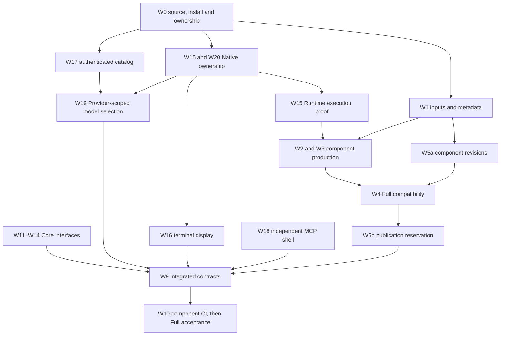

# Release framework integration — finite implementation record

This is the bounded W0–W20 integration record, not a second product
specification or a new authorization gate. It is retained while final source,
CI and live acceptance are being closed. Stable requirements belong to SPEC
and the scoped annexes; observed proof belongs to CURRENT. After acceptance,
Git history preserves the completed plan and its source provenance.

## 2026-11-13 reconciliation: original mandate versus achieved source and proof

**Evidence authority:** [CURRENT](../../CURRENT.md) has the dated exact
SHA, installed generation, saved-Chat and GitHub run IDs. The single ordered
unfinished-work plan is [HANDOFF](../../HANDOFF.md). The 2026-11-12
W0-W20 table and historical Writer ownership below are preserved as a
development snapshot, **not** as today's still-failing CI list.

### Scope evolution, without discarding any product contract

| Epoch | Original decision / new discovery | Resulting scope/order |
| --- | --- | --- |
| Initial W0-W14 | One release source, component fingerprints, Core-only, Manager/Full, version/Doctor, safe signing gate | Implemented as integrated source with CI consumers; original 0.167.1 baseline is historical |
| W15-W19 | Native claims/Busy, parent process tree, AppHost terminal, independent MCP shell, account-model Provider routing | Substantial source/test work integrated; real live Native/Android/account edges still need their own proof |
| W20 addition | User-observed `/switch` Owner lookup failure with cross-generation TUI/Core | Verified safe Owner discovery/reentry source fixes and hosted TUI tests; original user PID/thread and live account switch remain distinct |
| Upstream and operating release | Recipe advanced to upstream **0.167.2**; subsequent separately authorized Full **S167** and Provider **S27** were activated | Old S165 is not the current installed default; exact source 0ba05892 is not identical to S167's source 220cc2e4 |
| 2026-11-13 user orchestration mandate | First prove real A -> O -> W -> O -> A, then installed 0.167.2 acceptance, then consolidate findings/tasks in one dev branch | Existing W0-W20 obligations retained; runtime orchestration framework, budget change, runit auto sync, CI redesign become *later development* after documented real proof |
| Branch authority | `rewrite/rust-core` is the one continuing source, `main` separate signed-publication/approval authority | Isolated Writer branches temporary, not alternate long-lived feature truths; imported proposals remain non-normative |

The original plan required single-pass code implementation plus CI and
envisaged 1,370-3,020 product LoC for W0-W14. Those were **estimates**, not
today's unfinished workload. From `7b98296a` to `0ba05892` actual Git
change accounting is **161 commits, 175 files, +41,094/-5,216 lines**,
including generated/embedded upstream patches, copied sources, tests, CI
and docs. It is inaccurate to call these 41,094 newly authored product
lines. No work percentage should be inferred.

### 2026-11-13 evidence-only update

Exact development source `d9c3ed76`: Source `43372399358`, Manager
`43372399387`, Provider `43372399261`, Android fallback
`43372399238` succeeded. Core `43372399294` subsequently finished **SUCCESS** after its
Native-completion proof and Android smoke succeeded.
Full `43372399266` failed early admission (Core exact SHA not yet
qualified), **not** Full assembly. A new genuine GPT-6 O created two
real parent-bound W tasks, but no W model completion or W-to-O
delivery yet. This advances W0/W2/W3/W4/W10 and W15/W17/W18 proof
records only; it does not reclassify source as unimplemented.
Installed S167/S27 was independently read; physical W16 notification
tap, W20 account switch and reviewer allow/deny remain unproved.
See [CURRENT](../../CURRENT.md) and [HANDOFF](../../HANDOFF.md).

### Per-work present disposition

Here **source implemented** means integrated code/tests, **hosted qualified**
means a matching actual GitHub CI success on `0ba05892`, and **live gap**
means the indicated user/device path is not independently proven. None of
these labels is a second acceptance contract.

| Work | Current achieved work | Still unproved / boundary |
| --- | --- | --- |
| W0 | Git ancestry corrected; official one dev branch chosen; signed generations distinguished | Reconcile ongoing process and old Writer refs at each new experiment |
| W1 | Exact component-input fingerprints/producers implemented | Demonstrate digest-based reuse as actually consumed for each successor SHA |
| W2 | Android Core production path integrated; Core qualification passed | Installed Core-only transition/rollback is not inferred from hosted Core |
| W3 | Manager independent qualification implemented; `43353147332` SUCCESS | Real Manager terminal/notification on device separate |
| W4 | Qualified unsigned Full inventory/assembly implemented; prior 220cc Full qualified | **0ba Full 43353147279 failed at early Core-evidence admission**; rerun after all exact-source inputs ready |
| W5 | Component revision, composition revision, signed sequence separation implemented/tested | New actual signing/reservation not authorized; preserve S167 history |
| W6 | Upstream Retain contracts/tests integrated; full TUI `43353819723` SUCCESS | Physical UI and original reentry transcript are separate |
| W7 | Existing current alias is integrated and guarded | No reimplementation; retain rollback/current compatibility |
| W8 | Actual 0ba full TUI CI SUCCESS; older Clippy errors resolved | New source inputs invalidate proof only when affected |
| W9 | SPEC/annex/AGENTS hierarchy implemented | Latest orchestration/runit task docs and CURRENT/HANDOFF needed integration/refresh |
| W10 | Source, Core, Manager, Provider, Android, TUI hosted gates SUCCESS | 0ba Full final gate open; signing/publication remains separate authority |
| W11 | Core/Full update selection and Core-only source path implemented | Non-destructive actual installed update/no-op and mixed-generation edge coverage |
| W12 | Core-owned version JSON/details implemented; installed 0.167.2 JSON verified | Distinguish Provider selected pointer, running image and pending service activation |
| W13 | No-bwrap normal classification and failure differentiation implemented | Real explicitly requested sandbox/reviewer behavior separate |
| W14 | Signed-generation fixtures and CLI/Doctor regressions included in Core proof | Physical rollback and old user data preservation not inferred |
| W15 | Claims P0 and execution/Stop/tree/scope safeguards integrated; Core/Provider hosted tests passed | Actual parent/child wait, unknown ACK, sibling real concurrency, Busy recovery and reviewer allow/deny with receipts |
| W16 | Manager/terminal code and stock Android synthetic fallback `43353147285` PASS | Real foreground/background, locked-screen notification tap and exact terminal bound to AppHost work |
| W17 | Independent ChatGPT auth/catalog and stable model IDs implemented; Provider CI PASS | Actual S27 valid model/SSE and account-specific no-auth/deny paths |
| W18 | One independent Termux MCP shell and original call replay; connected shell observed | Native-Busy paired test, restarted tunnel receiver and exact original receipt under current service |
| W19 | Provider-scoped model list and selection in source, hosted TUI PASS | Real OpenAI/ChatGPT picker/direct/effort and same-thread inference across account changes |
| W20 | Legacy Owner/PID handling and switch TUI/reentry correction integrated; full TUI PASS | Attribute original user's failing process/thread; live permitted account-switch continuation and negative cases |

This categorization **does not** reopen fixed 2026-11-12 TLS/Clippy
diagnostics. Source `43353147385`, Core `43353147456`, Manager
`43353147332`, Provider `43353147336`, stock Android `43353147285`,
and TUI `43353819723` all succeeded for 0ba. The Full
`43353147279` was started before Core success and rejected at its
prerequisite lookup; assembly and real device operation were not executed.

### Newly exposed acceptance versus future implementation

- Prior independent worker saved Chats returned 323 and 667, but no
  **W -> O consumed/ACKed -> A delivered/ACKed** end-to-end receipt exists.
  A fresh C1-C8 experiment is the next mandatory *verification*, not a
  statement that durable orchestration is implemented.
- The future durable logical-job/queue/recipient/wakeup architecture is
  proposed in the imported
  [orchestration contract](orchestration/SESSION_INDEPENDENT_DURABLE_ORCHESTRATION.md)
  and [bridge options](orchestration/CODEX_CHATGPT_ORCHESTRATION_BRIDGE_DESIGN.md).
  Its budget ceilings 5/256/1024 and configurable elapsed duration are
  desired defaults, **not** verified present API support.
- The selected-vs-running Provider identity and one-time manual runit
  binding correction motivate the imported
  [runit generation task](RUNIT_GENERATION_ACTIVATION.md); it remains OPEN.
- Native busy independence, AppHost stable protocol model roundtrip, true
  parallel work, physical Android terminal/notification, original account
  switch, automatic model wakeup, and exact runit restart/rollback each have
  a separate evidence threshold. A synthetic or prior-generation result
  cannot satisfy a newer live qualification.
- **Priority now:** real orchestration chain -> complete installed
  0.167.2 verification and evidence ledger -> canonical documentation and
  branch integration -> in a *subsequent development stage* repair proven
  defects and CI admission ordering -> affected exact-source qualification
  -> separately authorized release. The single actionable queue/owners
  live in HANDOFF; do not maintain a parallel competing plan in this file.

### Provenance of adopted development proposals

- `docs/durable-orchestration-contract-20261112`
  at `6ccafe4889e8b22dc497478a6fb1bbaf1a6e0080`: two exact source
  documents under `docs/development/orchestration/` imported as non-normative
  designs; original blob identities verified at transfer.
- `work/tunnel-termux-v0.0.20-20261113`
  at `90ddd49d0d141bc764ab7a9730c41c948388f63e`: one focused
  `docs/development/RUNIT_GENERATION_ACTIVATION.md` document imported;
  unrelated branch source and stale CURRENT/HANDOFF were not overwritten.
- Historical `docs/release-framework-handoff-20261111` at `9a236db8`
  also contains `RELEASE_FRAMEWORK_PHASE1_REVIEW_20261111.md`. Its
  requirement to wait for a separate phase-2 approval was explicitly
  superseded by the later one-prompt implementation authorization, and its
  original 0.167.1/Full163 assumptions are outdated. Its useful W0-W18
  concerns, proof boundaries and Native P0 receipts are already accounted
  for in the W0-W20 implementation record/CURRENT, so the dated review
  brief was not copied as a fourth active development document. Its original
  branch/worktree remains intact; classification does not authorize deletion.
- The older documentation contract/Native integration lines have no new
  active requirements identified in this review beyond the current
  functional annexes and the finite W0-W20 record. Preserve active
  worktrees and their unmatched changes until separate ownership checks.
- Old W0-W20 history stays in this finite record; open work belongs in
  HANDOFF, verified present facts in CURRENT. Branch retirement is
  evidence-based and no original branch/old Writer is deleted by importing
  a document.

## Baseline, authority and ownership

Official input: `7b98296a411a2c435bb9f34ee51f286f33f3491b`, upstream
0.167.1 / `0a94398fa60c4fac0e7659e4213a0a36e613dd46`.
One integration worktree and owner-isolated feature worktrees share this
baseline; later focused worktrees start from frozen integration checkpoints. No primary-checkout reset, cleanup or branch switch is allowed.
One Writer owns each overlapping file; transfers are explicit.

**Decision A:** rewrite/rust-core is the one continuing development source.
Main remains separate publication/approval authority: signed indexes and
promotion consume that line. Its unrelated ancestry and existing approval
chain make an unconditional merge into development inappropriate. There is
currently no GitHub branch-protection rule to substitute for the implemented
exact-main authorization gate. Signing and activation stay separate.

The original assumption that e4f9ab5d and plan3ef675ad had no common ancestor
was caused by a shallow repository. The complete history establishes common
ancestors 27103ec0 and 0aebdd7f respectively. Selective patch review is still
necessary because the old checkout pins 0.167.0. It must not replace the
selected official recipe. The initial 0.167.1 input remains historical evidence.
During execution, discovery commit `ec51fe4a` advanced the official branch to
0.167.2 / `ce21072c90d32c40af7a55b60b2fb35c84a43a6a`; merge `795e0cae`
preserves that direct descendant of J. Apply and qualify the combined candidate
on the new exact upstream. Existing S165 remains 0.167.1 and is not rewritten.

## Implementation order

W6 Retain and already-accepted W7/W8 baseline evidence constrain every affected
TUI change. W15's completed operating P0 is not a prerequisite blocking other
work. Publication reservation metadata does not authorize signing/publication.
The independent follow-on Writer owns the final Source TLS fixture handoff and
the Native completion/process-manager Clippy repair in
`crates/release-builder/src/native_route.patch`. These edits do not transfer
Runtime, Provider or TUI execution authority and must receive exact-source
qualification before W8/W10/W15 can close. The earlier successful 53-gate
Core receipt belongs to the 1f checkpoint, not automatically the next SHA.

W20 reuses Core Owner discovery and upstream Native resume; it introduces no
Owner database or alternate Writer controller. The diagram orders source
responsibilities; actual Full admission follows successful same-source Core,
Manager and full-TUI qualification. Runtime execution-proof changes invalidate
Runtime production inputs and require affected consumer qualification again.

The Full inventory decision follows the latest Core/Full contract and actual
consumers: Core/Runtime, Manager and Enhanced TUI are the qualified composition;
Provider and the tunnel retain independent package/install/update authority.
An older ownership-annex sentence promised implicit inclusion of every optional
package, which neither Full production nor the closed publication inventory
implemented. That sentence is corrected without changing any signed inventory,
weakening optional-package admission or adding an unrelated bundling pipeline.
Native Core authority is also distinguished from the independent MCP shell.

For the current W15 correction, Models is the sole assembler/Writer of
native_route.patch and its Core/Protocol/rollout changes. Release handed back
the existing spawn-helper supervision and tests for Models to assemble with
the pipe/PTY and Core lifetime consumers. Integration owns the 53 required CI
selectors shared by basic Runtime proof and complete Enhanced TUI qualification.
Native owns Provider proof parsing, original receipt settlement and unloaded/Stop
observers. Integration owns norms and final assembly. These are existing
execution/receipt paths, not a new executor, history store or approval gate.

## Work packages and evidence gates

| Work | Defect / scope and implemented decision | Writer and principal source | Acceptance still required after focused local proof |
| --- | --- | --- | --- |
| W0 | Correct shallow ancestry, current S165 installation and mixed live generations; preserve dirty source | Integration; Git/process/installed inventory | Final remote HEAD and protected-asset comparison |
| W1 | Input identity follows actual producers, recipe, ABI, flags and lockfiles; qualification is separate | Release; component_inputs.py, component_artifact.py, qualified_component.py | Exact-source artifact/proof receipts |
| W2 | One canonical Android Core producer reused by source and runtime consumers | Release; reusable Core workflow and consumers | Hosted producer/cache plus consumer gates |
| W3 | Manager independent build and interface qualification | Release; manager workflow; Manager source | Hosted exact-source Manager qualification |
| W4 | Unsigned Full assembly binds successful same-source Core/Manager/full-TUI evidence | Release; full_qualification.py, release_control.py and workflow | Exact-source Full run after prerequisites |
| W5 | rN input revisions and composition revision separate from global sequence; immutable signed history | Release; component_revisions.py, release_reservations.py | Pure tests passed; no formal reservation/signing authorized |
| W6 | Preserve upstream TUI behavior; new model/switch paths have explicit Retain oracles | Models/Native; TUI patch and tests | Full hosted TUI tests |
| W7 | Existing current alias is already integrated; retain authority/symlink guards | Integration; current_alias.rs, existing tests | Reuse source tests; no redundant implementation |
| W8 | Baseline 7b98296 TUI success accepted; new changed paths need new exact-source proof | Integration | New full TUI qualification |
| W9 | Stable SPEC, single scoped norms, current evidence and finite handoff | Integration; SPEC and docs | Final links, dependency checks, exact evidence |
| W10 | Read-only qualification separated from exact-main approved signing/publication | Release/Integration; workflows, release_control.py | Safe push and final successful run IDs |
| W11 | Explicit --core/--full, no repeated cancellation, authenticated edition, Core-only build independent of TUI | Integration; main.rs, manual_update.rs, update_edition.rs | Local Core 271/0 passed; hosted CLI acceptance |
| W12 | Offline Core-owned version JSON/details, optional components and legacy unknown revisions | Integration; termux_version.rs, component_metadata.rs, provider.rs | Local Core 271/0 and installed read-only candidate passed |
| W13 | No-bwrap is normal platform information; explicit unsupported requests and real failures remain failures | Integration; Core Doctor path and DOCTOR norm | Local Core/Doctor passed; exact hosted qualification |
| W14 | Signed Core/Full fixtures, rollback, mismatched edition, noninteractive/version coverage | Integration; Core tests | Local signed fixtures/menu passed; exact hosted results |
| W15 | Original P0, verified scopes/reservations, execution schema 4 and canonical tree completion; retain root status, late receipts and selected-scope Stop/pruning; versioned inference admission and delayed terminal history | Native Provider; Models Runtime patch; Release PTY and CI under explicit leases | Provider440/Python41 and unchanged PTY15 pass; upstream/provided assembly and independent review pass; final hosted53 plus actual cold/tree/Stop/sibling acceptance remain |
| W16 | Exact Owner/home display, default-off auto, short descriptor-transition locks and unsafe-route rejection | Integration/Release after file-lease transfer; Manager terminal/window/task, Provider callback | Actual stock Android 66edd08d success; final source/device boundary retained |
| W17 | Fresh authenticated ChatGPT catalog, independent inference auth, stable stored Provider/model IDs | Models; models/control/projection and Provider docs | Candidate hosted tests; reuse operating live model loop only within stated boundary |
| W18 | One independent shell, original-call replay, conflicts, bounded output/process cleanup; common annotations unchanged | Integration; termux_shell, worker, candidate.py, connector refresh and qualification | Final frozen standalone worker passes eight actual stdio groups; earlier connected Busy replay preserved; final Runtime-Busy pair and exact Provider CI remain |
| W19 | OpenAI upstream-only; ChatGPT account catalog-only through picker/direct input/reentry/effort; preserve upstream command-name completion | Models; termux_chat_models, input preparation, TUI patch | Candidate full TUI, provider transitions and unsupported-model errors |
| W20 | Decode legacy owners safely; verify actual execution-home Writer locks; preserve current Native selection/thread; consume initial intent once, fence Native children and reject unsupported private handoffs | Native/Models; runtime-binding/native, profile_transport, profile_manager, app_server_session and quota replay | Owner correction154 affected tests/readbacks pass, including Manager139; provisional J same-thread switch and old-d2/S165 safe refusals passed; original d2 regression preserved; final Runtime/composition and hosted19 named gates remain |

## Source provenance and independent review

- e4f9ab5dc3045cbde8317774da95eb98db7646dd: original Native continuation
  claim repair; compared against the current producer and integrated with
  origin attribution. No operating recovery was repeated.
- c0a8189815c70f0c6678bc9374bcd352423dca57: independent MCP worker; direct
  descendant patch integrated, then actual independent-process replay and
  lifecycle tests added.
- 3ef675ad721c0a08a50891394cf03df3abb66b2d: planning evidence revalidated
  against real producers; its approval gate and 0.167.0 assumptions are not
  carried forward.
- 9a236db89a3778a1d28a488d093ddee9943759d3 and parent089ec7f6: prior P0
  recovery and janmori101 connector-refresh evidence folded into CURRENT
  and scoped Provider guidance; no duplicate dated handoff is created.
- a55d5bb8 Native integration, 0aebdd7f documentation baseline, PR #29 and
  2dd07d42 account-draft ancestry are already integrated. Preserve actual
  current consumers instead of replaying obsolete files.

Worker commits retain cherry-pick origin attribution. The integration branch
is the reviewable source; individual work branches are temporary and cannot
substitute for final official-source integration.

## Tests and proof reuse

The three baseline 7b98296 CI receipts, earlier P0 repair receipts, original
15 claim tests and successful connector refresh are reusable only for their
original source/account/device boundaries. New effects, owner parsing,
catalog selection, terminal display, metadata consumers and CI producers are
retested. No assertion is weakened and no required gate is deleted or skipped.

Local TUI compilation lacks the pinned rusty_v8 dependency. Hosted G full TUI
passed focused/Native/API and every mandatory Retain gate, including the corrected
pin refresh and compaction tests. Its success does not qualify J's later typed
reentry tests or subsequent Runtime changes. Actual candidate PTY switch and
provider-model continuity with synthetic responses passed separately. Old-runtime
compiler and incomplete earlier switch trials remain original failure evidence,
not accepted new behavior. Existing Stop/empty-jobs tests alone cannot certify
actual process termination; the new Runtime proof must pass positive and negative
consumer cases before final availability acceptance.

Live model evidence used the operating Provider and one original Chat/Native
thread, preserving approval and sandbox configuration. Synthetic account
fixtures are separate. Android stock tests prove Activity/session behavior on
the pinned emulator APK with synthetic Core transport and frontend; they do not prove a
physical device or real model inference.

The first W1 recheck at 26952f73 measured one conservative cache miss: e961f25c-to-26952f73 changed only Manager's dedicated
profile test formatting, which changed Manager's declared input identity while
Core's remained identical. The audited package-tree inventory is retained; it is
not described as the minimal activated Cargo graph. This may consume a new rN for
identical output bytes. No incomplete test exclusion or alternate dependency
resolver is introduced. Audit SHA256:
`32b8a5971c0e0e44409b1d70e995f010721b272999db281c4b17f4eb20e2d207`.
Its no-missing-input conclusion was incomplete: the real 0.167.2 transition
exposed release-builder::local_recipe directly embedding release/upstream.json
inside Core while the inventory excluded it. Source ea5f5e55 adds that blob to
Core only and proves stale-artifact refusal; Manager's recipe independence stays
intact. Two original red cases, three focused green cases, fifteen component/
consumer passes and three current-descriptor passes are retained in CURRENT.
The producer-helper change is itself an input and requires fresh qualification.

## Change accounting and rollback

The original 1,370–3,020 product and 500–800 documentation LoC ranges were
pre-investigation estimates for W0–W14. They are not completed counts. The
original W16 estimate and 559-line shell patch are not added to final totals.
The working-tree measurement below is relative to the original official
7b98296 baseline and is refreshed at source freeze. Both embedded patches are
expanded onto the same official ce210 upstream; wrapper text, upstream-version
noise, reverted iterations and overlapping work assignments are excluded.

| Category | Added LoC | Deleted LoC | Replacement pairs, already included |
| --- | ---: | ---: | ---: |
| Product | 10332 | 1119 | 666 |
| Tests | 19476 | 1366 | 865 |
| Build/CI/support | 3076 | 270 | 122 |
| Norms/documentation | 2555 | 513 | 308 |

The physical Git delta contains 174 files: 128 modified and 46 new, none deleted
relative to baseline. Replacing the two physical patch containers with their
106 changed logical files gives 278 distinct owned/logical files: 230 modified,
48 new, none deleted. The containers hold Native 84 files (+7467/-132) and TUI
22 files (+715/-86); those deltas are already classified in the product/test
rows. Replacement pairs are the smaller side of each replacement hunk and are
subsets of additions/deletions, not another LoC total. Rust test-item
classification lexically excludes comments/strings and supports cfg(all(test,...));
validation scripts count as tests. Source/line images and hashes support
independent recalculation.

Classifier SHA256: `30e8ab6bdf525db6d2f612bfdc57b021818bef005c01dfb9fc75a8b86b23e01e`.
Eight parent-module test-only imports/helpers are counted under tests, preserving
total additions/deletions. Expanded-image ledger SHA256:
`afc06641c2eeff310fffb1eab0d2ac34714eac3b9f4630d5414ec5d1491cf83c`.
The final categorized receipt is bound separately to the frozen source; numeric
documentation counts include this record and the file ledger itself. The ledger
generator SHA256 is `38f61150046c011ca05aeefa4979ff1926085a8566b4d64f7a2895953533c8cb`.

### Per-work exclusive file ownership

The [complete file ledger](RELEASE_FRAMEWORK_CHANGE_OWNERSHIP.tsv) assigns each
changed physical or expanded logical file to one primary W owner and records
shared responsibilities separately. The table is an exclusive whole-file
allocation, not a claim that every changed hunk was caused by that work package.
Documentation is counted once at W9. Expanded patch images replace their two
containers; the containers are not counted again. W7/W8 reuse the integrated
baseline; W13's implementation and tests are shared in W11/W14 and its norm in
W9, so a zero direct-file allocation does not mean the work was omitted.
The separate W20 hunk slice below is nonadditive. Parallel implementation used
explicit file leases; retirement and rollback preserve original owner receipts.
These working-tree counts are refreshed before the final source freeze.

| Work | Modified / new / deleted files | Product + / - / replacement | Tests + / - / replacement | Build and CI + / - / replacement | Docs + / - / replacement |
| --- | ---: | ---: | ---: | ---: | ---: |
| W0 | 1 / 0 / 0 | 0 / 0 / 0 | 0 / 0 / 0 | 4 / 4 / 4 | 0 / 0 / 0 |
| W1 | 2 / 3 / 0 | 0 / 0 / 0 | 254 / 1 / 1 | 266 / 3 / 3 | 0 / 0 / 0 |
| W2 | 6 / 7 / 0 | 0 / 0 / 0 | 419 / 7 / 7 | 817 / 138 / 37 | 0 / 0 / 0 |
| W3 | 0 / 1 / 0 | 0 / 0 / 0 | 0 / 0 / 0 | 81 / 0 / 0 | 0 / 0 / 0 |
| W4 | 1 / 5 / 0 | 0 / 0 / 0 | 921 / 2 / 2 | 647 / 0 / 0 | 0 / 0 / 0 |
| W5 | 4 / 4 / 0 | 0 / 0 / 0 | 181 / 0 / 0 | 407 / 16 / 16 | 0 / 0 / 0 |
| W6 | 5 / 2 / 0 | 0 / 0 / 0 | 142 / 9 / 9 | 159 / 4 / 3 | 0 / 0 / 0 |
| W7 | 0 / 0 / 0 | 0 / 0 / 0 | 0 / 0 / 0 | 0 / 0 / 0 | 0 / 0 / 0 |
| W8 | 0 / 0 / 0 | 0 / 0 / 0 | 0 / 0 / 0 | 0 / 0 / 0 | 0 / 0 / 0 |
| W9 | 20 / 5 / 0 | 0 / 0 / 0 | 0 / 0 / 0 | 0 / 0 / 0 | 2555 / 513 / 308 |
| W10 | 10 / 3 / 0 | 0 / 0 / 0 | 460 / 31 / 27 | 256 / 44 / 30 | 0 / 0 / 0 |
| W11 | 3 / 1 / 0 | 285 / 85 / 65 | 268 / 34 / 20 | 0 / 0 / 0 | 0 / 0 / 0 |
| W12 | 0 / 2 / 0 | 350 / 0 / 0 | 25 / 0 / 0 | 0 / 0 / 0 | 0 / 0 / 0 |
| W13 | 0 / 0 / 0 | 0 / 0 / 0 | 0 / 0 / 0 | 0 / 0 / 0 | 0 / 0 / 0 |
| W14 | 3 / 0 / 0 | 0 / 0 / 0 | 28 / 17 / 15 | 0 / 0 / 0 | 0 / 0 / 0 |
| W15 | 107 / 9 / 0 | 7502 / 781 / 440 | 12886 / 1068 / 634 | 322 / 0 / 0 | 0 / 0 / 0 |
| W16 | 8 / 2 / 0 | 507 / 47 / 36 | 1270 / 26 / 23 | 45 / 6 / 4 | 0 / 0 / 0 |
| W17 | 4 / 0 / 0 | 166 / 6 / 6 | 149 / 3 / 3 | 0 / 0 / 0 | 0 / 0 / 0 |
| W18 | 9 / 3 / 0 | 529 / 6 / 6 | 564 / 2 / 2 | 70 / 55 / 25 | 0 / 0 / 0 |
| W19 | 15 / 0 / 0 | 540 / 126 / 58 | 739 / 99 / 64 | 2 / 0 / 0 | 0 / 0 / 0 |
| W20 | 32 / 1 / 0 | 453 / 68 / 55 | 1170 / 67 / 58 | 0 / 0 / 0 | 0 / 0 / 0 |

### W20 measured subset and shared ownership

The reconciled direct W20 slice is **11 logical files/hunks: product +178/-22,
tests +528/-1**. It includes Manager quota/profile handling, typed TUI transport,
profile-manager tests, quota qualification and expanded upstream historical-quota
replay. This declared slice is not a complete exclusive W20 total.
The earlier f2aef205 affected union has 43 files (28 physical plus 15 expanded TUI),
+4006/-351. Owner registry/Writer lookup is shared with W15, terminal fixtures
with W16, selection/reentry/child fencing with W19, and norms with W9. That union
is neither W20-only LoC nor an addition to the global totals above.
Earlier 6450/f915/f149 snapshots are superseded measurement checkpoints, not
summable work. The refreshed direct-slice ledger binds exact 1f before/after images and hunk
ownership, including the fixture-only TOML parser correction:
`d31dc0d46d9e936876cd2f58562a40751e8690b783b0a81fe9f6ba928f846d6c`.
The historical shared union is not a current exclusive W20 measurement.
The W-task table owns file responsibility; this ledger prevents duplicate counts.

Rollback for development is a reviewed revert of a coherent feature commit,
followed by affected exact-source qualification. No rollback here mutates a
signed generation, active pointer, account, original result or Writer.
A failed publication proof prevents signing rather than changing already
issued S164/S165. Full-to-Core tests preserve previous Full and enforce
anti-rollback sequence rules; S164 cannot silently replace newer S165.

## Branch disposition

The read-only snapshot at 05:24:20 UTC, classified at 05:30:40 UTC, covers
114 local/tracking refs, 99 registered worktrees, 45 actual remote heads,
17 auxiliary refs and zero open PRs. There are 166 local and 257 remote tag
names, 258 names in the union and zero common-name object mismatches. An
annotated peeled row is not an extra remote tag. All tag names/objects and
worktree ownership were retained in the original audit; no ref was deleted.

Audit SHA256: `d47b958c7d81c81cc52d104412e6d7b00f0761eac7745893f9633bca2223277e`.
Complete inventory SHA256:
`ff1cf0e7a8b27b753d6768be71be06bd4a2f04ad1188ba4c218d3b4256a5187a`.
The anchor is local `578a386b88ef0cfecb268c439c485b650f457970`, official
development `1f1f5cffa26bccf27428132e7482c1a0e959fbf4` and publication
main `b2567063d2a7a333a718d2495e2c9f8c928d822c`. These are observations,
not a promise that refs stay frozen. The final source readback is separate.

| Class | Disposition | Condition before any retirement |
| --- | --- | --- |
| A | Technical retirement candidate after final acceptance | Required final CI/actual acceptance, preservation of original evidence, owner and consumer release; classification alone is not deletion authority |
| B | Remove dependencies before retirement | Related worktree, original failure/result, current test and recovery owners must release their references |
| C | Preserve for operation, publication or compatibility | Official source/main, signed history, fixed callers and rollback remain protected |
| D | Hold for another owner or unique history | Preserve the owner's intent, dirty recovery snapshots and unintegrated experiments |

| Scope | Total | A | B | C | D |
| --- | ---: | ---: | ---: | ---: | ---: |
| Local and tracking refs | 114 | 22 | 48 | 15 | 29 |
| Actual remote heads | 45 | 8 | 18 | 7 | 12 |
| Registered worktrees | 99 | 0 | 35 | 5 | 59 |
| Auxiliary refs | 17 | 0 | 3 | 0 | 14 |

Immediate deletion eligibility at this snapshot is **zero**; actual deletion
is **zero**. A worktree's presence establishes an ownership dependency, not an
idle process. Related-worktree counts below are per ref and are not additive.
Compared with the prior aa audit, the new Native evidence-retention branch and
two detached acceptance worktrees are held in B. The 89 unchanged legacy
ref/SHA dispositions retain their original evidence and owner conditions.

### Complete local and tracking reference classification

| Class | Ref | Exact object | Owner | Related worktrees |
| --- | --- | --- | --- | ---: |
| D | `refs/heads/archive/linux-app-operating-source-20261106` | `97118e775bc6e7dbcebe20fdcb7f763ae1ee7278` | prior_record | 1 |
| D | `refs/heads/archive/mobile-desktop-attempt-20261106` | `8de07907b1108bdc7ee7646e1ea55faa1ae14dec` | prior_record | 1 |
| D | `refs/heads/backup/user-dirty-20261109` | `0401e4af620733cb757f3ede72129c35a7dc5d4c` | prior_record | 0 |
| D | `refs/heads/backup/user-dirty-20261109-base` | `0814be7b51ddb058d3791b36275bb18487bee86c` | prior_record | 0 |
| B | `refs/heads/cr12-native-wire-retention-20261112` | `65641fade7a9423c20a7f90f6fefa19a0491cc2f` | native | 1 |
| B | `refs/heads/design/entry-architecture-20261105` | `604df76bb30f361543246a7face53004b1f3d55a` | prior_record | 1 |
| B | `refs/heads/docs/release-framework-handoff-20261111` | `9a236db89a3778a1d28a488d093ddee9943759d3` | prior_record | 1 |
| B | `refs/heads/docs/review-actions-20261110` | `e16bb12defc984ddd8f7f2318f32222f904b44da` | prior_record | 1 |
| D | `refs/heads/draft/thread-model-catalog-20261106` | `8d095cd754faf9f4ee8707f176d9648431bc08da` | prior_record | 0 |
| A | `refs/heads/experiment/profile-tui` | `c4d9a41d3827e05ef176abee55422f1d3c06a9a2` | prior_record | 0 |
| D | `refs/heads/experiment/web-provider` | `6aab6cd9c8e34d4d831517baf45418448de4549c` | prior_record | 0 |
| D | `refs/heads/experiment/web-termux` | `08e985693f0a0c258701f58be4b9118c52050edc` | prior_record | 0 |
| B | `refs/heads/feat/termux-mcp-shell-20261111` | `c0a8189815c70f0c6678bc9374bcd352423dca57` | prior_record | 1 |
| C | `refs/heads/fix/accepted-caller-repin-20261111` | `c642dd2087356254978993173d3c66d0f3a621dc` | prior_record | 1 |
| B | `refs/heads/fix/active-steer-20261104` | `f8d1a7f47c6281dfd69a905b5eafdd49fb47e1f4` | prior_record | 1 |
| B | `refs/heads/fix/attached-native-development-loop-20261106` | `cc535d18a897dad2c0323f72c7a2b6edf1ddafac` | prior_record | 1 |
| B | `refs/heads/fix/chatgpt-resume-concurrency-20261108` | `f93256083902fd4f5b289e895f8a3633046a0b17` | prior_record | 1 |
| B | `refs/heads/fix/current-generation-compat-link-20261111` | `a8cb66c6f2b0e3648bff05a615c67314c268ebc9` | prior_record | 1 |
| D | `refs/heads/fix/hosted-preflight-0161` | `ce371e090f865852ae1ca01a5513a75a1b485b7c` | prior_record | 0 |
| D | `refs/heads/fix/mobile-desktop-20261106` | `8de07907b1108bdc7ee7646e1ea55faa1ae14dec` | prior_record | 1 |
| D | `refs/heads/fix/native-route-transition-20261105` | `987dee84a5c33bf26371666a35cc615e2f284376` | prior_record | 1 |
| B | `refs/heads/fix/native-startup-settlement-20261108` | `317c7fe41d15af72f2c36b85da50163a3d8e858c` | prior_record | 1 |
| A | `refs/heads/fix/p0-413-native-repair` | `0902eb69b319f105d98d0043fe0d63436235453d` | prior_record | 0 |
| B | `refs/heads/fix/p0-stream-resume-identity` | `49e292b011e0c7d44e2a23f6856ca94a346956b0` | prior_record | 1 |
| C | `refs/heads/fix/release-notify-admission-20261111` | `c19b61bb3d1d3bdb7e3c4f2ad9763d71397e5ca0` | prior_record | 1 |
| D | `refs/heads/handoff/pro-local-baseline-20261106` | `b8c14252ee338a75ace4cf3bfdc463d9747108c5` | prior_record | 1 |
| B | `refs/heads/integration/codex-native-20261110` | `a55d5bb8fffa2f2fc918c47e8aa404647a141411` | prior_record | 1 |
| B | `refs/heads/integration/release-framework-20261112` | `578a386b88ef0cfecb268c439c485b650f457970` | root | 1 |
| C | `refs/heads/legacy/monolith` | `bf30a7dc94d4dad7f58836c69028160856e63c58` | prior_record | 0 |
| C | `refs/heads/main` | `53176ed79097a7a68e7bfd4dd961f94b71dff27a` | prior_record | 1 |
| B | `refs/heads/native-completion-schema4-20261112-r3` | `8537208569876ea5b8a0dc79a556d94573a93449` | native | 0 |
| B | `refs/heads/plan/release-framework-20261111` | `3ef675ad721c0a08a50891394cf03df3abb66b2d` | prior_record | 1 |
| B | `refs/heads/prep/0.164-native-review` | `27a91867864496ab97aa99fdb18502adfeedef93` | prior_record | 1 |
| D | `refs/heads/prep/pro-baseline-20261106` | `6018ad990f140d06d7b6aedf0ac866034bb1fe68` | prior_record | 0 |
| C | `refs/heads/prod/download-size-v1-base-9300` | `9300a68852c879f4730e9191e46837cfab6745d9` | prior_record | 0 |
| B | `refs/heads/refactor/docs-contract-20261110` | `0aebdd7f2614a38c08f96e1c266f0a7c2d88609a` | prior_record | 1 |
| A | `refs/heads/refactor/naming-and-delivery-rules` | `306d842f86aa658dfc9a6932ecd5ded08ff23913` | prior_record | 0 |
| C | `refs/heads/release/frozen-full-1670-caller` | `6624418979e1e682ce8971710935d29cc4d490fd` | prior_record | 1 |
| C | `refs/heads/release/frozen-full-1670-s163` | `d6f090e835a74b86677f2f672ef55669ec459fe1` | prior_record | 1 |
| D | `refs/heads/rewrite/rust-core` | `e4f9ab5dc3045cbde8317774da95eb98db7646dd` | prior_record | 1 |
| D | `refs/heads/tdev-work/AUTHORITY-COMPACTION-V1-88d33545bf5e4bc6b24ebaeb6962ee5b` | `838c8ba7e773cf9a9c660a6d6d3cc924d6f3b017` | prior_record | 0 |
| D | `refs/heads/tdev-work/RUNTIME-ALIGNMENT-0-159-2-AUTHORITY-560ff9af76714c9baee22584368935f3` | `019f2066cfcb3cd7625c23fb1440fb6af4131e37` | prior_record | 0 |
| D | `refs/heads/tdev-work/release-download-size-v1-a0dce69bd40e43f7b22f4d303b70efa5` | `ba0eacc4a07783997dc4a294d961ac6d0c5633f7` | prior_record | 0 |
| A | `refs/heads/tdev-work/update-download-size-v1-9fcae140207f4608b7268cd77f0146f5` | `4fd14ed8aafcf29602f43e00c314eb8da39a6e5f` | prior_record | 0 |
| B | `refs/heads/wip/chatgpt-accounts-source-20261110` | `2dd07d422ad063107f344ac88409271b6ad380ba` | prior_record | 1 |
| B | `refs/heads/work/native-completion-20261112` | `69e6fa352d6201079d4836c4915818006b412a8e` | native | 1 |
| B | `refs/heads/work/native-completion-producer-20261112` | `210dec0c121811da33b3c54911a365a7352f429f` | models | 1 |
| B | `refs/heads/work/native-owner-20261112` | `b0a955086a5e8f175ffe27bf63d2fb7c10558faa` | native | 1 |
| B | `refs/heads/work/native-source-bound-20261112` | `2090c574b95703d7560044a471f61cd886c38526` | native | 1 |
| B | `refs/heads/work/native-tree-producer-20261112` | `274190f3a97c5e87349c7d8feb50e4bd17fcec21` | models | 1 |
| B | `refs/heads/work/provider-models-20261112` | `fefaad9cf00505be31b785dee33825463469958a` | models | 1 |
| B | `refs/heads/work/reentry-handoff-guard-20261112` | `3c994eaf4d6aae933178a132eec9a34430a3638b` | models | 1 |
| B | `refs/heads/work/release-framework-20261112` | `9fd0c1af0475be9cbed74a950b168c83312bf7bd` | release | 1 |
| B | `refs/heads/work/release-lifecycle-20261112` | `7228a8a76728bdf93af6e8dc9d979bd0bd9e8ee2` | release | 1 |
| B | `refs/heads/work/release-source-fixture-20261112` | `6f4e38febef6b9966974b4856c5554d98f523043` | release | 1 |
| A | `refs/remotes/integration-transfer/acceptance-final` | `3140f7fc32394024ac79476a7a87f7a0aade5336` | legacy_transfer_evidence | 0 |
| A | `refs/remotes/integration-transfer/barrier31` | `ea04c19208b097ac1c2830cede8f1acf7b1563c7` | legacy_transfer_evidence | 0 |
| A | `refs/remotes/integration-transfer/codegate-v2` | `81049caeb05b351da76ce948bc1464cd8007aed6` | legacy_transfer_evidence | 0 |
| A | `refs/remotes/integration-transfer/discovery29` | `0c5a70523f7a7aca42f1e5910fbd4bf57a7ca180` | legacy_transfer_evidence | 0 |
| A | `refs/remotes/integration-transfer/fixture30` | `7ef80be546c6d815c3f9993178b205170f8b9cc3` | legacy_transfer_evidence | 0 |
| A | `refs/remotes/integration-transfer/gates31` | `12129a5ed37efda26119b79e1e25350d91a39808` | legacy_transfer_evidence | 0 |
| B | `refs/remotes/integration-transfer/native-result29` | `fa6b46789feddea27d5a6551c6eeeba6f09af56d` | legacy_transfer_evidence | 1 |
| A | `refs/remotes/integration-transfer/package-fixture26` | `e6f50f2977e1357e078917172ac9d59f7adad575` | legacy_transfer_evidence | 0 |
| A | `refs/remotes/integration-transfer/preflight-20261110` | `f6dff75b72d0d985cc3372baf5cf04d37d411314` | legacy_transfer_evidence | 0 |
| A | `refs/remotes/integration-transfer/provider-final` | `495c5213160e43682bc8e10d8f5203cc992399b9` | legacy_transfer_evidence | 0 |
| B | `refs/remotes/integration-transfer/qualification30` | `e0cca4c2d695694898841d7476acbaaf8ed581f0` | legacy_transfer_evidence | 1 |
| D | `refs/remotes/integration-transfer/recovery28` | `5c9334b6aa537102e6a0394247a61be4b44535f1` | legacy_transfer_evidence | 1 |
| A | `refs/remotes/integration-transfer/result29` | `94e09c845b84a0050a0474ba7da34eb26bb3c253` | legacy_transfer_evidence | 0 |
| A | `refs/remotes/integration-transfer/runtime-final` | `3c043bdd7e80cb8ef2fdcbe7132cc45c285ecd60` | legacy_transfer_evidence | 0 |
| A | `refs/remotes/integration-transfer/tui-proof-final` | `392b026f02a41f1364e575393dd78adc1774dd31` | legacy_transfer_evidence | 0 |
| A | `refs/remotes/integration-transfer/validation-final` | `18b90a5b34c819de11fbf36cd3a47ca30d35ec46` | legacy_transfer_evidence | 0 |
| C | `refs/remotes/origin/HEAD` | `b2567063d2a7a333a718d2495e2c9f8c928d822c` | prior_record | 0 |
| D | `refs/remotes/origin/archive/linux-app-operating-source-20261106` | `97118e775bc6e7dbcebe20fdcb7f763ae1ee7278` | prior_record | 1 |
| D | `refs/remotes/origin/archive/mobile-desktop-attempt-20261106` | `8de07907b1108bdc7ee7646e1ea55faa1ae14dec` | prior_record | 1 |
| B | `refs/remotes/origin/contingency/native-completion-20261112-remote` | `bfec2858798bfdea18843112019c3f3a1b9e6fc7` | native | 0 |
| B | `refs/remotes/origin/contingency/native-schema4-20261112-wip` | `08585ddd1cbb2bb67f1419233be9b8b56f99a416` | native | 1 |
| A | `refs/remotes/origin/contingency/release-framework-20261112` | `e8a08631d7e067f9e601dc95a150f9f50a9cf67e` | root | 0 |
| A | `refs/remotes/origin/contingency/release-framework-20261112-remote` | `dabd08ff52a7846e58ed913d8191626e9a4d315f` | root | 0 |
| D | `refs/remotes/origin/contingency/termux-outage-20261112` | `cc9d70b6022057144e613ee39801f116d6a00b0a` | external_ops | 0 |
| B | `refs/remotes/origin/contingency/termux-outage-20261112-models` | `fefaad9cf00505be31b785dee33825463469958a` | models | 1 |
| B | `refs/remotes/origin/contingency/termux-outage-20261112-native-base` | `b0a955086a5e8f175ffe27bf63d2fb7c10558faa` | native | 1 |
| B | `refs/remotes/origin/contingency/termux-outage-20261112-native-provider` | `69e6fa352d6201079d4836c4915818006b412a8e` | native | 1 |
| B | `refs/remotes/origin/contingency/termux-outage-20261112-native-provider-wip` | `7d42beee0cebd3e55cdaa25dbb2321622390bd29` | native | 1 |
| B | `refs/remotes/origin/contingency/termux-outage-20261112-producer` | `210dec0c121811da33b3c54911a365a7352f429f` | models | 1 |
| B | `refs/remotes/origin/contingency/termux-outage-20261112-release` | `9fd0c1af0475be9cbed74a950b168c83312bf7bd` | release | 1 |
| B | `refs/remotes/origin/design/entry-architecture-20261105` | `604df76bb30f361543246a7face53004b1f3d55a` | prior_record | 1 |
| B | `refs/remotes/origin/docs/release-framework-handoff-20261111` | `9a236db89a3778a1d28a488d093ddee9943759d3` | prior_record | 1 |
| D | `refs/remotes/origin/draft/thread-model-catalog-20261106` | `8d095cd754faf9f4ee8707f176d9648431bc08da` | prior_record | 0 |
| A | `refs/remotes/origin/experiment/profile-tui` | `2c9ec49685aa5677ed146d5f86f740464449740a` | prior_record | 0 |
| D | `refs/remotes/origin/experiment/stock-window-proof` | `ee28c904cb55d17848827c7c5bc986c79dedcbea` | prior_record | 1 |
| D | `refs/remotes/origin/experiment/web-provider` | `6aab6cd9c8e34d4d831517baf45418448de4549c` | prior_record | 0 |
| D | `refs/remotes/origin/experiment/web-termux` | `08e985693f0a0c258701f58be4b9118c52050edc` | prior_record | 0 |
| B | `refs/remotes/origin/fix/active-steer-20261104` | `f8d1a7f47c6281dfd69a905b5eafdd49fb47e1f4` | prior_record | 1 |
| B | `refs/remotes/origin/fix/attached-native-development-loop-20261106` | `cc535d18a897dad2c0323f72c7a2b6edf1ddafac` | prior_record | 1 |
| B | `refs/remotes/origin/fix/chatgpt-resume-concurrency-20261108` | `f93256083902fd4f5b289e895f8a3633046a0b17` | prior_record | 1 |
| B | `refs/remotes/origin/fix/current-generation-compat-link-20261111` | `a8cb66c6f2b0e3648bff05a615c67314c268ebc9` | prior_record | 1 |
| D | `refs/remotes/origin/fix/hosted-preflight-0161` | `ce371e090f865852ae1ca01a5513a75a1b485b7c` | prior_record | 0 |
| D | `refs/remotes/origin/fix/native-route-transition-20261105` | `987dee84a5c33bf26371666a35cc615e2f284376` | prior_record | 1 |
| A | `refs/remotes/origin/fix/p0-413-native-repair` | `0902eb69b319f105d98d0043fe0d63436235453d` | prior_record | 0 |
| C | `refs/remotes/origin/fix/release-notify-admission-20261111` | `c19b61bb3d1d3bdb7e3c4f2ad9763d71397e5ca0` | prior_record | 1 |
| A | `refs/remotes/origin/fix/stopped-native-shared-claim-reconciliation` | `fec19d8e2c9a08115b8e13c4a71f548dd794cb9d` | prior_record | 0 |
| D | `refs/remotes/origin/handoff/pro-local-baseline-20261106` | `b8c14252ee338a75ace4cf3bfdc463d9747108c5` | prior_record | 1 |
| B | `refs/remotes/origin/integration/codex-native-20261110` | `a55d5bb8fffa2f2fc918c47e8aa404647a141411` | prior_record | 1 |
| C | `refs/remotes/origin/legacy/monolith` | `bf30a7dc94d4dad7f58836c69028160856e63c58` | prior_record | 0 |
| C | `refs/remotes/origin/lupi/review-20261109` | `53176ed79097a7a68e7bfd4dd961f94b71dff27a` | prior_record | 1 |
| C | `refs/remotes/origin/main` | `b2567063d2a7a333a718d2495e2c9f8c928d822c` | prior_record | 0 |
| B | `refs/remotes/origin/prep/0.164-native-review` | `27a91867864496ab97aa99fdb18502adfeedef93` | prior_record | 1 |
| D | `refs/remotes/origin/prep/pro-baseline-20261106` | `6018ad990f140d06d7b6aedf0ac866034bb1fe68` | prior_record | 0 |
| C | `refs/remotes/origin/prod/download-size-v1-seq23-source` | `b164e5b61cb438913cdb1633d74c62d6c96f6523` | prior_record | 0 |
| C | `refs/remotes/origin/release/frozen-full-1670-s163` | `d6f090e835a74b86677f2f672ef55669ec459fe1` | prior_record | 1 |
| D | `refs/remotes/origin/release/seq18-no-emoji-product` | `9300a68852c879f4730e9191e46837cfab6745d9` | prior_record | 0 |
| C | `refs/remotes/origin/rewrite/rust-core` | `1f1f5cffa26bccf27428132e7482c1a0e959fbf4` | root | 1 |
| B | `refs/remotes/origin/wip/chatgpt-accounts-source-20261110` | `2dd07d422ad063107f344ac88409271b6ad380ba` | prior_record | 1 |
| B | `refs/remotes/origin/work/capability-restoration-166` | `3c1e47e46cef62f1ad781ac7207b09d7e1b138b2` | prior_record | 0 |

### Complete actual remote-head classification

| Class | Remote ref | Exact object | Owner |
| --- | --- | --- | --- |
| D | `refs/heads/archive/linux-app-operating-source-20261106` | `97118e775bc6e7dbcebe20fdcb7f763ae1ee7278` | prior_record |
| D | `refs/heads/archive/mobile-desktop-attempt-20261106` | `8de07907b1108bdc7ee7646e1ea55faa1ae14dec` | prior_record |
| B | `refs/heads/contingency/native-completion-20261112-remote` | `bfec2858798bfdea18843112019c3f3a1b9e6fc7` | native |
| A | `refs/heads/contingency/native-producer-20261112-remote` | `69d402b31c8efde828b86020ff7aa89ffe4b3896` | models |
| A | `refs/heads/contingency/native-proof-gates-20261112-remote` | `3562d5d327dfc39f8891e8b5a908ac86cef6373c` | release |
| B | `refs/heads/contingency/native-schema4-20261112-wip` | `08585ddd1cbb2bb67f1419233be9b8b56f99a416` | native |
| A | `refs/heads/contingency/release-framework-20261112` | `e8a08631d7e067f9e601dc95a150f9f50a9cf67e` | root |
| A | `refs/heads/contingency/release-framework-20261112-remote` | `dabd08ff52a7846e58ed913d8191626e9a4d315f` | root |
| D | `refs/heads/contingency/termux-outage-20261112` | `19c1694a547c5c0aa3c269eaf23550b6b8703f37` | external_ops |
| B | `refs/heads/contingency/termux-outage-20261112-models` | `fefaad9cf00505be31b785dee33825463469958a` | models |
| B | `refs/heads/contingency/termux-outage-20261112-native-base` | `b0a955086a5e8f175ffe27bf63d2fb7c10558faa` | native |
| B | `refs/heads/contingency/termux-outage-20261112-native-provider` | `69e6fa352d6201079d4836c4915818006b412a8e` | native |
| B | `refs/heads/contingency/termux-outage-20261112-native-provider-wip` | `7d42beee0cebd3e55cdaa25dbb2321622390bd29` | native |
| B | `refs/heads/contingency/termux-outage-20261112-producer` | `210dec0c121811da33b3c54911a365a7352f429f` | models |
| B | `refs/heads/contingency/termux-outage-20261112-release` | `9fd0c1af0475be9cbed74a950b168c83312bf7bd` | release |
| A | `refs/heads/contingency/tui-push-qualification-20261112` | `07ba87f0b67d4f3ae2dd4ae3afd78a5a0012dd2e` | root |
| B | `refs/heads/design/entry-architecture-20261105` | `604df76bb30f361543246a7face53004b1f3d55a` | prior_record |
| B | `refs/heads/docs/release-framework-handoff-20261111` | `9a236db89a3778a1d28a488d093ddee9943759d3` | prior_record |
| D | `refs/heads/draft/thread-model-catalog-20261106` | `8d095cd754faf9f4ee8707f176d9648431bc08da` | prior_record |
| A | `refs/heads/experiment/profile-tui` | `2c9ec49685aa5677ed146d5f86f740464449740a` | prior_record |
| D | `refs/heads/experiment/stock-window-proof` | `ee28c904cb55d17848827c7c5bc986c79dedcbea` | prior_record |
| D | `refs/heads/experiment/web-provider` | `6aab6cd9c8e34d4d831517baf45418448de4549c` | prior_record |
| D | `refs/heads/experiment/web-termux` | `08e985693f0a0c258701f58be4b9118c52050edc` | prior_record |
| B | `refs/heads/fix/active-steer-20261104` | `f8d1a7f47c6281dfd69a905b5eafdd49fb47e1f4` | prior_record |
| B | `refs/heads/fix/attached-native-development-loop-20261106` | `cc535d18a897dad2c0323f72c7a2b6edf1ddafac` | prior_record |
| B | `refs/heads/fix/chatgpt-resume-concurrency-20261108` | `f93256083902fd4f5b289e895f8a3633046a0b17` | prior_record |
| B | `refs/heads/fix/current-generation-compat-link-20261111` | `a8cb66c6f2b0e3648bff05a615c67314c268ebc9` | prior_record |
| D | `refs/heads/fix/hosted-preflight-0161` | `ce371e090f865852ae1ca01a5513a75a1b485b7c` | prior_record |
| D | `refs/heads/fix/native-route-transition-20261105` | `987dee84a5c33bf26371666a35cc615e2f284376` | prior_record |
| A | `refs/heads/fix/p0-413-native-repair` | `0902eb69b319f105d98d0043fe0d63436235453d` | prior_record |
| C | `refs/heads/fix/release-notify-admission-20261111` | `c19b61bb3d1d3bdb7e3c4f2ad9763d71397e5ca0` | prior_record |
| A | `refs/heads/fix/stopped-native-shared-claim-reconciliation` | `fec19d8e2c9a08115b8e13c4a71f548dd794cb9d` | prior_record |
| D | `refs/heads/handoff/pro-local-baseline-20261106` | `b8c14252ee338a75ace4cf3bfdc463d9747108c5` | prior_record |
| B | `refs/heads/integration/codex-native-20261110` | `a55d5bb8fffa2f2fc918c47e8aa404647a141411` | prior_record |
| C | `refs/heads/legacy/monolith` | `bf30a7dc94d4dad7f58836c69028160856e63c58` | prior_record |
| C | `refs/heads/lupi/review-20261109` | `53176ed79097a7a68e7bfd4dd961f94b71dff27a` | prior_record |
| C | `refs/heads/main` | `b2567063d2a7a333a718d2495e2c9f8c928d822c` | publication |
| B | `refs/heads/prep/0.164-native-review` | `27a91867864496ab97aa99fdb18502adfeedef93` | prior_record |
| D | `refs/heads/prep/pro-baseline-20261106` | `6018ad990f140d06d7b6aedf0ac866034bb1fe68` | prior_record |
| C | `refs/heads/prod/download-size-v1-seq23-source` | `b164e5b61cb438913cdb1633d74c62d6c96f6523` | prior_record |
| C | `refs/heads/release/frozen-full-1670-s163` | `d6f090e835a74b86677f2f672ef55669ec459fe1` | prior_record |
| D | `refs/heads/release/seq18-no-emoji-product` | `9300a68852c879f4730e9191e46837cfab6745d9` | prior_record |
| C | `refs/heads/rewrite/rust-core` | `1f1f5cffa26bccf27428132e7482c1a0e959fbf4` | root |
| B | `refs/heads/wip/chatgpt-accounts-source-20261110` | `2dd07d422ad063107f344ac88409271b6ad380ba` | prior_record |
| B | `refs/heads/work/capability-restoration-166` | `3c1e47e46cef62f1ad781ac7207b09d7e1b138b2` | prior_record |

### Retirement prerequisites and live consumers

Current workflows, scripts, release inputs and entry guides were scanned.
Main still pins the reusable release caller at
`c19b61bb3d1d3bdb7e3c4f2ad9763d71397e5ca0` in two places. Its two related
refs remain C even though newer code is integrated. Main has no branch
protection/ruleset; its unchanged exact-main release-intent check is a separate
implemented authority boundary. No repin, signing or publication occurred.

The primary local rewrite/rust-core remains e4f9ab5d on the old lineage and is
D, not the continuing official remote. Both user-dirty backup and its named
base remain D as an original recovery pair. Ref aliases sharing another
owner's worktree or source retain that owner's release condition. The old
integration name in a TUI artifact test is an intentional negative input,
not a production consumer. README selects only the official development line.

Six historical dfd53e61 push runs remain queued with zero jobs at the original
05:26 observation: Source43097698392, stock43097698113, Full43097698240,
Provider43097698142, Manager43097698237 and Core43097698276. They are this
integration's earlier CURRENT-only commit and ancestors of the new source;
none is current acceptance evidence. The current jobs were running or complete,
so no blocking was demonstrated. Qualification is unsigned; release advancement
requires explicit manual dispatch and its existing approval gate. The original
IDs/statuses were retained without cancellation or re-execution. Inspection
SHA256: `34b50c48c48ed379f7561ad70c50a7f56edc33833f6ed7b8024065786ec01afc`.

No branch, worktree, tag, CI run or protected asset is deleted by this record.
