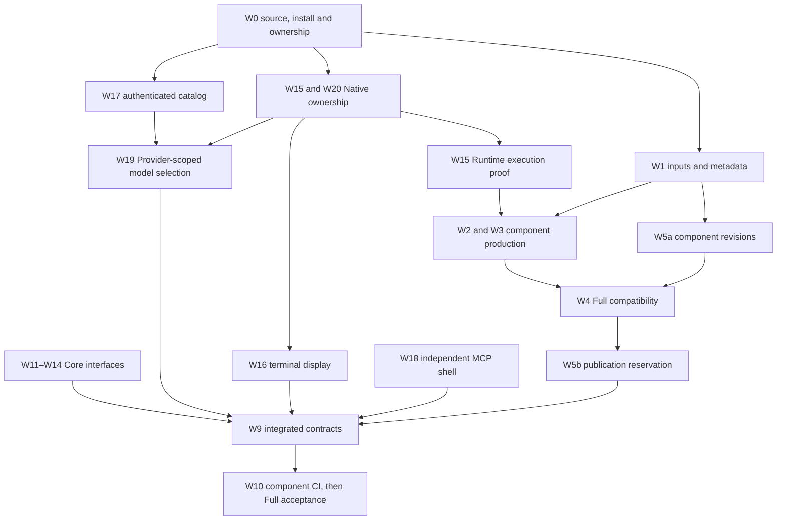

# Release framework integration — finite implementation record

This is the bounded W0–W20 integration record, not a second product
specification or a new authorization gate. It is retained while final source,
CI and live acceptance are being closed. Stable requirements belong to SPEC
and the scoped annexes; observed proof belongs to CURRENT. After acceptance,
Git history preserves the completed plan and its source provenance.

## Baseline, authority and ownership

Official input: `7b98296a411a2c435bb9f34ee51f286f33f3491b`, upstream
0.167.1 / `0a94398fa60c4fac0e7659e4213a0a36e613dd46`.
One integration worktree and owner-isolated feature worktrees share this
baseline; later focused worktrees start from frozen integration checkpoints. No primary-checkout reset, cleanup or branch switch is allowed.
One Writer owns each overlapping file; transfers are explicit.

**Decision A:** rewrite/rust-core is the one continuing development source.
Main remains separate publication/approval authority: signed indexes and
promotion consume that line. Its unrelated ancestry and existing approval
chain make an unconditional merge into development inappropriate. There is
currently no GitHub branch-protection rule to substitute for the implemented
exact-main authorization gate. Signing and activation stay separate.

The original assumption that e4f9ab5d and plan3ef675ad had no common ancestor
was caused by a shallow repository. The complete history establishes common
ancestors 27103ec0 and 0aebdd7f respectively. Selective patch review is still
necessary because the old checkout pins 0.167.0. It must not replace the
selected official recipe. The initial 0.167.1 input remains historical evidence.
During execution, discovery commit `ec51fe4a` advanced the official branch to
0.167.2 / `ce21072c90d32c40af7a55b60b2fb35c84a43a6a`; merge `795e0cae`
preserves that direct descendant of J. Apply and qualify the combined candidate
on the new exact upstream. Existing S165 remains 0.167.1 and is not rewritten.

## Implementation order

W6 Retain and already-accepted W7/W8 baseline evidence constrain every affected
TUI change. W15's completed operating P0 is not a prerequisite blocking other
work. Publication reservation metadata does not authorize signing/publication.
W20 reuses Core Owner discovery and upstream Native resume; it introduces no
Owner database or alternate Writer controller. The diagram orders source
responsibilities; actual Full admission follows successful same-source Core,
Manager and full-TUI qualification. Runtime execution-proof changes invalidate
Runtime production inputs and require affected consumer qualification again.

For the current W15 correction, Models is the sole assembler/Writer of
native_route.patch and its Core/Protocol/rollout changes. Release handed back
the existing spawn-helper supervision and tests for Models to assemble with
the pipe/PTY and Core lifetime consumers. Integration owns the 53 required CI
selectors shared by basic Runtime proof and complete Enhanced TUI qualification.
Native owns Provider proof parsing, original receipt settlement and unloaded/Stop
observers. Integration owns norms and final assembly. These are existing
execution/receipt paths, not a new executor, history store or approval gate.

## Work packages and evidence gates

| Work | Defect / scope and implemented decision | Writer and principal source | Acceptance still required after focused local proof |
| --- | --- | --- | --- |
| W0 | Correct shallow ancestry, current S165 installation and mixed live generations; preserve dirty source | Integration; Git/process/installed inventory | Final remote HEAD and protected-asset comparison |
| W1 | Input identity follows actual producers, recipe, ABI, flags and lockfiles; qualification is separate | Release; component_inputs.py, component_artifact.py, qualified_component.py | Exact-source artifact/proof receipts |
| W2 | One canonical Android Core producer reused by source and runtime consumers | Release; reusable Core workflow and consumers | Hosted producer/cache plus consumer gates |
| W3 | Manager independent build and interface qualification | Release; manager workflow; Manager source | Hosted exact-source Manager qualification |
| W4 | Unsigned Full assembly binds successful same-source Core/Manager/full-TUI evidence | Release; full_qualification.py, release_control.py and workflow | Exact-source Full run after prerequisites |
| W5 | rN input revisions and composition revision separate from global sequence; immutable signed history | Release; component_revisions.py, release_reservations.py | Pure tests passed; no formal reservation/signing authorized |
| W6 | Preserve upstream TUI behavior; new model/switch paths have explicit Retain oracles | Models/Native; TUI patch and tests | Full hosted TUI tests |
| W7 | Existing current alias is already integrated; retain authority/symlink guards | Integration; current_alias.rs, existing tests | Reuse source tests; no redundant implementation |
| W8 | Baseline 7b98296 TUI success accepted; new changed paths need new exact-source proof | Integration | New full TUI qualification |
| W9 | Stable SPEC, single scoped norms, current evidence and finite handoff | Integration; SPEC and docs | Final links, dependency checks, exact evidence |
| W10 | Read-only qualification separated from exact-main approved signing/publication | Release/Integration; workflows, release_control.py | Safe push and final successful run IDs |
| W11 | Explicit --core/--full, no repeated cancellation, authenticated edition, Core-only build independent of TUI | Integration; main.rs, manual_update.rs, update_edition.rs | Local Core 271/0 passed; hosted CLI acceptance |
| W12 | Offline Core-owned version JSON/details, optional components and legacy unknown revisions | Integration; termux_version.rs, component_metadata.rs, provider.rs | Local Core 271/0 and installed read-only candidate passed |
| W13 | No-bwrap is normal platform information; explicit unsupported requests and real failures remain failures | Integration; Core Doctor path and DOCTOR norm | Local Core/Doctor passed; exact hosted qualification |
| W14 | Signed Core/Full fixtures, rollback, mismatched edition, noninteractive/version coverage | Integration; Core tests | Local signed fixtures/menu passed; exact hosted results |
| W15 | Original P0, verified scopes/reservations, execution schema 4 and canonical tree completion; retain root status, late receipts and selected-scope Stop/pruning; versioned inference admission and delayed terminal history | Native Provider; Models Runtime patch; Release PTY and CI under explicit leases | Provider440/Python41 and unchanged PTY15 pass; upstream/provided assembly and independent review pass; final hosted53 plus actual cold/tree/Stop/sibling acceptance remain |
| W16 | Exact Owner/home display, default-off auto, short descriptor-transition locks and unsafe-route rejection | Integration/Release after file-lease transfer; Manager terminal/window/task, Provider callback | Actual stock Android 66edd08d success; final source/device boundary retained |
| W17 | Fresh authenticated ChatGPT catalog, independent inference auth, stable stored Provider/model IDs | Models; models/control/projection and Provider docs | Candidate hosted tests; reuse operating live model loop only within stated boundary |
| W18 | One independent shell, original-call replay, conflicts, bounded output/process cleanup; common annotations unchanged | Integration; termux_shell, worker, candidate.py, connector refresh and qualification | Final frozen standalone worker passes eight actual stdio groups; earlier connected Busy replay preserved; final Runtime-Busy pair and exact Provider CI remain |
| W19 | OpenAI upstream-only; ChatGPT account catalog-only through picker/direct input/reentry/effort; preserve upstream command-name completion | Models; termux_chat_models, input preparation, TUI patch | Candidate full TUI, provider transitions and unsupported-model errors |
| W20 | Decode legacy owners safely; verify actual execution-home Writer locks; preserve current Native selection/thread; consume initial intent once, fence Native children and reject unsupported private handoffs | Native/Models; runtime-binding/native, profile_transport, profile_manager, app_server_session and quota replay | Owner correction154 affected tests/readbacks pass, including Manager139; provisional J same-thread switch and old-d2/S165 safe refusals passed; original d2 regression preserved; final Runtime/composition and hosted19 named gates remain |

## Source provenance and independent review

- e4f9ab5dc3045cbde8317774da95eb98db7646dd: original Native continuation
  claim repair; compared against the current producer and integrated with
  origin attribution. No operating recovery was repeated.
- c0a8189815c70f0c6678bc9374bcd352423dca57: independent MCP worker; direct
  descendant patch integrated, then actual independent-process replay and
  lifecycle tests added.
- 3ef675ad721c0a08a50891394cf03df3abb66b2d: planning evidence revalidated
  against real producers; its approval gate and 0.167.0 assumptions are not
  carried forward.
- 9a236db89a3778a1d28a488d093ddee9943759d3 and parent089ec7f6: prior P0
  recovery and janmori101 connector-refresh evidence folded into CURRENT
  and scoped Provider guidance; no duplicate dated handoff is created.
- a55d5bb8 Native integration, 0aebdd7f documentation baseline, PR #29 and
  2dd07d42 account-draft ancestry are already integrated. Preserve actual
  current consumers instead of replaying obsolete files.

Worker commits retain cherry-pick origin attribution. The integration branch
is the reviewable source; individual work branches are temporary and cannot
substitute for final official-source integration.

## Tests and proof reuse

The three baseline 7b98296 CI receipts, earlier P0 repair receipts, original
15 claim tests and successful connector refresh are reusable only for their
original source/account/device boundaries. New effects, owner parsing,
catalog selection, terminal display, metadata consumers and CI producers are
retested. No assertion is weakened and no required gate is deleted or skipped.

Local TUI compilation lacks the pinned rusty_v8 dependency. Hosted G full TUI
passed focused/Native/API and every mandatory Retain gate, including the corrected
pin refresh and compaction tests. Its success does not qualify J's later typed
reentry tests or subsequent Runtime changes. Actual candidate PTY switch and
provider-model continuity with synthetic responses passed separately. Old-runtime
compiler and incomplete earlier switch trials remain original failure evidence,
not accepted new behavior. Existing Stop/empty-jobs tests alone cannot certify
actual process termination; the new Runtime proof must pass positive and negative
consumer cases before final availability acceptance.

Live model evidence used the operating Provider and one original Chat/Native
thread, preserving approval and sandbox configuration. Synthetic account
fixtures are separate. Android stock tests prove Activity/session behavior on
the pinned emulator APK with synthetic Core transport and frontend; they do not prove a
physical device or real model inference.

The first W1 recheck at 26952f73 measured one conservative cache miss: e961f25c-to-26952f73 changed only Manager's dedicated
profile test formatting, which changed Manager's declared input identity while
Core's remained identical. The audited package-tree inventory is retained; it is
not described as the minimal activated Cargo graph. This may consume a new rN for
identical output bytes. No incomplete test exclusion or alternate dependency
resolver is introduced. Audit SHA256:
`32b8a5971c0e0e44409b1d70e995f010721b272999db281c4b17f4eb20e2d207`.
Its no-missing-input conclusion was incomplete: the real 0.167.2 transition
exposed release-builder::local_recipe directly embedding release/upstream.json
inside Core while the inventory excluded it. Source ea5f5e55 adds that blob to
Core only and proves stale-artifact refusal; Manager's recipe independence stays
intact. Two original red cases, three focused green cases, fifteen component/
consumer passes and three current-descriptor passes are retained in CURRENT.
The producer-helper change is itself an input and requires fresh qualification.

## Change accounting and rollback

The original 1,370–3,020 product and 500–800 documentation LoC ranges were
pre-investigation estimates for W0–W14. They are not completed counts. The
original W16 estimate and 559-line shell patch are not added to final totals.
The following baseline-to-source-freeze accounting counts each changed line
once. Both embedded patches are expanded onto the same official ce210 upstream;
wrapper text, upstream-version noise, reverted iterations and overlapping work
assignments are excluded from semantic totals.

| Category | Added LoC | Deleted LoC | Replacement pairs, already included |
| --- | ---: | ---: | ---: |
| Product | 10340 | 1119 | 666 |
| Tests | 19393 | 1363 | 862 |
| Build/CI/support | 3076 | 270 | 122 |
| Norms/documentation | 2209 | 497 | 297 |

The physical Git delta contains 172 files: 127 modified and 45 new, none deleted
relative to baseline. Replacing the two physical patch containers with their
106 changed logical files gives 276 distinct owned/logical files: 229 modified,
47 new, none deleted. The containers hold Native 84 files (+7413/-132) and TUI
22 files (+715/-86); those deltas are already classified in the product/test
rows, not additional work. Replacement pairs are the smaller side of each
replacement hunk and are subsets of additions/deletions, not another LoC total.
Rust test-item classification lexically excludes comments/strings and supports
cfg(all(test,...)); validation scripts count as tests. Source/line images and
hashes allow independent recalculation.

Classifier SHA256: `dd1aa13ce04884253d0d21d9b355f980b9297005a004b66ecbfc1985fc92fd3e`.
Expanded-image ledger SHA256:
`b3c180599ef234b24a262838db15a9a09f28f1c79206a8323691faa3e7492d7a`.
The final categorized receipt is recorded with the source-freeze evidence;
numeric documentation counts include this record itself.

### W20 measured subset and shared ownership

The reconciled direct W20 slice is **11 logical files/hunks: product +178/-22,
tests +525/-1**. It includes Manager quota/profile handling, typed TUI transport,
profile-manager tests, quota qualification and expanded upstream historical-quota
replay. This declared slice is not a complete exclusive W20 total.
The inspectable affected union has 43 files (28 physical plus 15 expanded TUI),
+4006/-351. Owner registry/Writer lookup is shared with W15, terminal fixtures
with W16, selection/reentry/child fencing with W19, and norms with W9. That union
is neither W20-only LoC nor an addition to the global totals above.
Earlier 6450/f915/f149 snapshots are superseded measurement checkpoints, not
summable work. The final ledger binds exact before/after images and hunk ownership:
`c22187301e2530be47a4bb28c8c82d4253c1f50bda74ab444b5bd2b7a0813403`.
The W-task table owns file responsibility; this ledger prevents duplicate counts.

Rollback for development is a reviewed revert of a coherent feature commit,
followed by affected exact-source qualification. No rollback here mutates a
signed generation, active pointer, account, original result or Writer.
A failed publication proof prevents signing rather than changing already
issued S164/S165. Full-to-Core tests preserve previous Full and enforce
anti-rollback sequence rules; S164 cannot silently replace newer S165.

## Branch disposition

Snapshot 03:14:44–03:18:45 UTC: 112 local/tracking refs, 95 worktrees and 45
actual remote heads; 166 local and 257 remote tag names, zero common-name tag
mismatches and zero open PRs. All dispositions are accounted for: 73 unchanged,
16 unchanged transfers and 23 refreshed owned/current refs. The audit is bound by
`db0207c8fb8048701a29fcf2e8e804ca81a5f226f415e48afe4f23cc56b15408`.
Worktree presence is an ownership constraint, not proof a process is idle.
No branch, worktree or tag is deleted. Release/rollback/evidence and other-owner
snapshots are retained; integrated refs require owner/consumer release before
retirement. Unique experiments are not automatic merge inputs.

The table records observed SHA values, not a promise that refs remain frozen.
After its e8a08631 anchor, Runtime source7f3c3ef was integrated as f2aef205 and
source2612cdce added the fiftieth required oracle and removed the temporary
contingency workflow. Remote outage documentation through19c1694a was read and
reconciled against recovered original receipts; its expired temporary notice
was not reintroduced. Exact-main release-intent remained absent (404), main was
b2567063, and the authoritative development remote was ec51fe4a at observation.

| Ref | Observed SHA | Disposition | Worktree present |
| --- | --- | --- | --- |
| `local:archive/linux-app-operating-source-20261106` | `97118e775bc6` | other owner/operating snapshot: preserve | yes |
| `local:archive/mobile-desktop-attempt-20261106` | `8de07907b110` | other owner/operating snapshot: preserve | no |
| `local:backup/user-dirty-20261109` | `0401e4af6207` | other owner/operating snapshot: preserve | no |
| `local:backup/user-dirty-20261109-base` | `0814be7b51dd` | integrated legacy; owner/consumer release required | no |
| `local:design/entry-architecture-20261105` | `604df76bb30f` | integrated; preserve active worktree | yes |
| `local:docs/release-framework-handoff-20261111` | `9a236db89a37` | evidence selected into current integration; preserve source | yes |
| `local:docs/review-actions-20261110` | `e16bb12defc9` | integrated; preserve active worktree | yes |
| `local:draft/thread-model-catalog-20261106` | `8d095cd754fa` | unique historical experiment; preserve, no automatic merge | no |
| `local:experiment/profile-tui` | `c4d9a41d3827` | integrated legacy; owner/consumer release required | no |
| `local:experiment/web-provider` | `6aab6cd9c8e3` | unique historical experiment; preserve, no automatic merge | no |
| `local:experiment/web-termux` | `08e985693f0a` | unique historical experiment; preserve, no automatic merge | no |
| `local:feat/termux-mcp-shell-20261111` | `c0a8189815c7` | patch integrated; preserve original worktree | yes |
| `local:fix/accepted-caller-repin-20261111` | `c642dd208735` | publication authority/history: preserve | yes |
| `local:fix/active-steer-20261104` | `f8d1a7f47c62` | integrated; preserve active worktree | yes |
| `local:fix/attached-native-development-loop-20261106` | `cc535d18a897` | integrated; preserve active worktree | yes |
| `local:fix/chatgpt-resume-concurrency-20261108` | `f93256083902` | integrated; preserve active worktree | yes |
| `local:fix/current-generation-compat-link-20261111` | `a8cb66c6f2b0` | integrated; preserve active worktree | yes |
| `local:fix/hosted-preflight-0161` | `ce371e090f86` | unique historical experiment; preserve, no automatic merge | no |
| `local:fix/mobile-desktop-20261106` | `8de07907b110` | other owner/operating snapshot: preserve | yes |
| `local:fix/native-route-transition-20261105` | `987dee84a5c3` | other owner/operating snapshot: preserve | yes |
| `local:fix/native-startup-settlement-20261108` | `317c7fe41d15` | integrated; preserve active worktree | yes |
| `local:fix/p0-413-native-repair` | `0902eb69b319` | integrated legacy; owner/consumer release required | no |
| `local:fix/p0-stream-resume-identity` | `49e292b011e0` | integrated; preserve active worktree | yes |
| `local:fix/release-notify-admission-20261111` | `c19b61bb3d1d` | integrated; preserve active worktree | yes |
| `local:handoff/pro-local-baseline-20261106` | `b8c14252ee33` | other owner/operating snapshot: preserve | yes |
| `local:integration/codex-native-20261110` | `a55d5bb8fffa` | integrated; preserve active worktree | yes |
| `local:integration/release-framework-20261112` | `e8a08631d7e0` | Preserve current integration and its backup; not official development or publication head. | yes |
| `local:legacy/monolith` | `bf30a7dc94d4` | release/compatibility evidence: preserve | no |
| `local:main` | `53176ed79097` | publication authority/history: preserve | yes |
| `local:native-completion-schema4-20261112-r3` | `853720856987` | All 17 changed blobs match integration e8a08631 exactly. Preserve the reviewed source and 437-test receipt. | no |
| `local:plan/release-framework-20261111` | `3ef675ad721c` | evidence selected into current integration; preserve source | yes |
| `local:prep/0.164-native-review` | `27a918678644` | integrated; preserve active worktree | yes |
| `local:prep/pro-baseline-20261106` | `6018ad990f14` | unique historical experiment; preserve, no automatic merge | no |
| `local:prod/download-size-v1-base-9300` | `9300a68852c8` | release/compatibility evidence: preserve | no |
| `local:refactor/docs-contract-20261110` | `0aebdd7f2614` | integrated; preserve active worktree | yes |
| `local:refactor/naming-and-delivery-rules` | `306d842f86aa` | integrated legacy; owner/consumer release required | no |
| `local:release/frozen-full-1670-caller` | `6624418979e1` | publication authority/history: preserve | yes |
| `local:release/frozen-full-1670-s163` | `d6f090e835a7` | release/compatibility evidence: preserve | yes |
| `local:rewrite/rust-core` | `e4f9ab5dc304` | patch integrated; preserve original worktree | yes |
| `local:tdev-work/AUTHORITY-COMPACTION-V1-88d33545bf5e4bc6b24ebaeb6962ee5b` | `838c8ba7e773` | other owner/operating snapshot: preserve | no |
| `local:tdev-work/RUNTIME-ALIGNMENT-0-159-2-AUTHORITY-560ff9af76714c9baee22584368935f3` | `019f2066cfcb` | other owner/operating snapshot: preserve | no |
| `local:tdev-work/release-download-size-v1-a0dce69bd40e43f7b22f4d303b70efa5` | `ba0eacc4a077` | other owner/operating snapshot: preserve | no |
| `local:tdev-work/update-download-size-v1-9fcae140207f4608b7268cd77f0146f5` | `4fd14ed8aafc` | integrated legacy; owner/consumer release required | no |
| `local:wip/chatgpt-accounts-source-20261110` | `2dd07d422ad0` | integrated; preserve active worktree | yes |
| `local:work/native-completion-20261112` | `69e6fa352d62` | Preserve prior Owner/format source and its private device evidence; later schema4 source supersedes the consumer checkpoint. | yes |
| `local:work/native-completion-producer-20261112` | `210dec0c1218` | Original producer cherry-pick is recorded at 3306589d; later tree supervisor producer supersedes it. Preserve history. | yes |
| `local:work/native-owner-20261112` | `b0a955086a5e` | Original worker source cherry-pick is recorded at 4a2ed284. Preserve original candidate/Owner evidence. | yes |
| `local:work/native-source-bound-20261112` | `2090c574b957` | Carry forward the root f06 inventory and reviewed source-bound receipt; no replay or deletion. | yes |
| `local:work/native-tree-producer-20261112` | `7f3c3ef265cf` | Final Runtime frozen r2 is independently reviewed. Not yet in anchor e8a08631; root later reported integration f2aef205. Preserve source and exact qualification boundary. | yes |
| `local:work/provider-models-20261112` | `fefaad9cf005` | Original source cherry-pick is recorded at c0d02750; preserve branch and historical per-source receipts. | yes |
| `local:work/reentry-handoff-guard-20261112` | `3c994eaf4d6a` | Carry forward root f06 inventory: Manager test formatting correction; preserve branch, no code replay. | yes |
| `local:work/release-framework-20261112` | `9fd0c1af0475` | Original reentry PASS gate cherry-pick is recorded at f12e3025; current mandatory gates supersede this source. Preserve. | yes |
| `local:work/release-lifecycle-20261112` | `7228a8a76728` | Original admission gate cherry-pick is recorded at 0df10ca4. Preserve source; final gate inventory has subsequently grown. | yes |
| `tracking:integration-transfer/acceptance-final` | `3140f7fc3239` | integrated transfer; evidence-owner review before retirement | no |
| `tracking:integration-transfer/barrier31` | `ea04c19208b0` | integrated transfer; evidence-owner review before retirement | no |
| `tracking:integration-transfer/codegate-v2` | `81049caeb05b` | integrated transfer; evidence-owner review before retirement | no |
| `tracking:integration-transfer/discovery29` | `0c5a70523f7a` | integrated transfer; evidence-owner review before retirement | no |
| `tracking:integration-transfer/fixture30` | `7ef80be546c6` | integrated transfer; evidence-owner review before retirement | no |
| `tracking:integration-transfer/gates31` | `12129a5ed37e` | integrated transfer; evidence-owner review before retirement | no |
| `tracking:integration-transfer/native-result29` | `fa6b46789fed` | integrated; retain evidence worktree until owner release | no |
| `tracking:integration-transfer/package-fixture26` | `e6f50f2977e1` | integrated transfer; evidence-owner review before retirement | no |
| `tracking:integration-transfer/preflight-20261110` | `f6dff75b72d0` | integrated transfer; evidence-owner review before retirement | no |
| `tracking:integration-transfer/provider-final` | `495c5213160e` | integrated transfer; evidence-owner review before retirement | no |
| `tracking:integration-transfer/qualification30` | `e0cca4c2d695` | integrated; retain evidence worktree until owner release | no |
| `tracking:integration-transfer/recovery28` | `5c9334b6aa53` | integrated ref; preserve other-owner dirty evidence worktree | no |
| `tracking:integration-transfer/result29` | `94e09c845b84` | integrated transfer; evidence-owner review before retirement | no |
| `tracking:integration-transfer/runtime-final` | `3c043bdd7e80` | integrated transfer; evidence-owner review before retirement | no |
| `tracking:integration-transfer/tui-proof-final` | `392b026f02a4` | integrated transfer; evidence-owner review before retirement | no |
| `tracking:integration-transfer/validation-final` | `18b90a5b34c8` | integrated transfer; evidence-owner review before retirement | no |
| `tracking:origin/HEAD` | `b2567063d2a7` | publication authority/history: preserve | no |
| `tracking:origin/archive/linux-app-operating-source-20261106` | `97118e775bc6` | other owner/operating snapshot: preserve | no |
| `tracking:origin/archive/mobile-desktop-attempt-20261106` | `8de07907b110` | other owner/operating snapshot: preserve | no |
| `tracking:origin/contingency/native-completion-20261112-remote` | `bfec2858798b` | Preserve original failed runs and successful unsigned Provider run43143270459. This predates schema4/tree proof and cannot qualify the final source. | no |
| `tracking:origin/contingency/native-schema4-20261112-wip` | `08585ddd1cbb` | Outage WIP ancestor of later local consumer work; no runs on this branch. Preserve original unverified snapshot and worktree. | no |
| `tracking:origin/contingency/release-framework-20261112` | `e8a08631d7e0` | Preserve current integration and its backup; not official development or publication head. | no |
| `tracking:origin/contingency/release-framework-20261112-remote` | `dabd08ff52a7` | Ancestor of e8a08631. Existing contingency-native-proof workflow targets only this recovery branch; preliminary proof is not final Core/Full qualification. | no |
| `tracking:origin/contingency/termux-outage-20261112` | `cc9d70b60220` | Ancestor of integration. Local tracking is stale versus remote19c1694a; preserve external documentation without automatic replay. | no |
| `tracking:origin/contingency/termux-outage-20261112-models` | `fefaad9cf005` | Original source cherry-pick is recorded at c0d02750; preserve branch and historical per-source receipts. | no |
| `tracking:origin/contingency/termux-outage-20261112-native-base` | `b0a955086a5e` | Original worker source cherry-pick is recorded at 4a2ed284. Preserve original candidate/Owner evidence. | no |
| `tracking:origin/contingency/termux-outage-20261112-native-provider` | `69e6fa352d62` | Preserve prior Owner/format source and its private device evidence; later schema4 source supersedes the consumer checkpoint. | no |
| `tracking:origin/contingency/termux-outage-20261112-native-provider-wip` | `7d42beee0ceb` | Preserve the exact unverified source backup and temporary evidence worktree; later reviewed schema4 commit is the acceptance input. | no |
| `tracking:origin/contingency/termux-outage-20261112-producer` | `210dec0c1218` | Original producer cherry-pick is recorded at 3306589d; later tree supervisor producer supersedes it. Preserve history. | no |
| `tracking:origin/contingency/termux-outage-20261112-release` | `9fd0c1af0475` | Original reentry PASS gate cherry-pick is recorded at f12e3025; current mandatory gates supersede this source. Preserve. | no |
| `tracking:origin/design/entry-architecture-20261105` | `604df76bb30f` | integrated legacy; owner/consumer release required | no |
| `tracking:origin/docs/release-framework-handoff-20261111` | `9a236db89a37` | evidence selected into current integration; preserve source | no |
| `tracking:origin/draft/thread-model-catalog-20261106` | `8d095cd754fa` | unique historical experiment; preserve, no automatic merge | no |
| `tracking:origin/experiment/profile-tui` | `2c9ec49685aa` | integrated legacy; owner/consumer release required | no |
| `tracking:origin/experiment/stock-window-proof` | `ee28c904cb55` | unique historical experiment; preserve, no automatic merge | no |
| `tracking:origin/experiment/web-provider` | `6aab6cd9c8e3` | unique historical experiment; preserve, no automatic merge | no |
| `tracking:origin/experiment/web-termux` | `08e985693f0a` | unique historical experiment; preserve, no automatic merge | no |
| `tracking:origin/fix/active-steer-20261104` | `f8d1a7f47c62` | integrated legacy; owner/consumer release required | no |
| `tracking:origin/fix/attached-native-development-loop-20261106` | `cc535d18a897` | integrated legacy; owner/consumer release required | no |
| `tracking:origin/fix/chatgpt-resume-concurrency-20261108` | `f93256083902` | integrated legacy; owner/consumer release required | no |
| `tracking:origin/fix/current-generation-compat-link-20261111` | `a8cb66c6f2b0` | integrated legacy; owner/consumer release required | no |
| `tracking:origin/fix/hosted-preflight-0161` | `ce371e090f86` | unique historical experiment; preserve, no automatic merge | no |
| `tracking:origin/fix/native-route-transition-20261105` | `987dee84a5c3` | unique historical experiment; preserve, no automatic merge | no |
| `tracking:origin/fix/p0-413-native-repair` | `0902eb69b319` | integrated legacy; owner/consumer release required | no |
| `tracking:origin/fix/release-notify-admission-20261111` | `c19b61bb3d1d` | integrated legacy; owner/consumer release required | no |
| `tracking:origin/fix/stopped-native-shared-claim-reconciliation` | `fec19d8e2c9a` | integrated legacy; owner/consumer release required | no |
| `tracking:origin/handoff/pro-local-baseline-20261106` | `b8c14252ee33` | unique historical experiment; preserve, no automatic merge | no |
| `tracking:origin/integration/codex-native-20261110` | `a55d5bb8fffa` | integrated legacy; owner/consumer release required | no |
| `tracking:origin/legacy/monolith` | `bf30a7dc94d4` | release/compatibility evidence: preserve | no |
| `tracking:origin/lupi/review-20261109` | `53176ed79097` | publication authority/history: preserve | no |
| `tracking:origin/main` | `b2567063d2a7` | publication authority/history: preserve | no |
| `tracking:origin/prep/0.164-native-review` | `27a918678644` | integrated legacy; owner/consumer release required | no |
| `tracking:origin/prep/pro-baseline-20261106` | `6018ad990f14` | unique historical experiment; preserve, no automatic merge | no |
| `tracking:origin/prod/download-size-v1-seq23-source` | `b164e5b61cb4` | release/compatibility evidence: preserve | no |
| `tracking:origin/release/frozen-full-1670-s163` | `d6f090e835a7` | release/compatibility evidence: preserve | no |
| `tracking:origin/release/seq18-no-emoji-product` | `9300a68852c8` | unique historical experiment; preserve, no automatic merge | no |
| `tracking:origin/rewrite/rust-core` | `26952f732a67` | Historical J checkpoint; authoritative remote rewrite is ec51fe4a at this observation. No local tracking update was performed. | no |
| `tracking:origin/wip/chatgpt-accounts-source-20261110` | `2dd07d422ad0` | integrated legacy; owner/consumer release required | no |
| `tracking:origin/work/capability-restoration-166` | `3c1e47e46cef` | integrated legacy; check remaining consumers | no |

The following authoritative remote observations differ from or lack a local
tracking ref; the other forty remote heads match entries above.

| Actual remote ref | Observed SHA | Disposition |
| --- | --- | --- |
| `remote:contingency/native-producer-20261112-remote` | `69d402b31c8e` | Ancestor of integration; actual compiler import/type correction retained. Final tree producer is separate source7f3c3ef. |
| `remote:contingency/native-proof-gates-20261112-remote` | `3562d5d327df` | Ancestor of integration; CodeMode34 gate retained and extended in final mandatory inventory. No independent release authority. |
| `remote:contingency/termux-outage-20261112` | `19c1694a547c` | Two ops-only documentation commits after cc9, not locally fetched or automatically merged. Exact diff delivered to root for reconciliation after observed recovery. |
| `remote:contingency/tui-push-qualification-20261112` | `07ba87f0b67d` | Ancestor of integration; temporary official-rewrite full-push policy has been retired in the current source in favor of the existing explicit manual qualification path. |
| `remote:rewrite/rust-core` | `ec51fe4a5f51` | Authoritative rewrite head at observation; valid 0.167.2 discovery ancestor of integration. Its earlier Core success does not qualify new production inputs. |

### Retirement prerequisites

An additional consumer scan covered current workflows, scripts, release inputs
and user/agent entry guides. No open PR was present at this read. Ref aliases
sharing an owned worktree SHA/name remain subject to that owner's release,
even when the remote-tracking ref itself has no worktree. The old integration
name in the TUI artifact test is an intentional negative branch-admission
fixture; README now points only to rewrite/rust-core.

| Integrated inactive ref | Remaining retirement condition |
| --- | --- |
| `local:backup/user-dirty-20261109-base` | preserve other owner |
| `local:experiment/profile-tui` | eligible after final source acceptance no open pr |
| `local:fix/p0-413-native-repair` | eligible after final source acceptance no open pr |
| `local:refactor/naming-and-delivery-rules` | eligible after final source acceptance no open pr |
| `local:tdev-work/update-download-size-v1-9fcae140207f4608b7268cd77f0146f5` | eligible after final source acceptance no open pr |
| `remote:origin/design/entry-architecture-20261105` | after related worktree owner release |
| `remote:origin/experiment/profile-tui` | eligible after final source acceptance no open pr |
| `remote:origin/fix/active-steer-20261104` | after related worktree owner release |
| `remote:origin/fix/attached-native-development-loop-20261106` | after related worktree owner release |
| `remote:origin/fix/chatgpt-resume-concurrency-20261108` | after related worktree owner release |
| `remote:origin/fix/current-generation-compat-link-20261111` | after related worktree owner release |
| `remote:origin/fix/p0-413-native-repair` | eligible after final source acceptance no open pr |
| `remote:origin/fix/release-notify-admission-20261111` | after related worktree owner release |
| `remote:origin/fix/stopped-native-shared-claim-reconciliation` | eligible after final source acceptance no open pr |
| `remote:origin/integration/codex-native-20261110` | after related worktree owner release |
| `remote:origin/prep/0.164-native-review` | after related worktree owner release |
| `remote:origin/wip/chatgpt-accounts-source-20261110` | preserve other owner |

No deletion is performed during source acceptance. Release/rollback and other-owner snapshots remain preserved.
